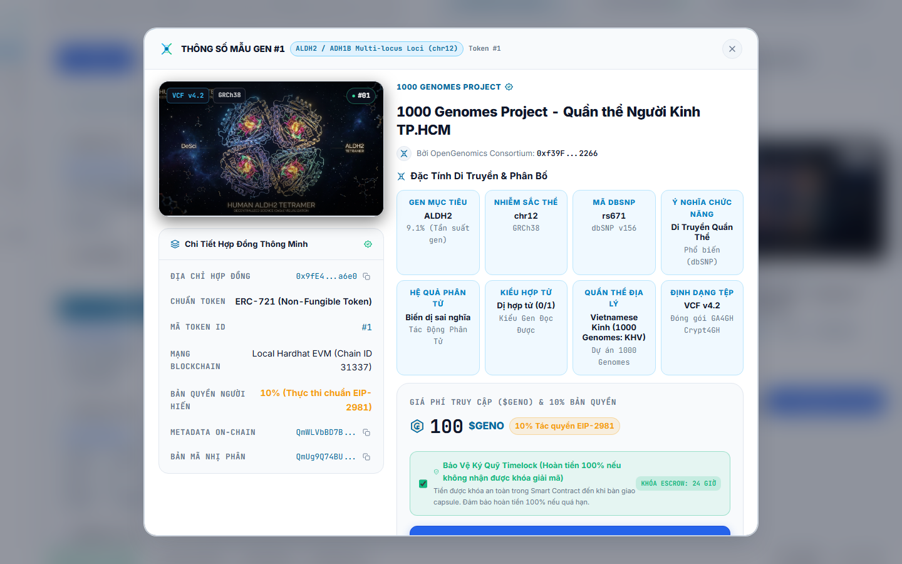
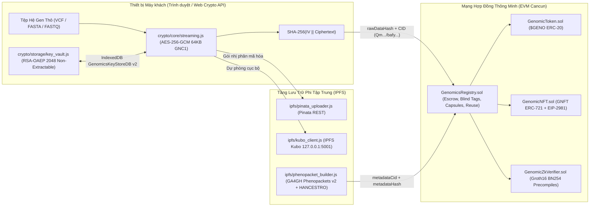
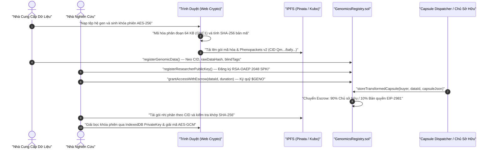

<div align="center">
  

  <p>
    
    
    
    
    
  </p>

  <p>
    <a href="#tom-tat">Tóm Tắt</a> ·
    <a href="#truc-quan">Minh Họa Hệ Thống</a> ·
    <a href="#kien-truc">Kiến Trúc</a> ·
    <a href="#dac-ta-mat-ma">Đặc Tả Mật Mã</a> ·
    <a href="#hop-dong-thong-minh">Hợp Đồng Thông Minh</a> ·
    <a href="#tap-du-lieu">Dữ Liệu Hệ Gen</a> ·
    <a href="#khoi-chay">Triển Khai</a> ·
    <a href="#kiem-dinh">Kiểm Định</a> ·
    <a href="#tai-lieu-tham-khao">Tài Liệu Tham Khảo</a>
  </p>
</div>

---

<a id="tom-tat"></a>
## 1. Tóm Tắt Kiến Trúc & Động Lực Nghiên Cứu

Dữ liệu hệ gen người (tệp biến thể VCF, trình tự tham chiếu FASTA, dữ liệu đọc thô FASTQ) là tài sản định danh bất biến và nhạy cảm cao nhất trong nghiên cứu y sinh. Các mô hình lưu trữ tập trung truyền thống buộc người hiến mẫu phải đặt niềm tin hoàn toàn vào bên trung gian lưu ký, thiếu cơ chế kiểm toán tính toàn vẹn bằng mật mã và không đảm bảo chia sẻ giá trị minh bạch khi dữ liệu được tái sử dụng qua nhiều công trình nghiên cứu thứ cấp.

**GenoChain** giải quyết bài toán này bằng kiến trúc **không tin cậy lưu ký phía máy khách** (non-custodial client-side architecture) trên EVM (`Cancun`) kết hợp mạng lưu trữ định địa chỉ nội dung IPFS:

1. **Bảo mật đầu-cuối phía máy khách (Client-Side AEAD):** Toàn bộ tệp hệ gen được mã hóa cục bộ trên trình duyệt bằng `AES-256-GCM` phân đoạn `64 KB` (`GNC1` framing) kèm dữ liệu xác thực bổ sung (`AAD`) trước khi rời khỏi thiết bị. Bản rõ không bao giờ xuất hiện trên blockchain hay các node IPFS công cộng.
2. **Định tuyến khóa bất đối xứng phi lưu ký (`RSA-OAEP 2048` + `IndexedDB`):** Mỗi nhà nghiên cứu duy trì cặp khóa `RSA-OAEP` (`e = 65537`, `SHA-256`) có thuộc tính `extractable: false` trong `IndexedDB`, chỉ lưu trữ khóa công khai trên chuỗi thông qua `GenomicsRegistry.registerResearcherPublicKey()` để nhận gói khóa phiên đã bọc (transformed capsule).
3. **Sàn giao dịch ký quỹ & Bản quyền chủ động (`EIP-2981` + `recordStudyReuse`):** Hợp đồng thông minh tách bạch giữa mua trực tiếp (`grantAccess`) và ký quỹ khóa thời gian (`grantAccessWithEscrow`, thời hạn `1 giờ – 30 ngày`), thực thi chia doanh thu `90% / 10%` tự động theo chuẩn `EIP-2981` và thu phí tái sử dụng nghiên cứu thứ cấp `5%` (`500 bps`) không trùng lặp.
4. **Truy vấn đặc tính ẩn danh & Xác thực không tiết lộ (`Groth16 BN254`):** Cho phép sàng lọc bộ dữ liệu theo cặp thẻ mù băm muối (`computeBlindTag` bằng `keccak256`) và trao thưởng ERC-20 (`GenomicZkVerifier`) khi chứng minh sở hữu biến thể mà không tiết lộ toàn bộ hệ gen gốc.

---

<a id="truc-quan"></a>
## 2. Minh Họa Vận Hành Hệ Thống

### Luồng Hoạt Động Đa Vai Trò (Thực Thi Trực Tiếp Trên EVM Cục Bộ & IPFS)

<div align="center">
  
  <br />
  <sub><em>Hình 1: Ghi hình vận hành thực tế trên Hardhat EVM cục bộ (Nhà nghiên cứu truy vấn thẻ ẩn danh &amp; giải mã trên RAM → Nhà cung cấp mã hóa phân đoạn &amp; đúc NFT → Quản trị giao thức điều phối khóa và quỹ thưởng ZK).</em></sub>
</div>

### Toàn Cảnh 6 Phân Hệ Giao Diện Người Dùng (`1440×900`)

| Cổng Nhà Nghiên Cứu: Sàn Giao Dịch & Truy Vấn Ẩn Danh | Chi Tiết Tài Sản & Ký Quỹ Khóa Thời Gian (`Escrow`) |
| :---: | :---: |
|  |  |
| *Đồng bộ danh mục on-chain (`getAllDataItems`), chuẩn hóa `GA4GH Phenopackets v2` và lọc theo thẻ băm muối.* | *Thực thi ký quỹ `grantAccessWithEscrow` kèm hoàn tiền quá hạn `claimEscrowRefund` và nhận capsule.* |

| Cổng Nhà Cung Cấp: Mã Hóa Cục Bộ & Đúc Tài Sản `GNFT` | Hòm Khóa Tự Chủ (`IndexedDB` `extractable: false`) |
| :---: | :---: |
|  |  |
| *Mã hóa `GNC1` 64 KB trên RAM, tính SHA-256 của bản mã và neo tệp lên IPFS Kubo / Pinata.* | *Khóa riêng không thể trích xuất thô; sao lưu khôi phục qua vỏ bọc mật mã `GENOCHAIN-ENCRYPTED-KEY-VAULT-v2`.* |

| Giải Mã Tại Bộ Nhớ Đệm & Ghi Nhận Tái Sử Dụng (`5%`) | Bảng Điều Khiển Quản Trị Giao Thức (`Admin`) |
| :---: | :---: |
|  |  |
| *Đối chiếu SHA-256 trước khi giải mã Web Crypto `AES-256-GCM`, xem trước biến thể và gọi `recordStudyReuse`.* | *Giám sát nguồn cung `$GENO`, cấp quyền capsule dispatcher, liên kết `GenomicZkVerifier` và tạo quỹ thưởng ZK.* |

---

<a id="kien-truc"></a>
## 3. Kiến Trúc Giao Thức Đầu-Cuối

Hệ thống phân tách rành mạch ranh giới tin cậy (Trust Boundary) giữa thiết bị người dùng, mạng lưu trữ IPFS và tầng thanh toán/kiểm chứng EVM:



### Chu Trình Ký Quỹ Escrow & Cấp Quyền Giải Mã Phi Lưu Ký



---

<a id="dac-ta-mat-ma"></a>
## 4. Đặc Tả Mật Mã Học & Cấu Trúc Dữ Liệu

Toàn bộ cấu trúc nhị phân và thông số mật mã dưới đây tương ứng trực tiếp với mô-đun [`crypto/`](crypto/core/symmetric.js) và [`frontend/src/services/`](frontend/src/services/datasetService.js):

### 4.1. Định Dạng Khung Mã Hóa Phân Đoạn `GNC1` (64 KB Streaming AEAD)

Nhằm xử lý các tệp giải trình tự kích thước lớn mà không làm tràn bộ nhớ trình duyệt nhưng vẫn chống cắt xén, đảo thứ tự hoặc ghép trộm phân đoạn (chunk reordering / truncation attack), tầng đối xứng sử dụng cấu trúc khung `GNC1`:

| Phân Vùng Byte | Kích Thước | Nội Dung & Quy Cách Mã Hóa |
| :--- | :---: | :--- |
| **Header `GNC1`** | `20 bytes` | Magic bytes `GNC1` (`4B`) + Phiên bản/Tham số kích thước phân đoạn (`65,536 bytes`) + Tổng số phân đoạn (`uint32 BE`) + Tổng kích thước bản rõ (`uint64 BE`). |
| **Header Mỗi Phân Đoạn** | `32 bytes` | Vector khởi tạo duy nhất `IV` (`12 bytes` ngẫu nhiên) + Độ dài phần thân mã hóa (`4 bytes`) + Thẻ xác thực `GMAC` (`16 bytes` kèm cuối ciphertext của Web Crypto AES-GCM). |
| **Dữ Liệu Xác Thực Bổ Sung (`AAD`)** | `16 bytes` | Gắn kết mật mã theo chuẩn big-endian cho từng khối: `chunkIndex (uint32) \|\| chunkCount (uint32) \|\| totalPlaintextSize (uint64)`. |
| **Chế Độ Khối Đơn (`Single-Block`)** | `>= 28 bytes` | Áp dụng cho tệp nhỏ hoặc gói siêu dữ liệu với bố cục tuyến tính `IV [12 bytes] \|\| Ciphertext \|\| GMAC [16 bytes]`. |

- **Ngân Sách An Toàn Khóa (NIST SP 800-38D §8.2.2):** Áp đặt giới hạn cứng $2^{32}$ lần gọi mã hóa trên cùng một khóa phiên AES-GCM nhằm đảm bảo xác suất va chạm `IV` 96-bit ở mức không đáng kể.
- **Tách Miền Khóa Báo Cáo Tóm Tắt (`crypto/reporting/pdf_generator.js`):** Khóa mã hóa tệp PDF tóm tắt lâm sàng được dẫn xuất độc lập bằng `HKDF-SHA256` sử dụng nhãn tách miền `GENOCHAIN_SUMMARY_PDF_DOMAIN_V1:${rawKeyHex}`, ngăn chặn sử dụng chéo khóa với dữ liệu VCF gốc.

### 4.2. Hòm Khóa Tự Chủ (`IndexedDB` & Sao Lưu Ngoại Tuyến)

- Cặp khóa `RSA-OAEP` (`2048`-bit, số mũ công khai $e = 65537$, hàm băm `SHA-256`) được tạo bằng Web Crypto API với cờ `extractable: false` đối với khóa riêng (`CryptoKey`) và lưu cố định theo địa chỉ ví trong bảng `GenomicsKeyStoreDB` phiên bản `2` (Dexie).
- Khi xuất bản sao lưu rời trình duyệt (`GENOCHAIN-ENCRYPTED-KEY-VAULT-v2`), khóa riêng tạm thời hoặc seed khôi phục được bọc bằng dẫn xuất từ chữ ký ví `EIP-191` hoặc `PBKDF2` (`100,000` vòng lặp `HMAC-SHA256`, `16 bytes` muối ngẫu nhiên) trước khi xuất thành tệp JSON.

### 4.3. Chỉ Mục Đặc Tính Ẩn Danh (`Salted Blind Tags`)

Thay vì lưu giá trị biến thể gen dạng bản rõ on-chain gây rò rỉ thông tin bệnh học của người hiến mẫu, chỉ số tìm kiếm được dẫn xuất bằng:

```solidity
keccak256(abi.encode("GENOCHAIN_BLIND_TAG_V1", traitKey, traitValue, datasetSalt))
```

Mỗi bộ dữ liệu cho phép gắn tối đa `MAX_BLIND_TAGS_PER_DATASET = 16` thẻ mù. Hàm truy vấn `matchesBlindTag()` bắt buộc đối chiếu điều kiện vòng đời `status == DataStatus.Active`; các bộ dữ liệu ở trạng thái `Paused` hoặc `Revoked` luôn trả về `false`.

---

<a id="hop-dong-thong-minh"></a>
## 5. Đặc Tả Hợp Đồng Thông Minh & Bất Biến Bảo Mật

Toàn bộ bốn hợp đồng lõi được biên dịch bằng Solidity `0.8.24` (mục tiêu `cancun`, trình tối ưu hóa `runs: 1`) và tuân thủ giới hạn kích thước bytecode `24,576 bytes` theo chuẩn **EIP-170**.

### 5.1. Số Đo Bytecode Thực Tế Trên Chuỗi (Đo Bằng `scripts/audit/check_eip170.py`)

| Hợp Đồng | Đường Dẫn | Bytecode Triển Khai (Runtime) | Bytecode Khởi Tạo (Initcode) | Biên Dự Phòng EIP-170 (`24,576 B`) | Chức Năng Trọng Tâm |
| :--- | :--- | :---: | :---: | :---: | :--- |
| **`GenomicsRegistry`** | [`contracts/GenomicsRegistry.sol`](contracts/GenomicsRegistry.sol) | `22,327 bytes` | `22,938 bytes` | `2,249 bytes` | Đăng ký dữ liệu, ký quỹ Escrow, chia tiền `90/10`, capsule, thẻ mù, tái sử dụng `5%`. |
| **`GenomicToken`** | [`contracts/GenomicToken.sol`](contracts/GenomicToken.sol) | `3,048 bytes` | `4,223 bytes` | `21,528 bytes` | Token `$GENO` (`ERC20Burnable`), nguồn cung đầu `10M`, trần faucet `50M`. |
| **`GenomicNFT`** | [`contracts/GenomicNFT.sol`](contracts/GenomicNFT.sol) | `8,286 bytes` | `9,265 bytes` | `16,290 bytes` | Chứng nhận sở hữu `GNFT` (`ERC721URIStorage`), bản quyền mặc định `1000 bps` (`10%`, `EIP-2981`). |
| **`GenomicZkVerifier`** | [`contracts/GenomicZkVerifier.sol`](contracts/GenomicZkVerifier.sol) | `8,382 bytes` | `9,567 bytes` | `16,194 bytes` | Xác thực `Groth16 BN254` qua precompiles `0x06`/`0x07`/`0x08` và quản lý quỹ thưởng ZK. |

### 5.2. Các Ràng Buộc Bảo Mật & Kinh Tế Thực Thi Ở Tầng EVM

| Cơ Chế Phòng Thủ | Ràng Buộc / Công Thức Thực Thi Trong Mã Nguồn | Mối Đe Dọa Được Loại Bỏ |
| :--- | :--- | :--- |
| **Chống Tấn Công Sybil Faucet** | `GenomicToken.faucet(to)` yêu cầu `msg.sender == tx.origin`, kiểm tra `msg.sender.code.length == 0` và `to.code.length == 0`, đồng thời áp dụng `FAUCET_COOLDOWN = 1 hours` trên **cả** `msg.sender` và `to` cho mỗi lần cấp `1,000 $GENO`. | Ngăn chặn hợp đồng trung gian hoặc tài khoản phụ dùng một lần rút cạn bể faucet. |
| **Đối Xứng Vòng Đời & Thu Hồi Quyền** | `updateDataStatus` (`Active` / `Paused` / `Revoked`), `hasActiveAccess()`, `getTransformedCapsule()` và `matchesBlindTag()` kiểm tra đồng bộ trạng thái `Active` và thời hạn hiệu lực; `dataId == 0 \|\| dataId > dataCount` revert tường minh. | Triệt tiêu lỗ hổng truy cập ngầm hoặc đọc rò capsule khi dữ liệu đã bị thu hồi hoặc tạm ngưng. |
| **Định Dạng CID & Vỏ Bọc Khóa Hợp Lệ** | `_isValidCid()` kiểm tra nghiêm ngặt tiền tố và độ dài IPFS CIDv0 (`Qm...`) hoặc CIDv1 (`bafy...`); `_isValidCapsule()` yêu cầu chuỗi JSON `{...}` độ dài `528..8192` ký tự chứa tối thiểu `512` ký tự thập lục phân. | Loại bỏ CID giả mạo và payload capsule rỗng/cắt ngắn trong cơ chế ký quỹ Escrow. |
| **Đặt Lại Quyền Worker Khi Chuyển Nhượng NFT** | Khi `GenomicNFT._update()` chuyển token sang chủ sở hữu mới, hợp đồng tự động gọi `resetAuthorizedWorkersForToken()` để vô hiệu hóa danh sách `authorizedCapsuleWorkers` của chủ cũ. | Ngăn chủ sở hữu cũ hoặc worker cũ tiếp tục phát hành capsule sau khi đã bán quyền sở hữu NFT. |
| **Xác Thực Cặp Song Tuyến Tính `BN254` Chặt Chẽ** | `GenomicZkVerifier` kiểm tra tọa độ chuẩn `< P_MOD`, thuộc đường cong $G_1 / G_2$, thành viên nhóm con $G_2$ (`[r]Q = O`), dùng hằng số NUMS khi khởi tạo, `vkEpoch++` khi cập nhật khóa xác thực với các điểm `G2` phân biệt, và thực thi `0x08 ecPairing` (`768 bytes`, `4` cặp, `181,000 gas`). | Chống giả mạo bằng chứng trên nhóm con không an toàn (small-subgroup attack) hoặc thao túng khóa xác thực VK. |
| **Phí Tái Sử Dụng Nghiên Cứu Thứ Cấp** | `recordStudyReuse()` trích `REUSE_FEE_BPS = 500` (`5%`, tối thiểu `1 wei`) phân chia theo tỷ lệ bản quyền hiện hành và chống ghi trùng bằng ánh xạ biên lai `studyReuseReceipts`. | Đảm bảo người hiến mẫu nhận được thù lao liên tục khi dữ liệu tham gia các nghiên cứu kế tiếp. |

---

<a id="tap-du-lieu"></a>
## 6. Bộ Dữ Liệu Hệ Gen & Siêu Dữ Liệu GA4GH

Kho mã nguồn đi kèm bộ mẫu thử nghiệm sinh học (lưu tại [`frontend/public/samples/`](frontend/public/samples/) và danh mục [`data/diverse_real_datasets/datasets_catalog.json`](data/diverse_real_datasets/datasets_catalog.json)) bao gồm 12 tệp đa định dạng hỗ trợ kiểm thử toàn trình từ phân tích variant đến mã hóa streaming:

| Tệp Mẫu (`frontend/public/samples/`) | Locus / Mã Tham Chiếu | Định Dạng | Nhóm Đặc Tính / Mục Đích Kiểm Thử |
| :--- | :--- | :---: | :--- |
| `ABCC11_earwax_type_rs17822931.vcf` | `rs17822931` (*ABCC11*) | VCF | Biến thể đặc tính biểu mô (Earwax type) — kiểm thử Blind Tag |
| `ACTN3_muscle_performance_rs1815739.vcf` | `rs1815739` (*ACTN3*) | VCF | Biến thể sợi cơ nhanh (Muscle performance) |
| `ALDH2_alcohol_flush_rs671.vcf` | `rs671` (*ALDH2*) | VCF | Chuyển hóa aldehyde & quỹ thưởng xác thực ZK |
| `CYP1A2_caffeine_metabolism_rs762551.vcf` | `rs762551` (*CYP1A2*) | VCF | Dược di truyền học — chuyển hóa caffeine |
| `EDAR_hair_thickness_rs3827760.vcf` | `rs3827760` (*EDAR*) | VCF | Hình thái nang tóc — nhóm biến thể Đông Á |
| `HERC2_eye_color_rs12913832.vcf` | `rs12913832` (*HERC2*) | VCF | Điều hòa sắc tố mống mắt |
| `LCT_lactose_intolerance_rs4988235.vcf` | `rs4988235` (*LCT*) | VCF | Dung nạp lactose ở người trưởng thành |
| `TAS2R38_bitter_taste_rs713598.vcf` | `rs713598` (*TAS2R38*) | VCF | Thụ thể vị đắng PTC |
| `KHV_chr12_1000genomes.vcf` | `chr12` (quần thể `KHV`) | VCF | Mẫu quần thể tham chiếu 1000 Genomes (`HANCESTRO`) |
| `NA12878_chr20_sample.vcf` | `chr20` (`NA12878` / GIAB) | VCF | Mẫu chuẩn Genome in a Bottle phân tích biến thể |
| `GRCh38_chrM_mitochondrial.fa` | `chrM` (`GRCh38`) | FASTA | Trình tự hệ gen ty thể chuẩn tham chiếu |
| `Illumina_WGS_reads_sample.fastq` | Giải trình tự đọc ngắn | FASTQ | Luồng dữ liệu đọc thô kiểm thử khung `GNC1` 64 KB |

Siêu dữ liệu lâm sàng được chuẩn hóa theo **GA4GH Phenopackets v2** (`ipfs/phenopacket_builder.js`) kết hợp mã phân loại nguồn gốc quần thể **HANCESTRO** trước khi neo lên IPFS.

---

<a id="cau-truc-ma-nguon"></a>
## 7. Cấu Trúc Kho Mã Nguồn

```text
├── contracts/                  # Hợp đồng Solidity 0.8.24 (Registry, GENO, GNFT, ZkVerifier)
├── crypto/
│   ├── core/                   # Mã hóa đối xứng AES-256-GCM (GNC1) & RSA-OAEP 2048
│   ├── reporting/              # Dẫn xuất khóa tách miền HKDF cho báo cáo PDF tóm tắt
│   └── storage/                # Kho lưu khóa bất đối xứng IndexedDB & tệp sao lưu v2
├── ipfs/                       # Pinata REST API, IPFS Kubo RPC client & Phenopackets v2 builder
├── frontend/
│   ├── public/samples/         # 12 tệp dữ liệu sinh học mẫu (VCF, FASTA, FASTQ)
│   └── src/services/           # Điều phối kết nối ví Ethers v6, Web Crypto và hợp đồng
├── data/                       # Danh mục bộ dữ liệu đa định dạng & dữ liệu tham chiếu lâm sàng
├── scripts/
│   ├── deploy/                 # Kịch bản triển khai & khởi tạo tham số hợp đồng cục bộ
│   ├── audit/                  # Kiểm tra ngưỡng EIP-170, đồng bộ i18n EN/VI & kiểm thử UX
│   └── demo/                   # Tích hợp Web3.py (web3_demo.py) và trình chuyển capsule
├── test/                       # Bộ kiểm thử đơn vị và kiểm thử đối kháng Hardhat / Mocha
├── docs/                       # Đặc tả yêu cầu, rubric kỹ thuật và hình ảnh minh chứng
└── .github/workflows/          # Quy trình CI tích hợp 4 tầng (security_ci.yml)
```

---

<a id="khoi-chay"></a>
## 8. Triển Khai Môi Trường Cục Bộ

### Yêu Cầu Hệ Thống

- **Node.js:** `v20.x` trở lên và **npm** `v10.x` trở lên
- **Python:** `3.10` trở lên (cho các kịch bản Web3.py và công cụ kiểm toán)
- **Tùy chọn IPFS:** Node IPFS Kubo cục bộ (`127.0.0.1:5001`) hoặc API key Pinata REST

### Cài Đặt & Vận Hành

1. **Cài đặt phụ thuộc gốc và biên dịch hợp đồng thông minh:**

   ```bash
   npm install
   npx hardhat compile
   ```

2. **Khởi chạy mạng EVM cục bộ (`Cancun`) trên cổng `8545`:**

   ```bash
   npx hardhat node
   ```

3. **Triển khai hệ thống hợp đồng sang nút mạng vừa khởi chạy (mở terminal thứ hai):**

   ```bash
   npx hardhat run scripts/deploy/deploy.js --network localhost
   ```

4. **Cài đặt và khởi chạy giao diện web (`React 18` + `Vite 8`):**

   ```bash
   cd frontend
   npm install
   npm run dev
   ```

> **Lưu ý cấu hình Windows:** Nếu chạy từ dấu nhắc PowerShell/CMD trên Windows với các đường dẫn chứa khoảng trắng hoặc chuỗi lệnh ghép, bọc lệnh thực thi qua `cmd /c` để đảm bảo phân tách tham số chính xác.

---

<a id="kiem-dinh"></a>
## 9. Quy Trình Kiểm Định & Tái Lập Kết Quả

Thay vì trích dẫn số liệu tự chấm tĩnh, toàn bộ quy trình kiểm chứng dưới đây được thiết kế để bất kỳ bên thứ ba nào cũng có thể tự tái lập cục bộ hoặc đối chiếu trực tiếp với quy trình CI trong [`.github/workflows/security_ci.yml`](.github/workflows/security_ci.yml):

| Hạng Mục Kiểm Định | Lệnh Thực Thi Tái Lập | Tiêu Chí & Công Cụ Độc Lập |
| :--- | :--- | :--- |
| **Kiểm thử hợp đồng thông minh** | `npx hardhat test` | Kiểm tra chức năng và kịch bản đối kháng trên EVM thực tế bằng `Mocha` & `Chai`. |
| **Ngưỡng kích thước bytecode EIP-170** | `python scripts/audit/check_eip170.py` | Xác nhận bytecode runtime của mọi hợp đồng nằm dưới ngưỡng cứng `24,576 bytes`. |
| **Phân tích tĩnh & Linting Solidity** | `npx solhint "contracts/**/*.sol"` | Kiểm soát cấu hình nghiêm ngặt trong [`.solhint.json`](.solhint.json) (`avoid-tx-origin`, `state-visibility`, `payable-fallback`). |
| **Phân tích lỗ hổng hợp đồng (CI)** | `slither .` (cấu hình trong `security_ci.yml`) | Phát hiện reentrancy, lỗi phân quyền và sai lệch luồng trạng thái trên AST Solidity. |
| **Kiểm tra phụ thuộc & Build Frontend** | `cd frontend && npm audit --audit-level=high && npm run build` | Đảm bảo không tồn tại lỗ hổng mức cao và biên dịch Vite thành công. |
| **Đối xứng từ điển đa ngôn ngữ EN/VI** | `node scripts/audit/i18n_parity.mjs` | Xác minh `493` khóa lá tiếng Anh khớp hoàn toàn với `493` khóa lá tiếng Việt (`0` khóa thiếu). |
| **Tích hợp Web3.py ngoại tuyến** | `python scripts/demo/web3_demo.py --offline-demo` | Kiểm tra tương tác Web3.py, tiền tố `0x` đủ `66` ký tự băm và mã hóa/giải mã đầu-cuối. |
| **Kiểm toán khả năng truy cập UI/UX** | `python scripts/audit/audit_ui_ux_axe.py` | Quét chuẩn trợ năng WCAG trên giao diện hiển thị thực tế. |

---

<a id="gioi-han"></a>
## 10. Phạm Vi Nghiên Cứu & Giới Hạn Kiến Trúc

Nhằm đảm bảo tính minh bạch khoa học trước khi cân nhắc triển khai ngoài mạng thử nghiệm, cần lưu ý các giới hạn thiết kế hiện hành:

- **Chi phí xác thực `Groth16` & Khởi tạo khóa xác thực (`VK`):** Mỗi lần gọi `ecPairing` (`0x08`, `4` cặp điểm, `768 bytes`) tiêu tốn khoảng `181,000 gas` theo bảng giá EIP-1108 chưa tính chi phí gọi hàm và kiểm tra điểm trên đường cong BN254; việc thiết lập bộ khóa xác thực mới (`setupVerificationKey`) yêu cầu quản trị viên cấu hình mạch chuẩn tương ứng off-chain.
- **Đặc thù dữ liệu cỡ lớn trên trình duyệt:** Dù khung `GNC1` chia luồng `64 KB` giảm áp lực cấp phát khối liên tục khi mã hóa, trình duyệt Web vẫn chịu giới hạn bộ nhớ khả dụng khi giải mã và xem trước trực tiếp các tệp FASTQ/VCF kích thước hàng trăm megabyte trên một tiến trình tab đơn lẻ.
- **Tính tin cậy của trình chuyển phát capsule (`Capsule Dispatcher`):** Trong phiên bản hiện tại, khi nhà cung cấp không trực tiếp ký phát gói khóa cho người mua, hệ thống hỗ trợ ủy quyền cho worker/dispatcher đã xác thực (`authorizedCapsuleWorkers` hoặc `capsuleDispatcher`) thực hiện tái mã hóa proxy off-chain và ghi nhận capsule lên chuỗi; việc chuyển đổi sang mạng MPC ngưỡng phi tập trung (Threshold Proxy Re-Encryption) là hướng mở rộng tiếp theo.
- **Triển khai mặc định trên EVM cục bộ:** Hệ thống hợp đồng được hiệu chỉnh cho môi trường phát triển Hardhat (`127.0.0.1:8545`, `Cancun`) nhằm phục vụ tái lập nghiên cứu; chưa qua kiểm toán tài chính độc lập (third-party external audit) để lưu thông tài sản thực trên mainnet.

---

<a id="tai-lieu-tham-khao"></a>
## 11. Tài Liệu Tham Khảo Khoa Học & Tiêu Chuẩn Kỹ Thuật

1. Danecek, P., Auton, A., Abecasis, G., Albers, C. A., Banks, E., DePristo, M. A., et al. (2011). *The variant call format and VCFtools*. **Bioinformatics**, 27(15), 2156–2158. doi:[10.1093/bioinformatics/btr330](https://doi.org/10.1093/bioinformatics/btr330).
2. Jacobsen, J. O. B., Baudis, M., Baynam, G. S., Beckmann, J. S., Beltran, S., Buske, O. J., et al. (2022). *The GA4GH Phenopacket schema defines a computable representation of clinical data*. **Nature Biotechnology**, 40, 817–820. doi:[10.1038/s41587-022-01357-4](https://doi.org/10.1038/s41587-022-01357-4).
3. Groth, J. (2016). *On the Size of Pairing-Based Non-interactive Arguments*. **Advances in Cryptology – EUROCRYPT 2016**, Lecture Notes in Computer Science, vol. 9666, 305–326. doi:[10.1007/978-3-662-49896-5_11](https://doi.org/10.1007/978-3-662-49896-5_11).
4. Dworkin, M. J. (2007). *Recommendation for Block Cipher Modes of Operation: Galois/Counter Mode (GCM) and GMAC*. **NIST Special Publication 800-38D**, National Institute of Standards and Technology. doi:[10.6028/NIST.SP.800-38D](https://doi.org/10.6028/NIST.SP.800-38D).
5. Moriarty, K. (Ed.), Kaliski, B., Jonsson, J., & Rusch, A. (2016). *PKCS #1: RSA Cryptography Specifications Version 2.2* (RSAES-OAEP). **IETF RFC 8017**. doi:[10.17487/RFC8017](https://doi.org/10.17487/RFC8017).
6. Benet, J. (2014). *IPFS - Content Addressed, Versioned, P2P File System*. **arXiv preprint arXiv:1407.3561**.
7. Entriken, W., Shirley, D., Evans, J., & Sachs, N. (2018); Baker, Z., et al. (2021). *EIP-721: Non-Fungible Token Standard* & *EIP-2981: NFT Royalty Standard*. **Ethereum Improvement Proposals**.

### Trích Dẫn Kho Mã Nguồn (`BibTeX`)

```bibtex
@software{genochain2026,
  title   = {GenoChain: Hạ tầng Trao đổi Dữ liệu Hệ gen Tự chủ và Xác thực Không tiết lộ trên EVM},
  author  = {{GenoChain Project Contributors}},
  year    = {2026},
  license = {MIT},
  url     = {https://github.com/khoinguyen59/GENOMICS_ON_BLOCKCHAIN}
}
```

### Giấy Phép

Phát hành theo điều khoản của [`MIT License`](LICENSE).
