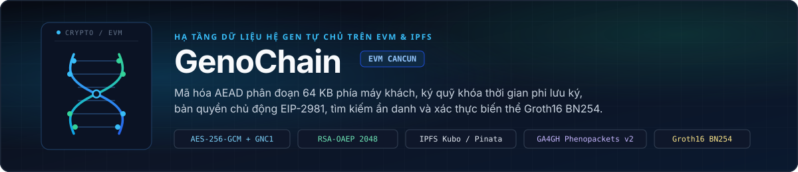
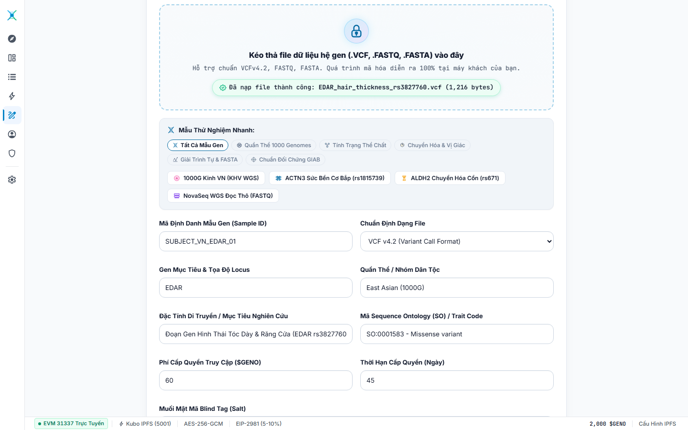
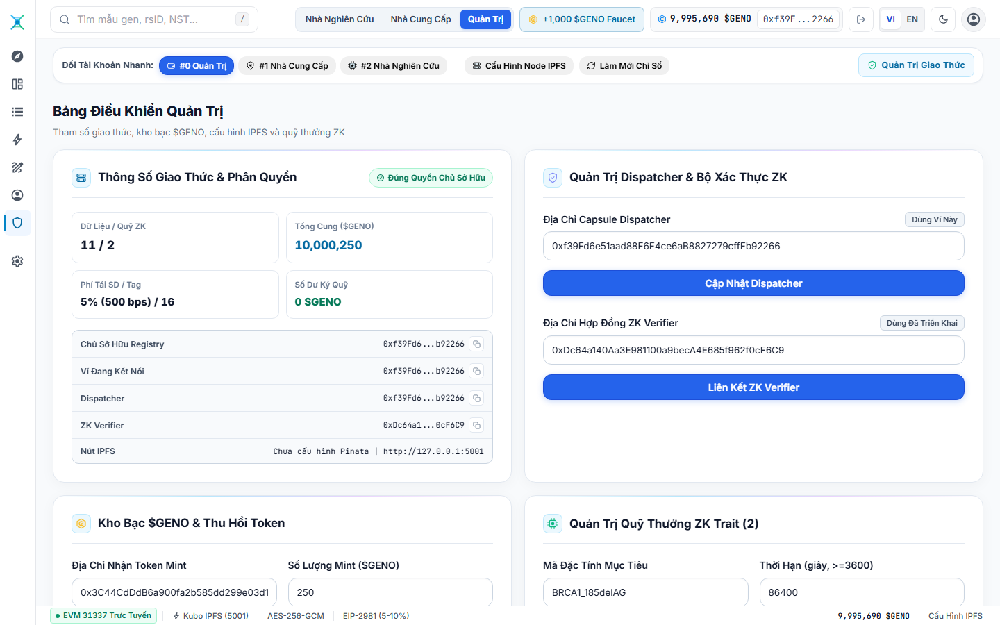
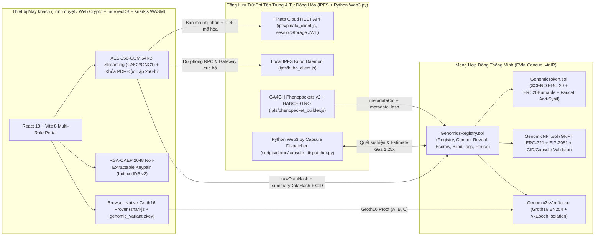
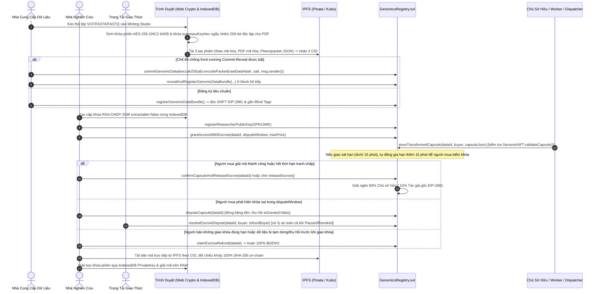
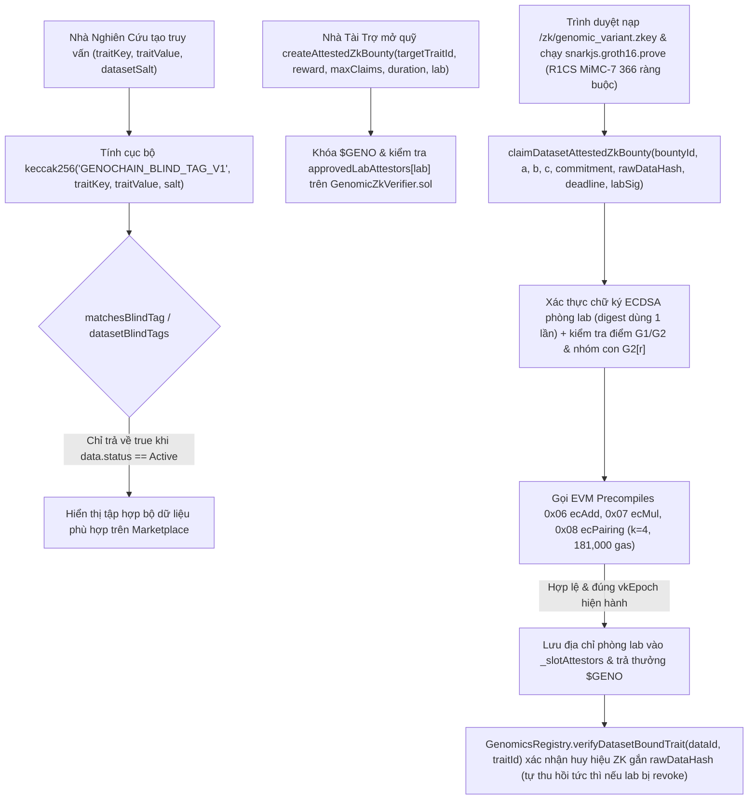

<div align="center">
  

  <p>
    
    
    
    
    
    
    
  </p>

  <p>
    <a href="#tong-quan">Tổng Quan</a> ·
    <a href="#giao-dien-ux">Giao Diện &amp; UX</a> ·
    <a href="#kien-truc-workflow">Kiến Trúc &amp; Workflow</a> ·
    <a href="#dac-ta-mat-ma">Đặc Tả Mật Mã</a> ·
    <a href="#hop-dong-thong-minh">Hợp Đồng Thông Minh</a> ·
    <a href="#ipfs-va-du-lieu">IPFS &amp; Dữ Liệu Hệ Gen</a> ·
    <a href="#cong-nghe">Công Nghệ</a> ·
    <a href="#cau-truc-thu-muc">Cấu Trúc Thư Mục</a> ·
    <a href="#trien-khai">Triển Khai</a> ·
    <a href="#tai-lieu-tham-khao">Tham Khảo</a>
  </p>
</div>

---

<a id="tong-quan"></a>
## 1. Tổng Quan & Động Lực Khoa Học

Dữ liệu giải trình tự hệ gen người (`VCF`, `VCF.GZ`, `BAM`, `Crypt4GH`, `FASTA`, `FASTQ`) là tài sản sinh học mang tính định danh bất biến và nhạy cảm bậc nhất trong nghiên cứu y sinh học và di truyền quần thể. Các nền tảng tập trung truyền thống đặt ra ba điểm nghẽn mang tính cấu trúc:

1. **Rủi ro lưu ký tập trung (Custodial Risk):** Người hiến dữ liệu phải tin tưởng tuyệt đối vào máy chủ trung gian trong việc lưu giữ bản rõ và khóa giải mã, thiếu cơ chế chứng minh mật mã độc lập.
2. **Đứt gãy tính toàn vẹn khi tái sử dụng (Integrity & Attribution Gap):** Khi một bộ dữ liệu di truyền tham gia nhiều công trình phân tích thứ cấp, người sở hữu gốc khó kiểm soát trạng thái thu hồi đồng thuận và không tự động nhận được chia sẻ giá trị minh bạch.
3. **Nghịch lý tìm kiếm vs. bảo mật (Search-Privacy Tradeoff):** Nhà nghiên cứu cần sàng lọc chính xác biến thể hoặc quần thể mục tiêu trước khi chi trả, nhưng việc công khai đặc tính nhạy cảm dạng bản rõ làm lộ danh tính di truyền của chủ thể.

**GenoChain** giải quyết đồng thời ba thách thức trên bằng một kiến trúc **phi lưu ký phía máy khách (Non-Custodial Client-Side Architecture)** vận hành trên máy ảo Ethereum (`Solidity 0.8.24`, mục tiêu `Cancun`, biên dịch `viaIR`), kết hợp tầng lưu trữ định địa chỉ nội dung **IPFS** (`Pinata Cloud API` + `Local Kubo Daemon`) và hệ chứng minh không tiết lộ tri thức **Groth16 BN254** chạy trực tiếp trên trình duyệt:

- **Bảo mật dữ liệu đầu-cuối trên trình duyệt:** Tệp giải trình tự văn bản và nhị phân nén (`.vcf.gz`, `.bam`, `.c4gh`) được mã hóa phân đoạn `64 KB` (`GNC2` streaming container với `25-byte AAD`, tương thích ngược giải mã `GNC1`) bằng `AES-256-GCM` qua W3C Web Crypto API ngay tại RAM trình duyệt mà không biến đổi luồng byte gốc; bản mã, báo cáo PDF tóm tắt (khóa `summaryKeyHex` ngẫu nhiên 256-bit độc lập đóng gói trong capsule) và siêu dữ liệu `GA4GH Phenopackets v2` được neo bằng ba mã băm `SHA-256` độc lập lên chuỗi.
- **Ký quỹ trao đổi công bằng (Fair-Exchange Escrow) & Trọng tài tranh chấp:** Tách bạch mua trực tiếp (`grantAccess`) và ký quỹ khóa thời gian (`grantAccessWithEscrow`), giới hạn thời hạn truy cập (`<= 365 ngày`), kiểm tra cú pháp JSON chuẩn RFC 8259 cho vỏ bọc khóa (`validateCapsule`), hỗ trợ khóa giải ngân thủ công có biên chặn (`<= +7 ngày`), mở hoàn tiền `100%` tức thì khi chủ dữ liệu tạm dừng/thu hồi trước khi giao khóa (`Paused`/`Revoked`), chặn rút hoàn đơn phương sau khi đã nhận khóa (chuyển tranh chấp qua `disputeCapsule` -> `resolveEscrowDispute`, kèm van xả `claimDisputeTimeoutRefund` sau `30 ngày` nếu trọng tài không phản hồi), cho phép tái phát capsule sau giải ngân khi xoay vòng khóa RSA đa thiết bị mà không đặt lại `expiresAt`.
- **Hòm khóa bất đối xứng phi trích xuất & Khôi phục đa thiết bị (`IndexedDB` `extractable: false`):** Khóa riêng `RSA-OAEP-2048` không thể đọc thô qua JavaScript thông thường; bản sao lưu `Sovereign Key Vault v2` bọc an toàn cả capsule Chủ sở hữu lẫn capsule Nhà nghiên cứu đã mua trong RAM bằng `AES-256-GCM` (`PBKDF2 600,000` vòng hoặc chữ ký `EIP-191`) và tự động tái đóng gói dưới khóa công khai phi trích xuất của thiết bị đích khi khôi phục.
- **Tìm kiếm đa thẻ mù & Chứng minh Groth16 không trapdoor:** Hỗ trợ gắn, lưu bền vững (chỉ cập nhật bộ nhớ cục bộ khi giao dịch chuỗi xác nhận thành công) và lọc tối đa `16` thẻ băm có muối `GENOCHAIN_BLIND_TAG_V1`, kết hợp mạch R1CS Groth16 `91` vòng **MiMC-7 Miyaguchi-Preneel** (`366` ràng buộc, `3` đầu vào công khai, `0` biến tự do) chạy `snarkjs` WebAssembly ngay tại trình duyệt và xác thực cặp song tuyến tính `BN254` (`ecPairing`) trên EVM không cần trapdoor hay middleware nội bộ.

---

<a id="giao-dien-ux"></a>
## 2. Kiến Trúc Giao Diện (UI) & Trải Nghiệm Người Dùng (UX)

Giao diện web (`React 18.3` + `Vite 8.3`) được tổ chức theo mô hình **Cổng đa vai trò hợp nhất (Unified Multi-Role Web3 Portal)** phục vụ đồng thời ba nhóm tác nhân trên cùng một không gian làm việc, hỗ trợ chuyển đổi ngữ cảnh tức thời mà không làm mất trạng thái bộ lọc hoặc khóa cục bộ.

### 2.1. Trực Quan Vận Hành Đa Vai Trò (Thực Thi Trực Tiếp Trên EVM Cục Bộ & IPFS)

<div align="center">
  
  <br />
  <sub><em>Hình 1: Chuỗi tương tác đầy đủ từ truy vấn bộ gen trên sàn giao dịch, mã hóa phân đoạn tại máy khách và đúc NFT, ký quỹ trao đổi khóa phiên, giải mã tại RAM trình duyệt đến điều phối quản trị giao thức.</em></sub>
</div>

### 2.2. Toàn Cảnh 6 Phân Hệ Giao Diện Cốt Lõi (`1440×900`)

| Sàn Giao Dịch & Bộ Lọc Sinh Học (Nhà Nghiên Cứu) | Chi Tiết Tài Sản, ZK Badge & Ký Quỹ (`Escrow`) |
| :---: | :---: |
|  |  |
| *Đồng bộ danh mục phân trang ưu tiên qua `getDataItemsPaginated(offset, 100)` (giữ `getAllDataItems()` on-chain theo `INVARIANT-10`), lọc theo nhiễm sắc thể, gen, nhóm máu, mã phả hệ `HANCESTRO`, định dạng, khung giá và thẻ mù.* | *Hiển thị 3 mã băm `SHA-256`, 3 CID IPFS, trạng thái xác thực ZK trên chuỗi, tỷ lệ tác quyền `EIP-2981` và chế độ thanh toán ký quỹ.* |

| Studio Kéo-Thả Mã Hóa & Đúc `GNFT` (Nhà Cung Cấp) | Hòm Khóa Tự Chủ (`IndexedDB` `extractable: false`) |
| :---: | :---: |
|  |  |
| *Phân tích header `VCF`/`VCF.GZ`/`BAM`/`Crypt4GH`/`FASTA`/`FASTQ`, đo trực tiếp `plaintextBytesOverWire = 0`, giới hạn xem trước `10 MB`.* | *Quản lý danh mục tài sản (`Active`/`Paused`/`Revoked`), chứng minh `ZK Trait Bounty` bằng `snarkjs`, giữ bền vững thẻ mù tùy biến và hạch toán chính xác tác quyền từ log `RoyaltyPaid`.* |

| Giải Mã Tại Bộ Nhớ Đệm & Ký Quỹ Công Bằng | Bảng Điều Khiển Quản Trị & Trọng Tài Giao Thức |
| :---: | :---: |
|  |  |
| *Đối soát 3 mã băm `SHA-256` từ IPFS Kubo, giải mã nguyên vẹn `.VCF`/`.VCF.GZ`/`.PDF`/`Phenopacket v2` trên RAM kèm nút `Xác Nhận & Giải Phóng` và `Khiếu Nại Khóa`.* | *Chuyển nhanh tài khoản vai trò cục bộ, theo dõi telemetry, bật/tắt `Commit-Reveal`, cập nhật `capsuleDispatcher` / `zkVerifier`, mở quỹ ZK và phân xử tranh chấp.* |

### 2.3. Thiết Kế Trải Nghiệm Người Dùng (UX Principles)

- **Hai giao diện Sáng / Tối, Song ngữ `VI`/`EN` (`702/702` khóa, `0` khóa thiếu) & Chuẩn Trợ Năng `WCAG 2.2 AA`:** Toàn bộ nút điều khiển tương tác đáp ứng kích thước mục tiêu tối thiểu `>= 24×24px` (`SC 2.5.8`), đồng bộ động `<html lang>`, hiển thị tỷ lệ tác quyền `EIP-2981` động (`royaltyBps / 100`) trên cả 6 bề mặt UI, tự động phát hiện quản trị hợp đồng `GenomicTimelock` trong `AdminPortal` kèm bộ tạo calldata `schedule(...)`/`execute(...)`, ẩn tự động bộ chuyển tài khoản Hardhat và khóa nút Faucet (`disabled` + `aria-disabled`) khi tắt trên các mạng không phải `31337` (đã kiểm chứng `0` rò rỉ chữ `Hardhat`/`31337`, `0` nguồn lặp vòng `127.0.0.1`/`localhost` trong CSP `index.html` lẫn mọi gói JS nội bộ và `0` truy vấn `127.0.0.1:8545`/`5001` trên bản dựng Sepolia `VITE_CHAIN_ID=11155111` ở cả `EN` và `VI`), loại bỏ CSS font ngoài không có SRI, cấu hình nguyên tử Private IPFS Gateway trong `IpfsSettingsModal`, phân tách `Activity Feed` chịu lỗi từng phần (`Promise.allSettled`), đếm ngược sống từng giây trong hộp thoại Release Escrow, che mật khẩu cho nhân chứng ZK (`type="password"`), ép độ dài passphrase xuất hòm khóa `>= 8` ký tự, hộp thoại dùng chuẩn `role="dialog"` trên cửa sổ kèm khóa tiêu điểm (`useModalFocusTrap`) và khôi phục tiêu điểm khi nhấn `Escape`, hiển thị vòng tiêu điểm `:focus-visible` qua token `--focus-ring-color` (`#005fcc` sáng / `#38bdf8` tối), khóa phím tắt `/` khi đang mở hộp thoại modal, bản địa hóa toàn diện `aria-label`/`title`, dọn sạch bộ đệm giải mã tức thì khi chuyển ví `A -> B` hoặc ngắt kết nối (`DatasetContext` & `useGenomicCatalog`) với updater React thuần khiết trong `useDatasetDecryption`, kèm khung xem trước/sao chép `variantCommitment` trong ZK Vault, lọc XSS an toàn không làm hỏng toán tử khoa học (`MAF < 5%`) hay alen VCF `<DEL>`/`<INS>`, trạng thái xác minh metadata 4 mức (`verified`/`unanchored`/`unverified`/`tampered` hiển thị đồng nhất trên mọi thẻ/bảng/chi tiết/Activity Feed, chặn mua khi phát hiện giả mạo), nút trạng thái ký quỹ chờ bàn giao (`escrowPendingDelivery`), bộ sắp xếp bảng xếp hạng trung thực, và đạt `0` vi phạm trên cả 34 kịch bản online lẫn 29 kịch bản offline (Desktop `1440×900`, Tablet `1024×768`, Mobile `390×844`).
- **Ổn định trạng thái Web3 bất đồng bộ theo kỷ nguyên (`Connection Epoch Guard`):** `Web3Context` cố định tham chiếu callback và gắn bộ đếm kỷ nguyên đơn điệu trên mọi `await` (`connectLocalAccount`, `connectWallet`, `accountsChanged`, `getContracts`, `fetchOnChainDatasets`), triệt tiêu hoàn toàn vòng lặp tái kết nối EIP-1193 và lỗi ghi đè `signer` cũ khi chuyển ví nhanh; mọi thao tác `navigator.clipboard.writeText` đều có lớp bắt lỗi an toàn khi trình duyệt từ chối quyền ghi.
- **Bảo toàn thẻ mù theo phiên (`sessionStorage`) & Hạch toán tác quyền chính xác trên chuỗi:** Hộp thoại Blind Tags lưu danh sách thẻ tùy biến không bí mật theo phiên làm việc trong `sessionStorage` (`genochain_blind_tags_session_v1_<addr>`, không bao giờ ghi `salt` dạng bản rõ vào `localStorage`) nên vẫn bảo toàn khi chuyển tab Nhà Cung Cấp hoặc tải lại trang (`F5`); chỉ số tác quyền đã nhận của chủ sở hữu cộng dồn chính xác từ sự kiện `RoyaltyPaid` trên chuỗi thay vì ước lượng tuyến tính (cấp quyền miễn phí `grantDirectAccess` ghi nhận `+0.0 $GENO`).
- **Ba chế độ quan sát & Khép kín vòng đời Ký quỹ:** Chuyển đổi tức thời giữa lưới thẻ (`Grid`), bảng đối chiếu (`Table`), luồng sự kiện (`Activity Feed`) và kho dữ liệu đã mua (`Licensed Datasets`); hỗ trợ phím tắt `/` và `Escape`, cảnh báo rõ sai lệch mạng RPC và đầy đủ thao tác ký quỹ cho cả ba vai trò.

---

<a id="kien-truc-workflow"></a>
## 3. Kiến Trúc Hệ Thống & Luồng Nghiệp Vụ (Workflows)

### 3.1. Kiến Trúc Phân Tầng Theo Ranh Giới Tin Cậy (Trust Boundaries)



### 3.2. Workflow 1 — Mã Hóa Máy Khách, Đăng Ký Chống Front-Running & Giao Dịch Ký Quỹ Công Bằng



### 3.3. Workflow 2 — Tìm Kiếm Thẻ Mù & Xác Thực Biến Thể Không Tiết Lộ (`zk-Genomics`)



---

<a id="dac-ta-mat-ma"></a>
## 4. Đặc Tả Mật Mã Học & Định Dạng Dữ Liệu

Toàn bộ hoạt động mã hóa/giải mã đối xứng, bất đối xứng, quản trị khóa và chứng minh Groth16 được hiện thực trong phân hệ [`crypto/`](crypto/client_crypto.js) và [`circuits/`](circuits/genomic_variant_proof.circom):

### 4.1. Khung Truyền Tải Phân Đoạn `GNC2` (`64 KB Chunked AEAD Framing`, Tương Thích Ngược `GNC1`)

Áp dụng mô hình cắt lát phân đoạn `64 KB` (`Blob.slice`, trần bảo vệ `500 MB`) lấy cảm hứng từ **GA4GH Crypt4GH** kết hợp chuẩn **NIST SP 800-38D (AES-256-GCM)** nhằm tránh treo luồng giao diện với tệp lớn và chống cắt ngắn, đảo vị trí hoặc tráo phân đoạn:

| Phân Vùng Nhị Phân | Kích Thước | Quy Cách Đóng Gói & Ràng Buộc Xác Thực |
| :--- | :---: | :--- |
| **Header Khung `GNC2`** | `20 bytes` | Magic `0x47 0x4E 0x43 0x32` (`"GNC2"`, `4 B`; bộ giải mã hỗ trợ ngược `"GNC1"`) + Kích thước phân đoạn mặc định `65,536 B` (`uint32 BE`) + Số phân đoạn (`uint32 BE`) + Tổng kích thước bản rõ (`uint64 BE`). |
| **Phụ Phí Mỗi Phân Đoạn** | `32 bytes` | Tiền tố độ dài phân đoạn (`4 B`) + Vector khởi tạo ngẫu nhiên `IV` (`12 B` CSPRNG riêng mỗi khối) + Thẻ xác thực `GMAC` (`16 B`). |
| **Dữ Liệu Xác Thực Bổ Sung (`AAD`)** | `25 bytes` | Ràng buộc toàn diện `GNC2`: `magic (4 B) \|\| chunkSize (uint32 BE) \|\| chunkIndex (uint32 BE) \|\| chunkCount (uint32 BE) \|\| totalPlaintextSize (uint64 BE) \|\| isFinal (1 B)` (`GNC1` cũ: `16 B`). |
| **Định Dạng Khối Đơn** | `>= 28 bytes` | Dùng cho tệp nhỏ hoặc siêu dữ liệu theo bố cục `IV [12 bytes] \|\| Ciphertext \|\| GMAC [16 bytes]`. |

- **Ngân sách gọi khóa & Khóa PDF độc lập:** Giới hạn $2^{32}$ lần gọi mỗi khóa `AES-256-GCM` (NIST SP 800-38D §8.2.2); báo cáo `ISO 32000 / PDF-1.4` (`crypto/reporting/pdf_generator.js`) mã hóa bằng khóa `summaryKeyHex` ngẫu nhiên 256-bit độc lập bọc trong RSA-OAEP Key Capsule (giữ dự phòng tách miền cho capsule cũ); phía khách luôn đối chiếu khớp `SHA-256` của toàn bộ gói nhị phân mã hóa với `rawDataHash` on-chain trước khi gọi `crypto.subtle.decrypt()`.

### 4.2. Hòm Khóa `RSA-OAEP-2048` (`IndexedDB v2`), Mạch R1CS Groth16 & Thẻ Mù

- **Hòm khóa phi trích xuất & Khôi phục đa thiết bị (`crypto/storage/key_vault.js`):** Khởi tạo cặp khóa `RSA-OAEP` `2048`-bit ($e = 65537$, `SHA-256`, `extractable: false`) trong `GenomicsKeyStoreDB v2`, hỗ trợ nạp khóa công khai cả dạng JWK lẫn SPKI PEM (`-----BEGIN PUBLIC KEY-----`); sao lưu cả capsule Chủ sở hữu lẫn capsule Nhà nghiên cứu đã mua theo định dạng `GENOCHAIN-ENCRYPTED-KEY-VAULT-v2` / `GENO-WALLET-BACKUP-v2` bằng `AES-256-GCM` dẫn xuất từ chữ ký ví `EIP-191` ràng buộc tên miền (`domain`) + muối ngẫu nhiên 16 byte (`PBKDF2-HMAC-SHA256` `100,000` vòng, tương thích ngược `v1`) hoặc mật khẩu `PBKDF2` (`600,000` vòng), tự động tái đóng gói dưới khóa công khai phi trích xuất của thiết bị đích khi khôi phục.
- **Mạch R1CS Groth16 BN254 không trapdoor (`circuits/genomic_variant_proof.circom`, `crypto/zk/groth16_prover.js`):** Mạch gồm `366` ràng buộc R1CS (`370` wire, `3` đầu vào công khai `[variantCommitment, donorTraitBind, domainHash]`, `0` biến tự do/slack) thực hiện hàm băm **91 vòng MiMC-7 ($x^7$, $\gcd(7, r-1) = 1$) cấu trúc Miyaguchi-Preneel** trên trường vô hướng BN254 `Fr`, ràng buộc chặt nhân chứng bí mật khác `0` và tách miền theo `(verifierAddress, chainId, vkEpoch, bountyId, donorAddress, targetTraitId)`. Kịch bản [`scripts/zk/build_groth16_artifacts.mjs`](scripts/zk/build_groth16_artifacts.mjs) thực thi lễ thiết lập `snarkjs` Phase 1 (`power = 9`) + Phase 2 có đóng góp CSPRNG và random beacon, xuất duy nhất hai tệp công khai `frontend/public/zk/genomic_variant.zkey` và `verification_key.json` (`IC = 4`), hủy bỏ toàn bộ tệp trung gian. Trình duyệt tạo bằng chứng nguyên bản qua `snarkjs.groth16.prove` (`singleThread: true`, CSP `'wasm-unsafe-eval'`), hoạt động đồng nhất trên cả `vite dev` lẫn bản đóng gói `vite preview`.
- **Chỉ mục Thẻ Mù (`MAX_BLIND_TAGS_PER_DATASET = 16`):** `keccak256(abi.encode("GENOCHAIN_BLIND_TAG_V1", traitKey, traitValue, datasetSalt))` giúp lọc chính xác đặc tính trên chuỗi mà không công khai bệnh lý hay biến thể bản rõ.

---

<a id="hop-dong-thong-minh"></a>
## 5. Đặc Tả Hợp Đồng Thông Minh & Bất Biến Bảo Mật

Bảy hợp đồng lõi & mô-đun biên dịch trên `Solidity 0.8.24` (`cancun`, `optimizer.runs: 200`, `viaIR: true`), đạt **`0` errors và `0` warnings** trên `Solhint --max-warnings 0` cùng **`0` High/Medium** trên `Slither`, kế thừa OpenZeppelin `^5.6.1` (`Ownable2Step`, `TimelockController`, `ERC20Burnable`, `ERC721URIStorage`, `ERC2981`, `SafeERC20`, `ReentrancyGuard`).

### 5.1. Số Đo Kích Thước Bytecode Thực Tế (EIP-170 — Ngưỡng `24,576 bytes` @ `optimizer.runs: 200`)

| Hợp Đồng | Tệp Nguồn | Runtime Bytecode | Initcode | Biên Dự Phòng EIP-170 | Vai Trò Kiến Trúc |
| :--- | :--- | :---: | :---: | :---: | :--- |
| **`GenomicsRegistry`** | [`contracts/GenomicsRegistry.sol`](contracts/GenomicsRegistry.sol) | `21,543 bytes` | `42,627 bytes` | `3,033 bytes` | Hợp đồng điều phối giữ 100% lưu ký `$GENO`, thanh toán `EIP-2981`, Commit-Reveal Bundle, điều phối Ký quỹ công bằng, trần `MAX_PRICE = 100M $GENO`, bỏ qua sự kiện trùng `updateDataStatus`, Tái sử dụng `5%`, `disableCapsuleDispatcher` (`0x0`) & `setDispatcherOptOut`, `EIP-1153` Reentrancy, `Ownable2Step` (tương thích `100%` ABI gốc và factory không tham số phụ). |
| **`GenomicsMetadataStore`** | [`contracts/registry/GenomicsMetadataStore.sol`](contracts/registry/GenomicsMetadataStore.sol) | `10,800 bytes` | `11,119 bytes` | `13,776 bytes` | Mô-đun lưu trữ phi lưu ký (`onlyRegistry`) quản lý danh mục lõi kèm biên kiểm tra `MAX_PRICE`/`MAX_ACCESS_DURATION`, khóa công khai nhà nghiên cứu, kỷ nguyên worker `O(1)`, 3 mã băm tạo phẩm, thẻ mù, Commit-Reveal, biên lai tái sử dụng và cầu nối `GenomicZkVerifier`. |
| **`GenomicsEscrowEngine`** | [`contracts/registry/GenomicsEscrowEngine.sol`](contracts/registry/GenomicsEscrowEngine.sol) | `8,735 bytes` | `8,965 bytes` | `15,841 bytes` | Mô-đun phi lưu ký (`onlyRegistry` cả ghi lẫn đọc capsule) vận hành `EscrowDeposit` đóng gói 5-slot, máy trạng thái `PauseState` tách rời toán học (`graceCutoff`, chống pause-pulsing & `getEscrowLockDeadline`/`setManualRelease` đối xứng trước/sau bàn giao), `manualEscrowRelease` (`H-01B`), van xả `30 ngày` và kho `_buyerCapsules`. |
| **`GenomicNFT`** | [`contracts/GenomicNFT.sol`](contracts/GenomicNFT.sol) | `15,667 bytes` | `16,865 bytes` | `8,909 bytes` | Chứng thư `GNFT` (`ERC-721` + `EIP-2981` trần `5000 bps`, `ReentrancyGuard`, `Ownable2Step`), `setRegistryContract` gắn khớp `genomicNFT()`, `validateCid`, `validateTokenUri` chặn XSS (`javascript:`/`data:`/`vbscript:`/`< 0x20`) cùng trần `MAX_TOKEN_URI_LENGTH = 2048`, và SWAR 32-byte `validateCapsule` (`60,491 gas` chuẩn / `332,810 gas` 8 KB). |
| **`GenomicZkVerifier`** | [`contracts/GenomicZkVerifier.sol`](contracts/GenomicZkVerifier.sol) | `17,412 bytes` | `18,614 bytes` | `7,164 bytes` | Quỹ thưởng `Groth16 BN254` (`ZkBounty` đóng gói 10-slot, `MAX_ACTIVE_BOUNTIES = 1024`, cắt tỉa `O(1)` & `pruneExpiredBounties`, kiểm tra phân biệt cặp điểm & điểm đối G1/G2 VK cùng phân nhóm G2 cấp gas động), `requireLabAttestation` + đa phòng lab `_slotAttestors` (`<= 8` lab/slot), `claimDatasetAttestedZkBounty`, `Ownable2Step`. |
| **`GenomicToken`** | [`contracts/GenomicToken.sol`](contracts/GenomicToken.sol) | `5,371 bytes` | `6,468 bytes` | `19,205 bytes` | Token `$GENO` (`ERC20Burnable`, `Ownable2Step`, `IGenomicTokenFaucet`), cung khởi tạo `10M`, trần cứng `MAX_TOTAL_SUPPLY = 100M`, trần faucet `50M` & `50k/h`, khóa `EIP-1153`, công tắc tắt & chế độ voucher ECDSA (`claimFaucetWithVoucher`). |
| **`GenomicTimelock`** | [`contracts/GenomicTimelock.sol`](contracts/GenomicTimelock.sol) | `5,279 bytes` | `6,533 bytes` | `19,297 bytes` | Hợp đồng quản trị trì hoãn sản xuất bọc OpenZeppelin `TimelockController`, tích hợp bàn giao `Ownable2Step` tự động qua `ENABLE_TIMELOCK=1` và [`scripts/deploy/timelock_accept_ownership.js`](scripts/deploy/timelock_accept_ownership.js). |

### 5.2. Các Cơ Chế Phòng Thủ Trọng Tâm Ở Tầng EVM

| Cơ Chế Bảo Mật | Hiện Thực Trong Hợp Đồng Thông Minh | Nguy Cơ Được Triệt Tiêu |
| :--- | :--- | :--- |
| **Fair-Exchange Escrow, Trần Thời Hạn & Trọng Tài An Toàn** | `MAX_ACCESS_DURATION = 365 days`; `manualEscrowRelease` chỉ bật trong `disputeWindow` (tối đa `+7 days`); hoàn `100%` tức thì khi `Paused`/`Revoked` trước giao khóa, chặn hoàn đơn phương sau giao khóa (`CapsuleAlreadyDelivered`) và cho phép tất toán `releaseEscrow`/`confirmCapsuleAndReleaseEscrow` công bằng; `resolveEscrowDispute` không kẹt `DataNotActive()`, van xả `claimDisputeTimeoutRefund` sau `30 ngày` (`DISPUTE_ARBITRATION_TIMEOUT`); hỗ trợ tái phát capsule sau giải ngân cho xoay khóa RSA mà không đặt lại `expiresAt`. | Ngăn người mua rút hoàn tiền sau khi đã nhận khóa giải mã, ngăn kẹt vĩnh viễn tiền ký quỹ khi trọng tài không phản hồi hoặc tạm dừng sau giao khóa, và hỗ trợ khôi phục đa thiết bị. |
| **Kiểm Định Multihash CID & JSON RFC 8259** | `GenomicNFT.validateCid()` xác thực phạm vi Base58btc 34-byte SHA2-256 (`0x12 0x20`) cho CIDv0 và giải mã trực tiếp 6 byte đầu Base32 RFC 4648 cho CIDv1 (`ver=0x01`, `codec ∈ {0x70, 0x55, 0x71}`, `SHA2-256` 59 ký tự, `BLAKE2b-256` 62 ký tự LEB128 `0xa0 0xe4 0x02`, `SHA2-512` 110 ký tự + bit đệm `0`); `validateCapsule()` kiểm tra JSON lồng nhau chuẩn RFC 8259 với `"keyCipher"` hex chẵn `>= 512` ký tự khác `0`. | Chặn CID giả mạo header multihash / varint ở mọi độ dài và gói khóa rỗng/toàn số `0`. |
| **Worker `O(1)`, Quỹ ZK Ràng Buộc Dataset & `Ownable2Step`** | Quyền worker lưu theo kỷ nguyên `O(1)` (`workerEpoch[dataId]++`) với kiểm tra biên `DataNotFound()`; `GenomicZkVerifier` nâng `MAX_ACTIVE_BOUNTIES = 1024` kèm cắt tỉa `O(1)` theo nhà tài trợ (`<= 4`), chế độ sản xuất `requireLabAttestation` + `approvedLabAttestors`, `claimDatasetAttestedZkBounty` & `verifyDatasetBoundTrait` khóa chặt `rawDataHash` + `bountyId` + digest dùng 1 lần; toàn bộ 4 hợp đồng dùng `Ownable2Step`. | Triệt tiêu DoS bão hòa 64 slot và quỹ Sybil không xác thực, chặn gắn nhầm chứng minh ZK giữa các bộ dữ liệu khác nhau của cùng chủ sở hữu và chống chuyển nhầm quyền quản trị một bước. |
| **Chống Front-running, Đối Xứng Trạng Thái & Faucet Production** | `commitGenomicData()` + `revealAndRegisterGenomicDataBundle()` khóa muối theo `msg.sender`; `_requireValidDataId()` revert `DataNotFound()` ngoài biên; `recordStudyReuse(..., maxFee)` chống trượt giá; `GenomicToken` hỗ trợ đồng thời faucet demo (`extcodesize == 0`, khóa tạm `EIP-1153`, cooldown `1 giờ` hai chiều, trần `50,000 $GENO/giờ`) và chế độ sản xuất khóa voucher ECDSA (`setFaucetConfig`, `claimFaucetWithVoucher`) hỗ trợ ví hợp đồng thông minh. | Chặn bot mempool, rò rỉ đọc bất đối xứng, bòn rút faucet qua constructor-factory, và sẵn sàng chuyển sang cấp phát có xác thực chữ ký khi đưa lên mạng công khai. |

### 5.3. Định Giá Gas Xác Thực ZK-SNARK Theo EIP-1108

Phương trình kiểm tra bằng chứng Groth16 gồm $k = 4$ cặp song tuyến tính trên BN254/alt_bn128: $e(-A, B) \cdot e(\alpha, \beta) \cdot e(vk_x, \gamma) \cdot e(C, \delta) = 1$. Theo chuẩn **EIP-1108**, precompile `0x08` (`ecPairing`) tiêu tốn $34{,}000 \cdot k + 45{,}000 = 181{,}000$ gas; toàn bộ giao dịch `claimZkBounty()` tiêu tốn khoảng `215,000 – 235,000 gas` trên EVM Cancun.

---

<a id="ipfs-va-du-lieu"></a>
## 6. Tầng Lưu Trữ IPFS, Chuẩn Hóa Sinh Học & Tự Động Hóa Web3.py

### 6.1. Lưu Trữ IPFS Hai Động Cơ (`Pinata Cloud` + `Local Kubo`) & Đường Ống Python `Web3.py`

- **Lưu trữ & Truy xuất thực tế ([`ipfs/pinata_uploader.js`](ipfs/pinata_uploader.js), [`ipfs/pinata_client.js`](ipfs/pinata_client.js), [`ipfs/kubo_client.js`](ipfs/kubo_client.js)):** Ưu tiên ghim lên `Pinata REST API` khi có JWT lưu tạm trong `sessionStorage` (không đọc `localStorage`), tự động chuyển sang node `IPFS Kubo` cục bộ (`http://127.0.0.1:5001/api/v0/add`). Trình khách đọc công khai cổng Pinata không cần JWT khi `fastCatalog`, chặn trang lỗi `text/html`/`<!doctype html`, áp dụng timeout `60s` cho tệp lớn, kiểm chứng toàn vẹn `100%` các tổ hợp CIDv1 được hợp đồng chấp nhận (`raw 0x55`, `dag-pb 0x70`, `dag-cbor 0x71` × `SHA2-256`, `SHA2-512`, RFC 7693 `BLAKE2b-256`); bộ tính CID cục bộ ([`ipfs/multihash.js`](ipfs/multihash.js)) khớp byte-for-byte với Kubo cho cả CIDv0 và CIDv1 đa tầng `174`-link đến `>45.88 MB`.
- **Khởi tạo, Điều phối khóa & Cổng IPFS Riêng tư Sản xuất:** [`scripts/deploy/deploy.js`](scripts/deploy/deploy.js) ghi nhận `deployedBlock` trước khi triển khai `GenomicToken` (chặn bão truy vấn log từ block `0`), tuân thủ nguyên tắc tối thiểu đặc quyền khi `SKIP_SEEDING=1` (không tự cấp quyền `capsuleDispatcher` hay `approvedLabAttestor` cho ví deployer nếu không khai báo tường minh), hỗ trợ `DISABLE_FAUCET=1`, `FAUCET_VOUCHER_SIGNER`, `ENABLE_TIMELOCK=1` (sinh calldata `scheduleBatch`/`executeBatch` và bàn giao qua [`scripts/deploy/timelock_accept_ownership.js`](scripts/deploy/timelock_accept_ownership.js)), dẫn xuất khóa vault bằng `PBKDF2-HMAC-SHA256` có muối (`210,000` vòng); [`scripts/demo/capsule_dispatcher.py`](scripts/demo/capsule_dispatcher.py) tách chặt lỗi giới hạn khoảng block khỏi `429`/rate-limit, bảo toàn trạng thái checkpoint khi reorg nông (`<= 128` block), đồng bộ hai chiều `next_nonce`, giới hạn tần suất xoay khóa mỗi người mua (`--max-rotations-per-hour`), xử lý tắt êm `SIGTERM`/`SIGINT`, yêu cầu khóa tường minh (chỉ mở khóa cục bộ với `--unlocked-local-signer`), nạp nóng vault (`--vault-file`), hỗ trợ `--json-logs`, `--health-port` (`/healthz` & `/metrics` Prometheus) và mã hóa phong bì **AWS KMS** tùy chọn (`AWS_KMS_KEY_ID`); bộ triển khai [`deploy/`](deploy/) cung cấp Private Kubo cách ly hoàn toàn (`kubo-private-init.sh`, `LIBP2P_FORCE_PNET=1`, `generate_swarm_key.py`, mạng `genochain_private internal: true`), Dockerfiles không quyền root (`Dockerfile.gateway`, `Dockerfile.dispatcher`, `read_only: true`, `cap_drop: [ALL]`, không cài `pip` lúc chạy, không mount mã nguồn mật), và cổng [`deploy/ipfs_access_gateway.py`](deploy/ipfs_access_gateway.py) tích hợp đầu cuối với frontend (`ipfs/kubo_client.js` & `IpfsSettingsModal`): phục vụ công khai `metadataCid` của dataset `Active`, khóa chặt `rawCid`/`summaryCid` bằng chữ ký `EIP-191 SIWE` + `hasActiveAccess`, hỗ trợ tải lên `POST /api/v0/upload`, stream phân khối `64 KiB` tới `525 MiB` (bọc khung `GNC2` cho `500 MiB` bản rõ), bền vững hóa SQLite WAL cho `NonceStore` (`TTL 660s`, tiêu thụ sau xác thực) và `GdprErasureReconciler` (đếm tham chiếu tránh gỡ nhầm CID dùng chung + quét lùi 5 block chống reorg + `repo/gc` theo GDPR Điều 17).

### 6.2. Siêu Dữ Liệu GA4GH Phenopackets v2 & 13 Bộ Dữ Liệu Hệ Gen Chuẩn

Mỗi bộ dữ liệu sinh siêu dữ liệu **GA4GH Phenopackets v2** nghiêm ngặt chuẩn Protobuf (`metaData.phenopacketSchemaVersion: "2.0.0"`, `NCBITaxon:9606`, `HANCESTRO`, nhóm máu trong `measurements` `LOINC:882-1` + SNOMED CT, `files[].fileAttributes` `map<string, string>`, `subjectOrBiosampleId` & `interpretationStatus`, mã định danh gen chuẩn số `HGNC:404`/`HGNC:1100`..., ẩn danh chủ thể `>= 128-bit` có muối CSPRNG và kiểm tra khai báo đầy đủ mọi tiền tố CURIE trong `metaData.resources`) qua [`ipfs/phenopacket_builder.js`](ipfs/phenopacket_builder.js). Hai thư mục tĩnh [`frontend/public/samples/`](frontend/public/samples/) và [`frontend/public/datasets/`](frontend/public/datasets/) cung cấp sẵn 13 tệp đa định dạng (khai báo tại [`frontend/src/services/vcf/presetCatalog.js`](frontend/src/services/vcf/presetCatalog.js); tập kiểm thử đa định dạng bổ sung tại [`data/diverse_real_datasets/datasets_catalog.json`](data/diverse_real_datasets/datasets_catalog.json)):

| Tệp Mẫu Sinh Học (`frontend/public/samples/` & `frontend/public/datasets/`) | Locus / Tham Chiếu | Định Dạng | Đặc Tính / Ứng Dụng Phân Tích |
| :--- | :--- | :---: | :--- |
| `KHV_chr12_1000genomes.vcf` | `chr12` (`KHV` 1000G) | `VCF` | Quần thể người Kinh TP.HCM (`ALDH2`/`ADH1B`, `HANCESTRO:0021`) |
| `NA12878_chr20_sample.vcf` | `chr20` (`NA12878` GIAB) | `VCF` | Mẫu tham chiếu đối chứng NIST Genome in a Bottle |
| `ACTN3_muscle_performance_rs1815739.vcf` | `rs1815739` (*ACTN3*) | `VCF` | Đa hình sợi cơ co giật nhanh (`p.Arg577Ter`) |
| `ALDH2_alcohol_flush_rs671.vcf` | `rs671` (*ALDH2*) | `VCF` | Chuyển hóa enzyme aldehyde & quỹ thưởng ZK Groth16 |
| `ABCC11_earwax_type_rs17822931.vcf` | `rs17822931` (*ABCC11*) | `VCF` | Biến thể kiểu hình biểu mô — kiểm thử thẻ mù đa hình |
| `CYP1A2_caffeine_metabolism_rs762551.vcf` | `rs762551` (*CYP1A2*) | `VCF` | Dược di truyền học — tốc độ thanh thải caffeine ở gan |
| `EDAR_hair_thickness_rs3827760.vcf` | `rs3827760` (*EDAR*) | `VCF` | Hình thái nang tóc và răng trong quần thể Đông Á |
| `HERC2_eye_color_rs12913832.vcf` | `rs12913832` (*HERC2*) | `VCF` | Điều hòa sắc tố mống mắt và da |
| `LCT_lactose_intolerance_rs4988235.vcf` | `rs4988235` (*MCM6/LCT*) | `VCF` | Khả năng dung nạp lactose ở người trưởng thành |
| `TAS2R38_bitter_taste_rs713598.vcf` | `rs713598` (*TAS2R38*) | `VCF` | Thụ thể cảm nhận vị đắng hợp chất PTC |
| `GRCh38_chrM_mitochondrial.fa` | `chrM` (`GRCh38`) | `FASTA` | Trình tự hệ gen ty thể người chuẩn tham chiếu (`NC_012920.1`) |
| `Illumina_WGS_reads_sample.fastq` | Dữ liệu đọc ngắn NGS | `FASTQ` | Kiểm thử đóng gói luồng phân đoạn `GNC2` `64 KB` |
| `SAMtools_bcftools_view.vcf` | `chr20` / `rs6111385` | `VCF` | Bộ gọi biến dị đa mẫu (`SAMtools/BCFtools`) |

---

<a id="cong-nghe"></a>
## 7. Công Nghệ Sử Dụng (Technology Stack)

| Tầng Hệ Thống | Công Nghệ / Thư Viện | Phiên Bản / Tiêu Chuẩn | Vai Trò Trong Kiến Trúc |
| :--- | :--- | :--- | :--- |
| **Smart Contracts** | `Solidity`, `@openzeppelin/contracts` | `0.8.24` (`cancun`, `viaIR`), `^5.6.1` | Logic sổ cái, Escrow, Tokenomics ERC-20/721, EIP-2981, ZK Verifier |
| **Zero-Knowledge Proving** | `snarkjs`, R1CS BN254 (`genomic_variant_proof.circom`) | `^0.7.6`, Groth16 / EIP-197 | Tạo & xác thực bằng chứng Groth16 trên trình duyệt và CLI không trapdoor |
| **Blockchain Tooling** | `Hardhat`, `@nomicfoundation/hardhat-toolbox-mocha-ethers`, `ethers` | `^3.16.0`, `^3.0.7`, `^6.13.0` | Biên dịch EVM, chạy nút local `31337`, triển khai và kiểm thử hợp đồng |
| **Frontend Core** | `React`, `React DOM`, `Vite`, Modular SVG Icon System | `^18.3.1`, `^8.3.8` | Giao diện Web3 đa vai trò WCAG 2.2 AA, React Context, 70 SVG icon nội sinh |
| **Client Crypto & Queue** | `Web Crypto API`, `IndexedDB v2`, `p-queue`, `p-retry`, `sanitizeGenomicMetadata` | Native, `^10.0.0`, `^8.0.1`, Fixed-Point XSS | `AES-256-GCM`, `RSA-OAEP-2048` phi trích xuất, tuần tự hóa giao dịch, chống XSS & prototype-pollution |
| **Storage & Python** | `IPFS Kubo`, `Pinata API`, `GA4GH Phenopackets`, `Python Web3.py` | Kubo `/api/v0/*`, `v2.0.0`, `3.10+` | Lưu trữ bản mã `.vcf`/`.fastq`/`.pdf`, siêu dữ liệu chuẩn & daemon chuyển phát khóa |

---

<a id="cau-truc-thu-muc"></a>
## 8. Cấu Trúc Thư Mục Dự Án

```text
├── assets/readme/              # Banner SVG, GIF walkthrough & 6 ảnh giao diện thực tế
├── circuits/                   # Mạch R1CS Groth16 BN254 (genomic_variant_proof.circom) & artifact R1CS
├── contracts/                  # GenomicsRegistry.sol, registry/ (MetadataStore, EscrowEngine), GenomicZkVerifier.sol, GenomicNFT.sol, GenomicToken.sol, GenomicTimelock.sol, interfaces/, mocks/
├── crypto/
│   ├── core/                   # AES-256-GCM, RSA-OAEP-2048 & streaming GNC2/GNC1 64 KB
│   ├── reporting/              # Bộ sinh báo cáo PDF-1.4 chuẩn ISO 32000 kèm chuyển tự tiếng Việt
│   ├── storage/                # Hòm khóa IndexedDB (GenomicsKeyStoreDB v2) & sao lưu đa thiết bị
│   └── zk/                     # Bộ tính witness R1CS, định dạng .wtns & wrapper snarkjs Groth16
├── ipfs/                       # kubo_client.js, pinata_client.js, pinata_uploader.js, multihash.js, phenopacket_builder.js
├── frontend/
│   ├── .env.example            # Mẫu cấu hình VITE_RPC_URL / VITE_CHAIN_ID / VITE_CHAIN_NAME
│   ├── public/                 # samples/ (4 URL preset / 12 tệp trên đĩa), datasets/ (9 URL preset / 21 tệp đối chứng & đa định dạng trên đĩa) & zk/ (genomic_variant.zkey, verification_key.json)
│   └── src/                    # components/, context/, contracts/, features/ (researcher/donor/admin), hooks/, i18n/, services/, styles/
├── data/                       # Danh mục bộ dữ liệu đa định dạng & dữ liệu giải trình tự tham chiếu
├── deploy/                     # Bộ triển khai VPS riêng tư: ipfs_access_gateway.py (SIWE + upload + SQLite + GDPR), kubo-private-init.sh, generate_swarm_key.py, Dockerfile.gateway/dispatcher, docker-compose.vps.yml, Caddyfile.example & DEPLOYMENT_RUNBOOK.md
├── docs/                       # Đặc tả kỹ thuật, nghiên cứu, hướng dẫn sử dụng 3 vai trò & minh chứng
├── scripts/
│   ├── deploy/                 # deploy.js (SKIP_SEEDING/DISABLE_FAUCET/ENABLE_TIMELOCK), timelock_accept_ownership.js, deploy_localhost.js & sync_abis.py
│   ├── zk/                     # build_groth16_artifacts.mjs (lễ thiết lập Phase 1/2 snarkjs không trapdoor)
│   ├── demo/                   # capsule_dispatcher.py (--watch, --vault-file, --json-logs, --health-port, SIGTERM, AWS KMS tùy chọn), web3_demo.py, zk_ceremony_helper.mjs, zk_prover_cli.mjs
│   └── audit/                  # check_eip170.py, parse_slither.py, i18n_parity.mjs, audit_ui_ux_axe.py, e2e_fullstack_playwright.py & đối kháng
├── test/                       # Bộ kiểm thử hợp đồng, mật mã, OWASP 2026, Groth16 & hồi quy bảo mật (33 tệp, 495 tests)
├── .github/workflows/          # Quy trình CI ci.yml (push/PR) & security_ci.yml (định kỳ hàng tuần, ghim phiên bản Python)
├── hardhat.config.js           # Cấu hình Solidity 0.8.24 Cancun + viaIR + mạng localhost / sepolia / baseSepolia / base theo biến môi trường
└── package.json                # Khai báo phụ thuộc và npm scripts gốc
```

---

<a id="trien-khai"></a>
## 9. Cài Đặt, Triển Khai & Tái Lập Kiểm Chứng

### 9.1. Yêu Cầu Môi Trường & Khởi Chạy Cục Bộ (Localhost Stack)

- **Node.js & npm:** Khuyến nghị `Node.js v22.15.0` / `npm 10.9.2` (tương thích hoàn toàn với `Hardhat 3`, `snarkjs` và `Vite 8`).
- **Python:** `Python 3.12+` kèm môi trường ảo `.venv` (`web3==7.16.0`, `cryptography==46.0.3`, `eth-account==0.14.0`, `slither-analyzer==0.11.6`, `solc-select==1.2.0` với `solc 0.8.24`, `playwright`, `requests`, `boto3`).
- **IPFS Kubo:** `Kubo v0.32.1` chạy ở chế độ mạng riêng tư (`LIBP2P_FORCE_PNET=1`, `Routing.Type=none`, `Bootstrap=[]`).

```bash
# 1. Cài đặt phụ thuộc gốc & frontend (có thể dùng npm ci tái lập khóa phiên bản)
npm ci
npm --prefix frontend ci

# 2. Biên dịch 7 hợp đồng Solidity 0.8.24 (Cancun, viaIR) & tái tạo artifact Groth16 BN254 không trapdoor
npx hardhat compile
node scripts/zk/build_groth16_artifacts.mjs

# 3. Khởi chạy nút EVM Hardhat cục bộ (Terminal 1)
npx hardhat node --hostname 127.0.0.1 --port 8545

# 4. Khởi chạy Private IPFS Kubo PNET cục bộ (Terminal 2, dùng deploy/kubo-private-init.sh hoặc swarm.key)
LIBP2P_FORCE_PNET=1 ipfs daemon

# 5. Triển khai 5 hợp đồng cốt lõi, nạp Verification Key Groth16 V2 & ghim 13 bộ dữ liệu lên Kubo (Terminal 3)
REQUIRE_IPFS=1 npx hardhat run scripts/deploy/deploy.js --network localhost

# 6. Chạy cổng Web3 React/Vite (cổng 3000 dev hoặc 4173 preview bản production)
npm --prefix frontend run build
npm --prefix frontend run preview -- --host 127.0.0.1 --port 4173
```

### 9.2. Triển Khai Sản Xuất Phi Tập Trung (Timelock Tự Trị & Private IPFS VPS)

Hệ thống hỗ trợ đầy đủ quy trình chuyển giao quyền quản trị phi tập trung `Ownable2Step` sang `GenomicTimelock` (không có quản trị viên đặc quyền `admin = 0x0`, độ trễ mặc định `172,800s` = `48h`) cùng hạ tầng **Private Kubo PNET + SIWE IPFS Access Gateway (`deploy/ipfs_access_gateway.py`) + Watch-Mode Capsule Dispatcher (`scripts/demo/capsule_dispatcher.py`)**:

```bash
# Triển khai chế độ tối thiểu đặc quyền: tắt Faucet, bỏ dữ liệu mẫu, bàn giao qua Timelock
ENABLE_TIMELOCK=1 SKIP_SEEDING=1 DISABLE_FAUCET=1 npx hardhat run scripts/deploy/deploy.js --network localhost
TIMELOCK_LOCAL_FAST_FORWARD=1 npx hardhat run scripts/deploy/timelock_accept_ownership.js --network localhost
```

Xem chi tiết kiến trúc tường lửa, TLS Caddy, SQLite WAL cho `NonceStore`/`GdprErasureReconciler` và AWS KMS tùy chọn tại [`deploy/DEPLOYMENT_RUNBOOK.md`](deploy/DEPLOYMENT_RUNBOOK.md).

### 9.3. Bảng Kết Quả Kiểm Chứng Thực Nghiệm 18 Cổng (Live Empirical Verification)

Mọi chỉ số dưới đây được đo trực tiếp trên mã nguồn hiện hành bằng lệnh thực tế (không dùng mock, không bỏ qua kiểm tra mật mã):

| Cổng | Hạng Mục Kiểm Chứng | Lệnh Thực Thi | Kết Quả Thực Nghiệm |
| :---: | :--- | :--- | :--- |
| **01** | Toàn bộ bộ kiểm thử Hardhat Mocha | `npx hardhat test` | **495 passing / 0 failing** (`33` tệp test) |
| **02** | Stress đối kháng & Đa định dạng sinh học | `independent_stress_suite.mjs` & `test_diverse_datasets_e2e.mjs` | **24/24 PASS** & **14/14 PASS** |
| **03** | Trần bytecode EIP-170 & EIP-3860 | `python scripts/audit/check_eip170.py` | **7/7 hợp đồng PASS** (`GenomicsRegistry` `21,543 B <= 24,576 B`) |
| **04** | Phân tích tĩnh chuẩn phong cách Solhint | `npm run lint:sol` (`--max-warnings 0`) | **0 errors / 0 warnings** |
| **05** | Phân tích bảo mật tĩnh Slither | `slither . --exclude-dependencies` + `parse_slither.py` | **0 High / 0 Medium** trên `contracts/` |
| **06** | Đối xứng song ngữ i18n & từ điển icon | `i18n_parity.mjs` & `verify_frontend_dictionaries.mjs` | **702/702 khóa EN/VI**, `0` khóa thiếu, `70` SVG icons |
| **07** | Chuỗi cung ứng phụ thuộc (`npm ci` & `audit`) | `npm ci` & `npm audit --omit=dev` (root & `frontend/`) | **0 lỗ hổng** (root `0`, frontend `0`) |
| **08** | Liêm chính, UI/UX đối kháng & cú pháp | `academic_hygiene_toolkit.py`, `ui_ux_adversarial_suite.mjs`, `py_compile`, `bash -n`, `swarm_baseline_gate.sh` | **3/3**, **15/15**, **18/18 Python**, **2/2 Shell**, **13/13 Gate** PASS |
| **09** | Bản dựng Vite & CSP loại bỏ loopback | `VITE_CHAIN_ID=11155111 npm --prefix frontend run build` | **231 modules**, **0** rò rỉ `127.0.0.1`/`localhost` trong `index.html` & gói JS nội bộ |
| **10** | Trợ năng WCAG 2.2 AA (Offline Preview) | `audit_ui_ux_axe.py --base-url http://127.0.0.1:4173 --output %TEMP%\ui_ux_axe_offline.json` | **29/29 kịch bản PASS**, `0` vi phạm, `0px` overflow, `:focus-visible`/`<html lang>`/`.os2-search-clear >= 24px` |
| **11** | Trợ năng WCAG 2.2 AA (Online Live EVM+Kubo) | `audit_ui_ux_axe.py --base-url http://127.0.0.1:4173` | **34/34 kịch bản PASS**, `0` vi phạm, `0px` overflow, `:focus-visible`/`<html lang>`/`.os2-search-clear >= 24px` |
| **12** | Cách ly Private Kubo `0.32.1` PNET | `LIBP2P_FORCE_PNET=1 ipfs swarm peers` | **Peers: 0** (cách ly hoàn toàn mạng công cộng) |
| **13** | Khớp byte CIDv0/CIDv1 với Kubo `0.32.1` | `test_ipfs_cid.mjs` + kiểm chứng `11 B`/`256 KiB`/`600 KiB` | **100% byte-exact parity** (CIDv0 & CIDv1) |
| **14** | Triển khai sống `REQUIRE_IPFS=1` | `REQUIRE_IPFS=1 hardhat run scripts/deploy/deploy.js` | **13 cohort**, **40 recursive pins** trên Kubo |
| **15** | Kiểm toán nút sống & Demo Web3.py | `live_chain_audit.py` & `web3_demo.py` | **PASS 100%** (EVM + Kubo + 3-hash + Blind Tags + Reuse) |
| **16** | Cổng SIWE IPFS Gateway & Watch Dispatcher | `ipfs_access_gateway.py` (`:8090`) & `capsule_dispatcher.py` (`:8091`) | `/healthz`/`/metrics` `200`, unauth `401`, SIWE `200`, replay `401`, unlicensed `403`, auto-dispatch capsule |
| **17** | Bàn giao quản trị `GenomicTimelock` | `ENABLE_TIMELOCK=1 SKIP_SEEDING=1 DISABLE_FAUCET=1` + `timelock_accept_ownership.js` | **4/4 hợp đồng** thuộc `GenomicTimelock`, `admin=0x0`, `faucetEnabled=false` |
| **18** | Kiểm thử E2E Chromium toàn ngăn xếp | `e2e_fullstack_playwright.py` (4 luồng trực tiếp) | **4/4 luồng PASS** (WASM Groth16 + F5 IndexedDB decrypt + wallet switch isolation), **0 console/page errors**, `OPEN_PORTS == []` |

> **Minh Bạch Học Thuật về Sự Cố Mất Dữ Liệu Cục Bộ (2026-11-23 07:29 AM):** Một sự cố xóa dữ liệu hồ sơ cục bộ trước khi đẩy lên remote đã làm mất vĩnh viễn các commit cục bộ chưa đẩy (`cf07788..f7fb398c`), một số báo cáo nghiên cứu/tệp lịch sử cũ trong thư mục `docs/` bị bỏ qua bởi `.gitignore` và các bản ghi MP4 cũ trong `recordings/`. Toàn bộ mã nguồn khôi phục, giao diện Solidity/JS bị thiếu, artifact Groth16 mới và 18 cổng kiểm chứng thực nghiệm ở bảng trên đã được tái dựng và xác thực trực tiếp lại từ đầu mà không ngụy tạo hay trích dẫn các tệp đã mất.

---

<a id="tai-lieu-tham-khao"></a>
## 10. Tài Liệu Tham Khảo, Quy Chuẩn & Đạo Đức Dữ Liệu Hệ Gen

1. **GA4GH Phenopackets v2 Schema (`v2.0.0`):** Global Alliance for Genomics and Health — chuẩn hóa siêu dữ liệu kiểu hình không định danh (`NCBITaxon:9606`, `HANCESTRO`, `HGNC`, `LOINC`, `SO`).
2. **GA4GH Crypt4GH & NIST SP 800-38D:** Tiêu chuẩn mã hóa luồng phân đoạn `AES-256-GCM` cho tệp giải trình tự sinh học (`VCF`, `FASTQ`, `FASTA`, `BAM`).
3. **EIP-2981 (NFT Royalty Standard), ERC-20, ERC-721 & EIP-197 (`ecPairing` BN254):** Nền tảng kinh tế dữ liệu, chia sẻ bản quyền tự động và xác thực bằng chứng Groth16 trên EVM.
4. **OWASP Smart Contract Top 10 (2026 Edition) & W3C WCAG 2.2 Level AA:** Khung phòng thủ bảo mật hợp đồng thông minh và chuẩn trợ năng giao diện Web3.
5. **Nguyên Tắc Dữ Liệu Phi Bệnh Lý (`INV-11`):** Toàn bộ 13 bộ dữ liệu khởi tạo và tập kiểm thử đa định dạng trong kho mã nguồn chỉ sử dụng các đa hình sinh học phân tử lành tính hoặc mẫu tham chiếu mở chuẩn quốc tế (1000 Genomes KHV, NIST GIAB NA12878, dbSNP lành tính, RefSeq `chrM`), tuyệt đối không chứa hồ sơ bệnh án lâm sàng hay danh tính bệnh nhân thật.
6. **Bản Quyền & Môn Học:** Dự án nghiên cứu học thuật môn **IS355 — Công nghệ Blockchain** (Khoa Hệ thống Thông tin, Trường Đại học Công nghệ Thông tin — ĐHQG-HCM, phát hành theo giấy phép MIT).
