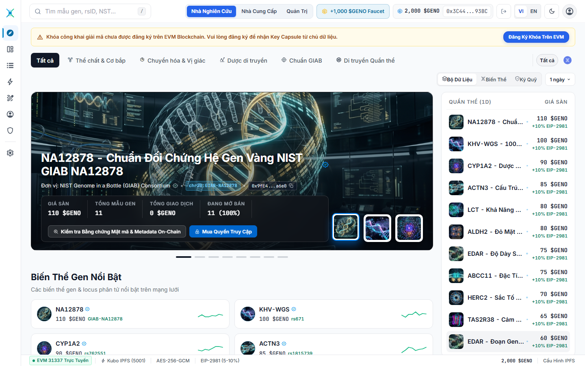
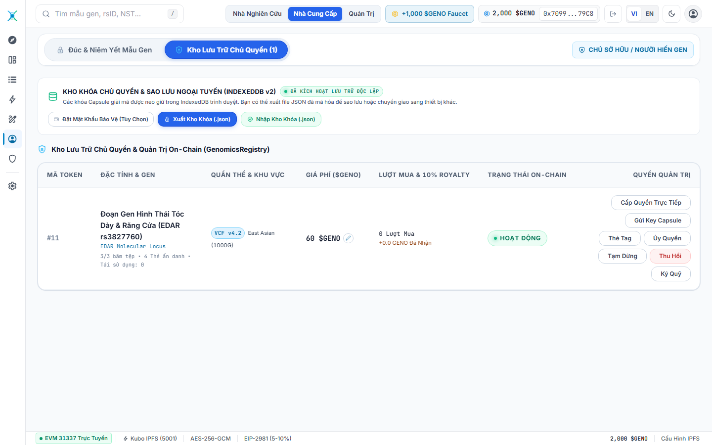
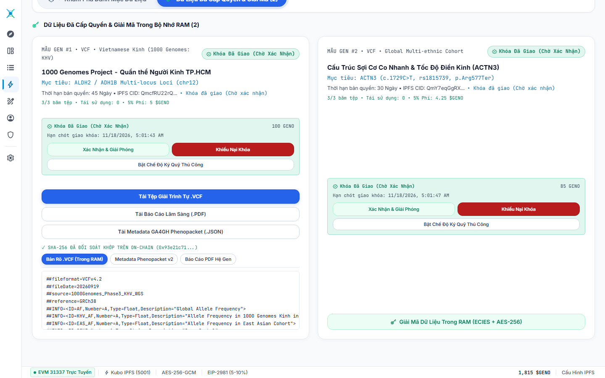
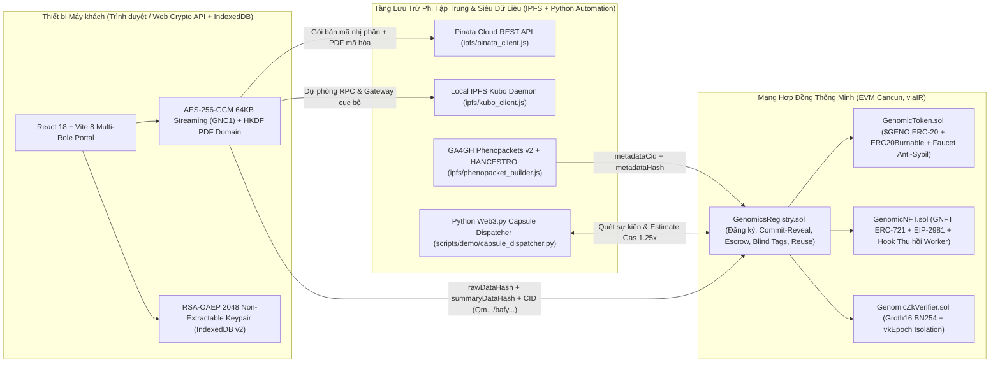
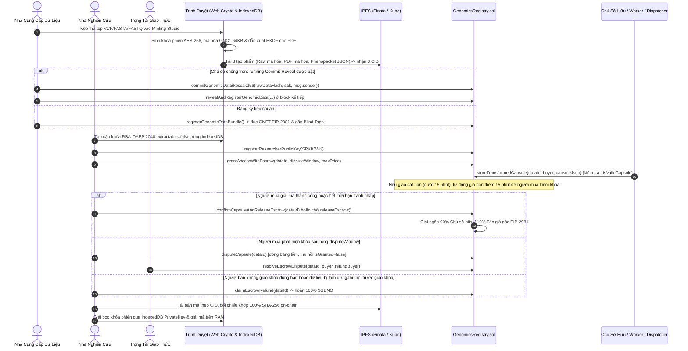
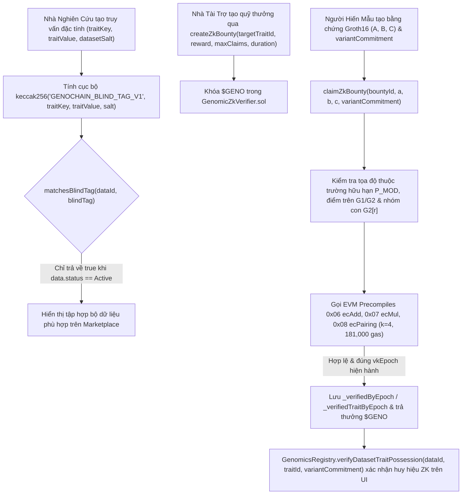

<div align="center">
  

  <p>
    
    
    
    
    
    
    
  </p>

  <p>
    <a href="#tong-quan">Tổng Quan</a> ·
    <a href="#giao-dien-ux">Giao Diện &amp; UX</a> ·
    <a href="#kien-truc-workflow">Kiến Trúc &amp; Workflow</a> ·
    <a href="#dac-ta-mat-ma">Đặc Tả Mật Mã</a> ·
    <a href="#hop-dong-thong-minh">Hợp Đồng Thông Minh</a> ·
    <a href="#ipfs-va-du-lieu">IPFS &amp; Dữ Liệu Hệ Gen</a> ·
    <a href="#cong-nghe">Công Nghệ</a> ·
    <a href="#cau-truc-thu-muc">Cấu Trúc Thư Mục</a> ·
    <a href="#trien-khai">Triển Khai</a> ·
    <a href="#tai-lieu-tham-khao">Tham Khảo</a>
  </p>
</div>

---

<a id="tong-quan"></a>
## 1. Tổng Quan & Động Lực Khoa Học

Dữ liệu giải trình tự hệ gen người (`VCF`, `FASTA`, `FASTQ`) là tài sản sinh học mang tính định danh bất biến và nhạy cảm bậc nhất trong nghiên cứu y sinh học và di truyền quần thể. Các nền tảng tập trung truyền thống đặt ra ba điểm nghẽn mang tính cấu trúc:

1. **Rủi ro lưu ký tập trung (Custodial Risk):** Người hiến dữ liệu phải tin tưởng tuyệt đối vào máy chủ trung gian trong việc lưu giữ bản rõ và khóa giải mã, thiếu cơ chế chứng minh mật mã độc lập.
2. **Đứt gãy tính toàn vẹn khi tái sử dụng (Integrity & Attribution Gap):** Khi một bộ dữ liệu di truyền tham gia nhiều công trình phân tích thứ cấp, người sở hữu gốc khó kiểm soát trạng thái thu hồi đồng thuận và không tự động nhận được chia sẻ giá trị minh bạch.
3. **Nghịch lý tìm kiếm vs. bảo mật (Search-Privacy Tradeoff):** Nhà nghiên cứu cần sàng lọc chính xác biến thể hoặc quần thể mục tiêu trước khi chi trả, nhưng việc công khai đặc tính nhạy cảm dạng bản rõ làm lộ danh tính di truyền của chủ thể.

**GenoChain** giải quyết đồng thời ba thách thức trên bằng một kiến trúc **phi lưu ký phía máy khách (Non-Custodial Client-Side Architecture)** vận hành trên máy ảo Ethereum (`Solidity 0.8.24`, mục tiêu `Cancun`, biên dịch `viaIR`), kết hợp tầng lưu trữ định địa chỉ nội dung **IPFS** (`Pinata Cloud API` + `Local Kubo Daemon`) và lớp xác thực không tiết lộ tri thức **Groth16 BN254**:

- **Bảo mật dữ liệu đầu-cuối trên trình duyệt:** Tệp giải trình tự được mã hóa phân đoạn `64 KB` (`GNC1` streaming container) bằng `AES-256-GCM` qua W3C Web Crypto API ngay tại RAM trình duyệt trước khi rời khỏi thiết bị; bản mã và báo cáo PDF tóm tắt (`HKDF-SHA256` tách miền) cùng siêu dữ liệu `GA4GH Phenopackets v2` được neo bằng ba mã băm `SHA-256` độc lập lên chuỗi.
- **Ký quỹ trao đổi công bằng (Fair-Exchange Escrow) & Trọng tài tranh chấp:** Tách bạch mua trực tiếp (`grantAccess`) và ký quỹ có bảo vệ thời gian (`grantAccessWithEscrow`), kiểm tra cấu trúc JSON hợp lệ của vỏ bọc khóa (`_isValidCapsule`), tự động gia hạn cửa sổ kiểm tra khi giao khóa sát giờ chót, chống rút hoàn tiền đơn phương sau khi khóa đã giao, kèm cơ chế đóng băng khiếu nại (`disputeCapsule`) và trọng tài phân xử (`resolveEscrowDispute`).
- **Hòm khóa bất đối xứng phi trích xuất (`IndexedDB` `extractable: false`):** Khóa riêng `RSA-OAEP-2048` của nhà nghiên cứu không thể đọc thô qua JavaScript thông thường; toàn bộ khóa phiên AES chỉ được trao đổi dưới dạng gói bọc khóa dành riêng cho từng người mua.
- **Tìm kiếm thẻ mù & Quỹ thưởng ZK-SNARK:** Hỗ trợ lọc bộ dữ liệu qua thẻ băm có muối `GENOCHAIN_BLIND_TAG_V1` kết hợp xác minh sở hữu biến thể qua cặp song tuyến tính `BN254` (`ecPairing`) mà không tiết lộ trình tự DNA thô.

---

<a id="giao-dien-ux"></a>
## 2. Kiến Trúc Giao Diện (UI) & Trải Nghiệm Người Dùng (UX)

Giao diện web (`React 18.3` + `Vite 8.3`) được tổ chức theo mô hình **Cổng đa vai trò hợp nhất (Unified Multi-Role Web3 Portal)** phục vụ đồng thời ba nhóm tác nhân trên cùng một không gian làm việc, hỗ trợ chuyển đổi ngữ cảnh tức thời mà không làm mất trạng thái bộ lọc hoặc khóa cục bộ.

### 2.1. Trực Quan Vận Hành Đa Vai Trò (Thực Thi Trực Tiếp Trên EVM Cục Bộ & IPFS)

<div align="center">
  
  <br />
  <sub><em>Hình 1: Chuỗi tương tác đầy đủ từ truy vấn bộ gen trên sàn giao dịch, mã hóa phân đoạn tại máy khách và đúc NFT, ký quỹ trao đổi khóa phiên, giải mã tại RAM trình duyệt đến điều phối quản trị giao thức.</em></sub>
</div>

### 2.2. Toàn Cảnh 6 Phân Hệ Giao Diện Cốt Lõi (`1440×900`)

| Sàn Giao Dịch & Bộ Lọc Sinh Học (Nhà Nghiên Cứu) | Chi Tiết Tài Sản, ZK Badge & Ký Quỹ (`Escrow`) |
| :---: | :---: |
|  |  |
| *Đồng bộ danh mục trực tiếp qua `getAllDataItems()`, hỗ trợ lọc theo nhiễm sắc thể, gen, nhóm máu (`O+`, `A+`...), mã phả hệ `HANCESTRO`, định dạng, khung giá và thẻ mù.* | *Hiển thị đầy đủ 3 mã băm `SHA-256`, 3 CID IPFS, trạng thái xác thực ZK trên chuỗi, tỷ lệ tác quyền `EIP-2981` và chế độ thanh toán ký quỹ.* |

| Studio Kéo-Thả Mã Hóa & Đúc `GNFT` (Nhà Cung Cấp) | Hòm Khóa Tự Chủ (`IndexedDB` `extractable: false`) |
| :---: | :---: |
|  |  |
| *Tự động phân tích header `VCF`/`FASTA`/`FASTQ`, chạy bộ đo kiểm toán truyền tải trực tiếp (`plaintextBytesOverWire = 0`), bảo vệ ngưỡng bộ nhớ xem trước `10 MB`.* | *Quản lý danh mục tài sản đã phát hành (`Active`/`Paused`/`Revoked`), ủy quyền worker giao khóa, quản trị ký quỹ và sao lưu hòm khóa `v2`.* |

| Giải Mã Tại Bộ Nhớ Đệm & Tái Sử Dụng (`5%`) | Bảng Điều Khiển Quản Trị & Trọng Tài Giao Thức |
| :---: | :---: |
|  |  |
| *Xác thực lại `SHA-256` của bản mã tải từ IPFS trước khi giải mã bằng khóa riêng `IndexedDB`, hiển thị hộp điều khiển vòng đời Escrow và gọi `recordStudyReuse()`.* | *Chuyển nhanh tài khoản vai trò cục bộ, cập nhật `capsuleDispatcher` / `zkVerifier`, tạo & đóng quỹ thưởng ZK, và phân xử tranh chấp ký quỹ.* |

### 2.3. Thiết Kế Trải Nghiệm Người Dùng (UX Principles)

- **Hệ thống hai giao diện Sáng / Tối & Song ngữ động (`VI` / `EN`):** Toàn bộ chuỗi văn bản UI được quản lý đồng bộ hai chiều trên `542` khóa ngữ nghĩa (`en.js` / `vi.js`), chuyển đổi tức thời ở cấp độ React Context. Các bảng màu nút hành động, nhãn trạng thái, viền hộp thoại và thẻ cảnh báo được tinh chỉnh đạt ngưỡng tương phản tiêu chuẩn khả năng tiếp cận WCAG trên cả nền sáng lẫn nền tối.
- **Tối ưu điều hướng đa thiết bị & bàn phím:** Thanh điều hướng trái thu gọn linh hoạt (`52px -> 220px` khi hover trên desktop, drawer đáp ứng trên tablet/mobile), phím tắt `/` nhảy nhanh vào ô tìm kiếm trung tâm, phím `Escape` đóng an toàn mọi modal chi tiết/IPFS/quản lý khóa, cùng cấu trúc tiêu đề phân cấp hợp lệ cho trình đọc màn hình.
- **Ba chế độ quan sát trên Sàn Nghiên Cứu:** Cho phép chuyển đổi mượt mà giữa chế độ lưới thẻ (`Grid`), bảng đối chiếu tham số sinh học chi tiết (`Table`), luồng sự kiện hợp đồng thời gian thực (`Activity Feed`) và kho lưu trữ các bộ dữ liệu đã cấp quyền (`Licensed Datasets`).
- **Minh bạch hóa ranh giới mạng & trạng thái RPC:** Hệ thống chủ động phát hiện sai lệch mạng ví (Chain ID không khớp với mạng triển khai của hợp đồng) và trạng thái mất kết nối nút EVM cục bộ để hiển thị banner cảnh báo rõ ràng cùng nguyên bản thông báo lỗi RPC, tuyệt đối không cập nhật giả lập trạng thái UI khi giao dịch thất bại.
- **Khép kín trải nghiệm Ký quỹ Escrow trên giao diện:** Người mua có đầy đủ nút xác nhận giải ngân (`#btn-confirm-escrow-*`), khiếu nại khóa hỏng (`#btn-dispute-escrow-*`), bật/tắt chế độ xác nhận thủ công và rút hoàn tiền quá hạn (`#btn-claim-refund-*`); chủ sở hữu vẫn truy cập được bảng điều hành ký quỹ kể cả khi bộ dữ liệu đang tạm dừng (`Paused`); và quản trị viên có giao diện trọng tài xử lý trực tiếp lệnh `resolveEscrowDispute`.

---

<a id="kien-truc-workflow"></a>
## 3. Kiến Trúc Hệ Thống & Luồng Nghiệp Vụ (Workflows)

### 3.1. Kiến Trúc Phân Tầng Theo Ranh Giới Tin Cậy (Trust Boundaries)



### 3.2. Workflow 1 — Mã Hóa Máy Khách, Đăng Ký Chống Front-Running & Giao Dịch Ký Quỹ Công Bằng



### 3.3. Workflow 2 — Tìm Kiếm Thẻ Mù & Xác Thực Biến Thể Không Tiết Lộ (`zk-Genomics`)



---

<a id="dac-ta-mat-ma"></a>
## 4. Đặc Tả Mật Mã Học & Định Dạng Dữ Liệu

Toàn bộ hoạt động mã hóa/giải mã đối xứng, bất đối xứng và quản trị khóa được hiện thực nguyên bản bằng `Web Crypto API` tăng tốc phần cứng (`Intel AES-NI` / `ARMv8 Cryptography Extensions`) trong phân hệ [`crypto/`](crypto/client_crypto.js):

### 4.1. Khung Truyền Tải Phân Đoạn `GNC1` (`64 KB Streaming AEAD`)

Áp dụng mô hình xử lý dòng bộ nhớ $O(1)$ kế thừa nguyên lý **GA4GH Crypt4GH** và nâng cấp lên chuẩn mã hóa khối xác thực **NIST SP 800-38D (AES-256-GCM)** nhằm vừa chống tràn bộ nhớ trình duyệt khi xử lý tệp lớn vừa chống tấn công cắt ngắn, đảo vị trí hoặc tráo đổi phân đoạn:

| Phân Vùng Nhị Phân | Kích Thước | Quy Cách Đóng Gói & Ràng Buộc Xác Thực |
| :--- | :---: | :--- |
| **Header Khung `GNC1`** | `20 bytes` | Magic bytes `0x47 0x4E 0x43 0x31` (`"GNC1"`, `4 B`) + Kích thước phân đoạn mặc định `65,536 bytes` (`uint32 BE`, `4 B`) + Tổng số phân đoạn (`uint32 BE`, `4 B`) + Tổng kích thước bản rõ (`uint64 BE`, `8 B`). |
| **Phụ Phí Mỗi Phân Đoạn** | `28–32 bytes` | Vector khởi tạo ngẫu nhiên `IV` (`12 bytes` CSPRNG riêng cho từng khối) + Bản mã + Thẻ xác thực `GMAC` (`16 bytes`). |
| **Dữ Liệu Xác Thực Bổ Sung (`AAD`)** | `16 bytes` | Ràng buộc toàn vẹn thứ tự và ranh giới tệp cho từng phân đoạn: `chunkIndex (uint32 BE) \|\| chunkCount (uint32 BE) \|\| totalPlaintextSize (uint64 BE)`. |
| **Định Dạng Khối Đơn** | `>= 28 bytes` | Dùng cho tệp nhỏ hoặc siêu dữ liệu theo bố cục `IV [12 bytes] \|\| Ciphertext \|\| GMAC [16 bytes]`. |

- **Kiểm soát ngân sách lời gọi khóa (Key Invocation Budget):** Giới hạn cứng tối đa $2^{32}$ lần gọi mã hóa trên cùng một khóa phiên AES-256-GCM nhằm giữ xác suất va chạm `IV` 96-bit ở mức không đáng kể theo khuyến nghị NIST SP 800-38D §8.2.2.
- **Tách miền mật mã cho báo cáo PDF (`crypto/reporting/pdf_generator.js`):** Báo cáo tóm tắt lâm sàng chuẩn `ISO 32000 / PDF-1.4` (đã tích hợp bộ chuyển tự Unicode tiếng Việt sang Latin/WinAnsi để loại bỏ lỗi ký tự vỡ trong Type1 Helvetica) được mã hóa bằng khóa dẫn xuất qua `HKDF-SHA256` từ nhãn tách miền `GENOCHAIN_SUMMARY_PDF_DOMAIN_V1:${rawKeyHex}`, tách biệt hoàn toàn với khóa giải mã tệp `VCF`/`FASTQ` gốc.
- **Đảm bảo tính toàn vẹn trước giải mã:** `rawDataHash` lưu trên hợp đồng là giá trị băm `SHA-256` tính trực tiếp trên **toàn bộ gói nhị phân đã mã hóa**. Ứng dụng khách luôn đối chiếu khớp từng bit với `rawDataHash` (và đối chiếu các tệp liên quan) trước khi gọi `crypto.subtle.decrypt()`.

### 4.2. Hòm Khóa Bất Đối Xứng `RSA-OAEP-2048` & Sao Lưu Ngoại Tuyến

- **Cặp khóa không thể trích xuất:** `crypto/storage/key_vault.js` khởi tạo cặp khóa `RSA-OAEP` độ dài `2048`-bit, số mũ công khai $e = 65537$, hàm băm `SHA-256` với tham số `extractable: false` cho khóa riêng (`PrivateKey`), lưu bền vững trong cơ sở dữ liệu `IndexedDB` (`GenomicsKeyStoreDB v2`, phân tách phạm vi theo địa chỉ ví).
- **Sao lưu & khôi phục đa thiết bị:** Hỗ trợ xuất/nhập vỏ bọc sao lưu `GENOCHAIN-ENCRYPTED-KEY-VAULT-v2` được bảo vệ bằng khóa dẫn xuất từ chữ ký ví `EIP-191` hoặc mật khẩu người dùng qua `PBKDF2` (`100,000` vòng `HMAC-SHA256`, `16 bytes` muối ngẫu nhiên).

### 4.3. Chỉ Mục Thẻ Mù (Salted Blind Tags)

Khóa tìm kiếm đặc tính di truyền được ẩn danh hóa bằng hàm băm tách miền:

```solidity
keccak256(abi.encode("GENOCHAIN_BLIND_TAG_V1", traitKey, traitValue, datasetSalt))
```

Mỗi bộ dữ liệu gắn tối đa `MAX_BLIND_TAGS_PER_DATASET = 16` thẻ mù (`datasetBlindTags`), giúp lọc chính xác gen, biến thể `rsId` hoặc quần thể ngay trên EVM mà không để lộ tên bệnh lý hay biến thể ở dạng văn bản thuần trên chuỗi.

---

<a id="hop-dong-thong-minh"></a>
## 5. Đặc Tả Hợp Đồng Thông Minh & Bất Biến Bảo Mật

Toàn bộ bốn hợp đồng thông minh lõi được biên dịch bằng `Solidity 0.8.24` (mục tiêu EVM `cancun`, trình tối ưu `enabled: true`, `runs: 1`, `viaIR: true`), sử dụng chuẩn OpenZeppelin `^5.6.1` (`Ownable`, `ERC20Burnable`, `ERC721URIStorage`, `ERC2981`, `SafeERC20`, `ReentrancyGuard`).

### 5.1. Số Đo Kích Thước Bytecode Thực Tế (EIP-170 — Ngưỡng `24,576 bytes`)

| Hợp Đồng | Tệp Nguồn | Bytecode Triển Khai (Runtime) | Bytecode Khởi Tạo (Initcode) | Biên Dự Phòng EIP-170 | Vai Trò Kiến Trúc |
| :--- | :--- | :---: | :---: | :---: | :--- |
| **`GenomicsRegistry`** | [`contracts/GenomicsRegistry.sol`](contracts/GenomicsRegistry.sol) | `24,539 bytes` | `25,043 bytes` | `37 bytes` | Sổ cái đăng ký 3 tạo phẩm, Commit-Reveal, Ký quỹ Fair-Exchange Escrow, Trọng tài tranh chấp, Capsule JSON validation, Thẻ mù, Tái sử dụng `5%`. |
| **`GenomicZkVerifier`** | [`contracts/GenomicZkVerifier.sol`](contracts/GenomicZkVerifier.sol) | `8,056 bytes` | `9,240 bytes` | `16,520 bytes` | Quỹ thưởng nghiên cứu ZK-SNARK `Groth16 BN254` qua precompiles `0x06`/`0x07`/`0x08`, kiểm tra nhóm con $G_2[r]$, cách ly `vkEpoch`. |
| **`GenomicNFT`** | [`contracts/GenomicNFT.sol`](contracts/GenomicNFT.sol) | `7,579 bytes` | `8,688 bytes` | `16,997 bytes` | Chứng thư sở hữu dữ liệu `GNFT` (`ERC-721` + `EIP-2981` royalty `1000 bps`), chỉ cấp quyền đúc `onlyRegistry`, tự động đồng bộ thu hồi worker khi đổi chủ. |
| **`GenomicToken`** | [`contracts/GenomicToken.sol`](contracts/GenomicToken.sol) | `3,183 bytes` | `4,255 bytes` | `21,393 bytes` | Token tiện ích `$GENO` (`ERC20Burnable`), cung khởi tạo `10,000,000`, trần faucet `50,000,000`, chống Sybil hai chiều. |

### 5.2. Các Cơ Chế Phòng Thủ Trọng Tâm Ở Tầng EVM

| Cơ Chế Bảo Mật | Hiện Thực Trong Hợp Đồng Thông Minh | Nguy Cơ Được Triệt Tiêu |
| :--- | :--- | :--- |
| **Fair-Exchange Escrow & Trọng tài** | `_deliverCapsule()` không giải ngân ngay khi nhận capsule; khóa `claimEscrowRefund()` sau khi `capsuleDelivered == true`; gia hạn `+15 minutes` nếu giao sát giờ chót; `disputeCapsule()` đóng băng tiền và hạ `isGranted = false` để admin xử lý qua `resolveEscrowDispute()`. | Ngăn cả hai kịch bản gian lận: người bán đẩy chuỗi rác để rút tiền lẫn người mua đọc khóa AES xong đòi hoàn 100% tiền ký quỹ. |
| **Máy trạng thái Parser Capsule JSON** | `_isValidCapsule()` phân tích cú pháp JSON theo từng byte (`st = 0..8`), yêu cầu đúng khóa `"keyCipher"` chứa chuỗi hex chẵn dài `>= 512` ký tự trong gói tổng `528..8192` bytes. | Chặn payload giả dạng hoặc rỗng (như chuỗi thiếu dấu ngoặc / không có trường `keyCipher` hợp lệ) lách vào kho capsule. |
| **Kiểm định Multihash CID chuẩn hóa** | `_isValidCid()` kiểm tra bảng mã Base58btc cho CIDv0 (`Qm...`, chặn ký tự cấm `0`, `O`, `I`, `l`, `-`, `!` và tiền tố giả `QmGeno`) và Base32 RFC 4648 cho CIDv1 (`bafy...`, độ dài `>= 50`). | Ngăn việc neo CID giả hoặc chuỗi rác lên sổ cái bất biến. |
| **Đối xứng Trạng thái & Biên `dataId`** | `_requireValidDataId()` revert `DataNotFound()` khi `dataId == 0 \|\| dataId > dataCount`; `hasActiveAccess()`, `getTransformedCapsule()`, `buyerCapsules()` và `recordStudyReuse()` kiểm tra đồng bộ `status == Active`, tranh chấp, tình trạng giao khóa và hạn truy cập. | Loại bỏ tình trạng hàm đọc/ghi xử lý bất đối xứng hoặc đọc rò dữ liệu khi chủ thể đã tạm dừng/thu hồi đồng thuận (`Paused`/`Revoked`). |
| **Chống Front-running Đăng ký** | `commitGenomicData()` lưu `keccak256(abi.encodePacked(commitment, msg.sender))` kèm số khối hiện tại; `revealAndRegisterGenomicData()` chỉ chấp nhận tiết lộ từ cùng `msg.sender` ở khối sau với `salt` bí mật. | Chặn bot quan sát mempool đánh cắp `rawDataHash` để đăng ký trước. |
| **Thu hồi Worker $O(1)$ khi Chuyển nhượng NFT** | Hook `GenomicNFT._update()` gọi `resetAuthorizedWorkersForToken()` để tăng `workerEpoch[dataId]` và dọn mảng `_authorizedWorkersList` với chỉ số 1-based `_workerIndex`. | Chủ cũ hoặc worker cũ lập tức mất quyền cấp phát capsule ngay khi `GNFT` đổi chủ trên thị trường thứ cấp. |
| **Chống Sybil Faucet Hai Chiều** | `GenomicToken.faucet(to)` yêu cầu `msg.sender == tx.origin`, kiểm tra `msg.sender.code.length == 0` & `to.code.length == 0`, đồng thời áp dụng `FAUCET_COOLDOWN = 1 hours` trên **cả** `msg.sender` và `to` cho mỗi lượt `1,000` `$GENO`. | Chặn hợp đồng trung gian hoặc chuỗi tài khoản dùng một lần bòn rút bể token thử nghiệm. |
| **Toán học BN254 Groth16 & Cách ly Epoch** | `GenomicZkVerifier` khởi tạo bằng điểm NUMS không cửa hậu; kiểm tra phần tử trường `< P_MOD`, thuộc đường cong $G_1 / G_2$ và phép nhân vô hướng bậc $r$ trong nhóm con $G_2[r]$; buộc `ActiveBountiesExist` trước khi xoay vòng VK và cách ly bằng chứng theo `vkEpoch`. | Chống giả mạo cặp điểm trên nhóm con yếu (small-subgroup attack) và ngăn phát lại bằng chứng giữa các thế hệ khóa xác thực hoặc các chiến dịch bounty khác nhau. |

### 5.3. Định Giá Gas Xác Thực ZK-SNARK Theo EIP-1108

Phương trình kiểm tra bằng chứng Groth16 gồm $k = 4$ cặp song tuyến tính trên đường cong BN254/alt_bn128:

$$e(-A, B) \cdot e(\alpha, \beta) \cdot e(vk_x, \gamma) \cdot e(C, \delta) = 1$$

Áp dụng biểu thức định giá Precompile `0x08` (`ecPairing`) theo chuẩn **EIP-1108**:

$$\text{Gas}_{\text{ecPairing}} = 34{,}000 \cdot k + 45{,}000 = 34{,}000 \times 4 + 45{,}000 = 181{,}000\text{ gas}$$

Kết hợp cùng Precompile `0x06` (`ecAdd`), `0x07` (`ecMul`) và chuyển khoản `SafeERC20`, toàn bộ quá trình kiểm chứng bằng chứng biến thể và giải ngân thưởng `claimZkBounty()` tiêu tốn khoảng ~`215,000 – 235,000 gas` trên chuỗi EVM tương thích Cancun.

---

<a id="ipfs-va-du-lieu"></a>
## 6. Tầng Lưu Trữ IPFS, Chuẩn Hóa Sinh Học & Tự Động Hóa Web3.py

### 6.1. Kiến Trúc Lưu Trữ IPFS Hai Động Cơ (`Pinata Cloud` + `Local Kubo`)

1. **Tầng Giao Thức Khách ([`ipfs/pinata_uploader.js`](ipfs/pinata_uploader.js), [`ipfs/kubo_client.js`](ipfs/kubo_client.js)):** Ưu tiên ghim lên `Pinata REST API` khi có JWT, tự động chuyển sang node `IPFS Kubo` cục bộ (`http://127.0.0.1:5001/api/v0/add`). Trên trình duyệt, khi proxy dev `/ipfs-rpc/add` trả về HTTP `404`/`405` ngoài Vite proxy, client tự động chuyển hướng sang endpoint `/api/v0/add` trực tiếp của Kubo daemon.
2. **Tính Toán CID Xác Định Chuẩn UnixFS DAG-PB ([`ipfs/multihash.js`](ipfs/multihash.js)):** Đóng gói luồng byte theo cấu trúc Protobuf UnixFS (`\x08\x02...`) và tiền tố multihash SHA-256 (`0x12 0x20`) trước khi mã hóa Base58btc, bảo đảm CID tính cục bộ trùng khớp byte-for-byte với hàm băm của Kubo.
3. **Kịch bản Khởi Tạo & Ghim Đồng Loạt ([`scripts/deploy/deploy.js`](scripts/deploy/deploy.js)):** Tự động mã hóa và ghim toàn bộ 30 tạo phẩm (10 tệp biến thể đã mã hóa + 10 báo cáo PDF mã hóa + 10 siêu dữ liệu JSON) lên IPFS Kubo (khi daemon sẵn sàng), sinh `seedMetadata.json` công khai (không lộ khóa AES) và đóng gói khóa phiên vào kho `.local/dispatcher_seed_vault.json` được bọc bằng `AES-256-GCM`.

### 6.2. Siêu Dữ Liệu GA4GH Phenopackets v2 & Bộ 12 Tệp Mẫu Hệ Gen

Mỗi bộ dữ liệu sinh siêu dữ liệu JSON tuân thủ lược đồ **GA4GH Phenopackets v2** (`ISO 4454:2022`) qua [`ipfs/phenopacket_builder.js`](ipfs/phenopacket_builder.js), sử dụng danh pháp ẩn danh chủ thể (`k-anonymized pseudonym`), phân loại chủng loài `NCBITaxon:9606` (*Homo sapiens*), mã mô tả quần thể theo từ vựng chuẩn **HANCESTRO** và thuật ngữ đặc tính **SO / HPO**.

Kho dữ liệu [`frontend/public/samples/`](frontend/public/samples/) cung cấp sẵn 12 tệp đa định dạng phục vụ thử nghiệm toàn trình (kèm danh mục chuẩn hóa tại [`data/diverse_real_datasets/datasets_catalog.json`](data/diverse_real_datasets/datasets_catalog.json)):

| Tệp Mẫu Sinh Học (`frontend/public/samples/`) | Locus / Mã Tham Chiếu | Định Dạng | Đặc Tính / Ứng Dụng Phân Tích |
| :--- | :--- | :---: | :--- |
| `ABCC11_earwax_type_rs17822931.vcf` | `rs17822931` (*ABCC11*) | `VCF` | Biến thể kiểu hình biểu mô — thử nghiệm thẻ mù đa hình |
| `ACTN3_muscle_performance_rs1815739.vcf` | `rs1815739` (*ACTN3*) | `VCF` | Đa hình sợi cơ co giật nhanh (`p.Arg577Ter`) |
| `ALDH2_alcohol_flush_rs671.vcf` | `rs671` (*ALDH2*) | `VCF` | Chuyển hóa enzyme aldehyde & quỹ thưởng ZK |
| `CYP1A2_caffeine_metabolism_rs762551.vcf` | `rs762551` (*CYP1A2*) | `VCF` | Dược di truyền học — tốc độ chuyển hóa caffeine |
| `EDAR_hair_thickness_rs3827760.vcf` | `rs3827760` (*EDAR*) | `VCF` | Hình thái nang tóc trong quần thể Đông Á |
| `HERC2_eye_color_rs12913832.vcf` | `rs12913832` (*HERC2*) | `VCF` | Điều hòa sắc tố mống mắt |
| `LCT_lactose_intolerance_rs4988235.vcf` | `rs4988235` (*MCM6/LCT*) | `VCF` | Khả năng dung nạp lactose ở người trưởng thành |
| `TAS2R38_bitter_taste_rs713598.vcf` | `rs713598` (*TAS2R38*) | `VCF` | Thụ thể cảm nhận vị đắng PTC |
| `KHV_chr12_1000genomes.vcf` | `chr12` (Quần thể `KHV`) | `VCF` | Dữ liệu quần thể người Kinh TP.HCM (1000 Genomes, `HANCESTRO`) |
| `NA12878_chr20_sample.vcf` | `chr20` (`NA12878` GIAB) | `VCF` | Mẫu tham chiếu đối chứng Genome in a Bottle |
| `GRCh38_chrM_mitochondrial.fa` | `chrM` (`GRCh38`) | `FASTA` | Trình tự hệ gen ty thể người chuẩn tham chiếu |
| `Illumina_WGS_reads_sample.fastq` | Dữ liệu đọc ngắn NGS | `FASTQ` | Kiểm thử đóng gói luồng phân đoạn `GNC1` `64 KB` |

### 6.3. Đường Ống Python `Web3.py` & Trình Điều Phối Khóa Tự Động

- **[`scripts/demo/capsule_dispatcher.py`](scripts/demo/capsule_dispatcher.py):** Daemon lắng nghe sự kiện `AccessGranted` và `EscrowDeposited` theo block checkpoint, giải bọc khóa phiên từ kho vault mã hóa trong RAM, hỗ trợ đọc khóa công khai người mua ở cả hai chuẩn **JWK JSON** lẫn **SPKI PEM**, tự động ước lượng giới hạn gas thực tế (`max(int(estimate_gas * 1.25), 500_000)`, dự phòng `1,500,000` cho giao dịch `viaIR`), bỏ qua các ký quỹ đang tranh chấp và phản ánh chính xác mã thoát khi có giao dịch revert.
- **[`scripts/demo/web3_demo.py`](scripts/demo/web3_demo.py):** Kịch bản minh họa đầu-cuối trên Python (`Web3.py` + `cryptography`), thực thi đầy đủ chu trình mã hóa `AES-256-GCM`, tạo CIDv0 chuẩn UnixFS, ký giao dịch mua ký quỹ, lưu/đọc capsule, và bảo toàn nguyên vẹn `0x` + đủ `66` ký tự hex trên mã băm giao dịch (`Web3.to_hex`).

---

<a id="cong-nghe"></a>
## 7. Công Nghệ Sử Dụng (Technology Stack)

| Tầng Hệ Thống | Công Nghệ / Thư Viện | Phiên Bản / Tiêu Chuẩn | Vai Trò Trong Kiến Trúc |
| :--- | :--- | :--- | :--- |
| **Smart Contracts** | `Solidity`, `@openzeppelin/contracts` | `0.8.24` (`cancun`, `viaIR`), `^5.6.1` | Logic sổ cái, Escrow, Tokenomics ERC-20/ERC-721, EIP-2981, ZK Groth16 Verifier |
| **Blockchain Tooling** | `Hardhat`, `@nomicfoundation/hardhat-toolbox-mocha-ethers`, `ethers` | `^3.16.0`, `^3.0.7`, `^6.13.0` | Biên dịch EVM, chạy mạng local RPC `31337`, triển khai và kiểm thử hợp đồng |
| **Frontend Core** | `React`, `React DOM`, `Vite`, `Lucide React` | `^18.3.1`, `^8.3.5`, `^0.460.0` | Giao diện Web3 đa vai trò, quản lý trạng thái React Context, SVG icon system |
| **Client Crypto & DB** | `Web Crypto API`, `Dexie` (`IndexedDB`), `DOMPurify` | Native Browser, `^4.4.7`, `^3.4.17` | `AES-256-GCM`, `HKDF-SHA256`, `RSA-OAEP-2048` phi trích xuất, làm sạch HTML/SVG |
| **Decentralized Storage** | `IPFS Kubo Daemon`, `Pinata REST API`, `GA4GH Phenopackets` | Kubo `/api/v0/*`, Schema `2.0.0` | Lưu trữ bản mã `.vcf`/`.fastq`/`.pdf`, chuẩn hóa siêu dữ liệu `HANCESTRO` |
| **Python & Automation** | `Python`, `Web3.py`, `cryptography`, `eth-account` | `3.10+` | Daemon `capsule_dispatcher.py`, kịch bản tương tác `web3_demo.py`, kiểm tra bytecode/UI |

---

<a id="cau-truc-thu-muc"></a>
## 8. Cấu Trúc Thư Mục Dự Án

```text
├── assets/
│   └── readme/                 # Banner SVG, video GIF walkthrough & 6 ảnh giao diện thực tế
├── contracts/
│   ├── GenomicsRegistry.sol    # Hợp đồng lõi: Sổ cái, Commit-Reveal, Escrow, Blind Tags, Reuse
│   ├── GenomicZkVerifier.sol   # Trình xác thực bằng chứng không tiết lộ Groth16 BN254
│   ├── GenomicNFT.sol          # ERC-721 + EIP-2981 gắn hook đồng bộ thu hồi worker khi đổi chủ
│   ├── GenomicToken.sol        # ERC-20Burnable ($GENO) & faucet chống Sybil hai chiều
│   └── mocks/                  # Hợp đồng giả lập kiểm thử chống tái nhập (Reentrancy vectors)
├── crypto/
│   ├── client_crypto.js        # Giao diện lập trình mật mã tổng hợp phía máy khách
│   ├── core/                   # Mã hóa đối xứng, bất đối xứng RSA-OAEP & streaming GNC1 64 KB
│   ├── reporting/              # Bộ sinh tệp PDF-1.4 tóm tắt lâm sàng kèm chuyển tự an toàn
│   └── storage/                # Hòm khóa IndexedDB (GenomicsKeyStoreDB v2) & sao lưu ví
├── ipfs/
│   ├── kubo_client.js          # Máy khách IPFS Kubo RPC (/api/v0/add, /api/v0/cat) + fallback proxy
│   ├── pinata_client.js        # Máy khách Pinata Cloud pinning REST API
│   ├── pinata_uploader.js      # Bộ điều phối IPFS Dual-Engine & bộ đệm LRU giới hạn 50 mục
│   ├── multihash.js            # Đóng gói UnixFS DAG-PB Protobuf & tính Base58btc CIDv0
│   └── phenopacket_builder.js  # Trình dựng & kiểm tra lược đồ GA4GH Phenopackets v2 + HANCESTRO
├── frontend/
│   ├── public/samples/         # 12 tệp dữ liệu sinh học mẫu (VCF, FASTA, FASTQ)
│   └── src/
│       ├── components/         # Thanh điều hướng, thanh bên thu gọn, 70 SVG icon, modal chi tiết/IPFS
│       ├── context/            # Web3Context, DatasetContext, LanguageContext (VI/EN), ThemeContext
│       ├── contracts/          # ABI JSON đồng bộ với artifacts & contractAddresses/seedMetadata
│       ├── features/           # Phân hệ UI 3 vai trò: researcher/, donor/, admin/
│       ├── hooks/              # useGenomicCatalog, useGenomicFilters, useDatasetDecryption
│       ├── i18n/               # Bộ từ điển song ngữ EN/VI cân xứng 542 khóa
│       ├── services/           # datasetService.js (kết nối hợp đồng + IPFS) & vcfService.js
│       └── styles/             # Biến chủ đề Light/Dark tokens.css & CSS mô-đun giao diện
├── data/                       # Danh mục bộ dữ liệu đa định dạng & dữ liệu giải trình tự tham chiếu
├── scripts/
│   ├── deploy/                 # deploy.js, deploy_localhost.js & đồng bộ ABI
│   ├── demo/                   # capsule_dispatcher.py, web3_demo.py, live_execution_e2e.mjs
│   └── audit/                  # Công cụ kiểm tra EIP-170, đồng bộ i18n, kiểm toán UI WCAG & đối kháng
├── test/                       # Bộ kịch bản kiểm thử hợp đồng, mật mã, ZK-SNARK & luồng ký quỹ
├── .github/workflows/          # Quy trình CI security_ci.yml (Tests, Slither/Solhint, Build, Web3.py)
├── hardhat.config.js           # Cấu hình Solidity 0.8.24 Cancun + viaIR
└── package.json                # Khai báo phụ thuộc và npm scripts gốc
```

---

<a id="trien-khai"></a>
## 9. Cài Đặt, Triển Khai & Tái Lập Kiểm Chứng

### 9.1. Yêu Cầu Môi Trường

- **Node.js:** `v20.x` trở lên và **npm** `v10.x` trở lên
- **Python:** `3.10` trở lên (kèm thư viện `web3`, `cryptography`, `eth-account` nếu chạy script Python)
- **Lưu trữ IPFS (tùy chọn khi tải lên mạng thật):** Node **IPFS Kubo** cục bộ tại `http://127.0.0.1:5001` hoặc **Pinata JWT** cấu hình qua hộp thoại *IPFS Settings* trên giao diện web

### 9.2. Khởi Chạy Hệ Thống Cục Bộ

1. **Cài đặt thư viện gốc & biên dịch hợp đồng thông minh:**

   ```bash
   npm install
   npx hardhat compile
   ```

2. **Khởi động nút mạng EVM cục bộ (`Chain ID: 31337`) ở terminal thứ nhất:**

   ```bash
   npx hardhat node
   ```

3. **Triển khai toàn bộ hợp đồng & khởi tạo 10 cohort dữ liệu mẫu ở terminal thứ hai:**

   ```bash
   npx hardhat run scripts/deploy/deploy.js --network localhost
   ```

4. **Khởi chạy giao diện web (`React 18` + `Vite 8`) ở terminal thứ ba:**

   ```bash
   cd frontend
   npm install
   npm run dev
   ```

5. **(Tùy chọn) Chạy daemon tự động chuyển phát khóa phiên qua `Web3.py`:**

   ```bash
   python scripts/demo/capsule_dispatcher.py --rpc-url http://127.0.0.1:8545
   ```

> **Lưu ý trên Windows:** Khi thực thi lệnh trong môi trường tự động hóa hoặc shell PowerShell có đường dẫn chứa dấu cách/chuỗi lệnh nối tiếp, có thể bọc lệnh qua `cmd /c "<command>"` để bảo toàn tham số và mã thoát chuẩn xác.

### 9.3. Các Lệnh Tái Lập Kiểm Chứng Kỹ Thuật

Toàn bộ lệnh dưới đây cho phép bất kỳ bên thứ ba nào tự kiểm tra trạng thái biên dịch, bảo mật tĩnh, kích thước bytecode và chất lượng giao diện của dự án (tham chiếu thêm cấu hình CI tại [`.github/workflows/security_ci.yml`](.github/workflows/security_ci.yml)):

| Hạng Mục Kiểm Chứng | Lệnh Thực Thi | Nội Dung Xác Minh |
| :--- | :--- | :--- |
| **Kiểm thử Smart Contract & Mật mã** | `npx hardhat test` | Thực thi toàn bộ bộ kiểm thử đơn vị, tái nhập, ký quỹ Escrow, ZK-SNARK BN254 và mã hóa `GNC1` trên EVM cục bộ. |
| **Ngưỡng Bytecode EIP-170** | `python scripts/audit/check_eip170.py` | Đo kích thước runtime và initcode của từng hợp đồng so với ngưỡng cứng `24,576 bytes`. |
| **Phân tích Tĩnh Solidity** | `npx solhint "contracts/**/*.sol"` | Kiểm tra quy tắc an toàn Solidity theo cấu hình tại [`.solhint.json`](.solhint.json). |
| **Build Production Frontend** | `cd frontend && npm run build` | Kiểm tra đóng gói tài nguyên `Vite` (`rolldown`/chunk splitting) không phát sinh lỗi biên dịch. |
| **Kiểm tra Phụ thuộc Runtime** | `npm audit --omit=dev` (tại root và `frontend/`) | Xác minh chuỗi thư viện thực thi không chứa lỗ hổng đã công bố. |
| **Đối xứng Từ điển Song ngữ** | `node scripts/audit/i18n_parity.mjs` | Xác nhận đầy đủ `542 / 542` khóa ngữ nghĩa tương ứng giữa tiếng Việt và tiếng Anh. |
| **Kiểm toán Trợ năng UI/UX Đa khung nhìn** | `python scripts/audit/audit_ui_ux_axe.py` | Quét tự động `axe-core` cùng kiểm tra tương phản màu WCAG và tràn bố cục ngang trên Desktop (`1440×900`), Tablet (`1024×768`) và Mobile (`390×844`) ở cả Light/Dark và VI/EN. |
| **Tương tác `Web3.py` Ngoại tuyến** | `python scripts/demo/web3_demo.py --offline-demo` | Kiểm tra khả năng nạp ABI, liên kết địa chỉ hợp đồng và mô hình hóa chữ ký giao dịch từ Python. |

---

<a id="gioi-han"></a>
## 10. Phạm Vi Thiết Kế & Hướng Mở Rộng Kiến Trúc

Nhằm minh bạch hóa ranh giới kỹ thuật hiện hành trước khi cân nhắc mở rộng sang môi trường mạng công khai (Testnet/Mainnet):

1. **Biên độ Bytecode của `GenomicsRegistry.sol`:** Hợp đồng lõi hiện có kích thước triển khai `24,539 bytes` (cách trần EIP-170 `24,576 bytes` là `37 bytes`). Khi bổ sung thêm nghiệp vụ mới vào `GenomicsRegistry`, cần tách các hàm tiện ích hoặc bộ kiểm tra cú pháp sang `library` bên ngoài hoặc kiến trúc Diamond (`EIP-2535`).
2. **Đánh đổi thiết kế Chống Sybil ở `GenomicToken.faucet()`:** Việc kiểm tra `msg.sender == tx.origin` ngăn chặn hiệu quả ví hợp đồng thông minh tự động hóa bòn rút bể faucet thử nghiệm, đồng nghĩa các ví thông minh (`ERC-4337 Account Abstraction`) sẽ không gọi trực tiếp được `faucet()` mà cần nhận token qua ví EOA hoặc cấp phát của quản trị viên (`mint()`).
3. **Chi phí Gas của Xác thực `Groth16` & Trình chuyển phát Khóa (`Dispatcher`):** Mỗi lượt xác thực `ecPairing` (`k = 4`) tiêu tốn `181,000 gas` cố định ở precompile `0x08`; với trình chuyển phát khóa off-chain hiện hỗ trợ `capsuleDispatcher` và `authorizedCapsuleWorkers`, hướng nghiên cứu tiếp theo là thay thế bằng mạng **Threshold Proxy Re-Encryption (tPRE / MPC)** đa nút không cần tin cậy một thực thể duy nhất.
4. **Giới hạn Bộ nhớ Trình duyệt với Tệp Giải Trình Tự Cỡ Rất Lớn:** Dù khung `GNC1` 64 KB hỗ trợ mã hóa luồng hiệu quả, việc xem trước bản rõ hàng trăm megabyte trong cùng một tab trình duyệt vẫn bị giới hạn bởi dung lượng heap JavaScript; giao diện chủ động đặt ngưỡng bảo vệ xem trước `10 MB` để tránh treo tab.

---

<a id="tai-lieu-tham-khao"></a>
## 11. Tài Liệu Tham Khảo Khoa Học & Tiêu Chuẩn Kỹ Thuật

1. Danecek, P., Auton, A., Abecasis, G., Albers, C. A., Banks, E., DePristo, M. A., et al. (2011). *The variant call format and VCFtools*. **Bioinformatics**, 27(15), 2156–2158. doi:[10.1093/bioinformatics/btr330](https://doi.org/10.1093/bioinformatics/btr330).
2. Jacobsen, J. O. B., Baudis, M., Baynam, G. S., Beckmann, J. S., Beltran, S., Buske, O. J., et al. (2022). *The GA4GH Phenopacket schema defines a computable representation of clinical data*. **Nature Biotechnology**, 40, 817–820. doi:[10.1038/s41587-022-01357-4](https://doi.org/10.1038/s41587-022-01357-4).
3. Senf, A., Davies, R., Haziza, F., Rashid, M., et al. / Global Alliance for Genomics and Health (GA4GH). *Crypt4GH: A secure method for sharing human genetic data*. **bioRxiv / GA4GH File Format Specification**. doi:[10.1101/2020.05.29.123216](https://doi.org/10.1101/2020.05.29.123216).
4. Groth, J. (2016). *On the Size of Pairing-Based Non-interactive Arguments*. **Advances in Cryptology – EUROCRYPT 2016**, Lecture Notes in Computer Science, vol. 9666, 305–326. doi:[10.1007/978-3-662-49896-5_11](https://doi.org/10.1007/978-3-662-49896-5_11).
5. Dworkin, M. J. (2007). *Recommendation for Block Cipher Modes of Operation: Galois/Counter Mode (GCM) and GMAC*. **NIST Special Publication 800-38D**, National Institute of Standards and Technology. doi:[10.6028/NIST.SP.800-38D](https://doi.org/10.6028/NIST.SP.800-38D).
6. Moriarty, K. (Ed.), Kaliski, B., Jonsson, J., & Rusch, A. (2016). *PKCS #1: RSA Cryptography Specifications Version 2.2* (RSAES-OAEP). **IETF RFC 8017**. doi:[10.17487/RFC8017](https://doi.org/10.17487/RFC8017).
7. Benet, J. (2014). *IPFS - Content Addressed, Versioned, P2P File System*. **arXiv preprint arXiv:1407.3561**.
8. Buterin, V., & Reitwiessner, C. (2017–2018); Entriken, W., et al. (2018); Baker, Z., et al. (2021). *EIP-196 / EIP-197 / EIP-1108: Precompiled Contracts & Gas Schedule for alt_bn128*; *EIP-721: Non-Fungible Token Standard*; *EIP-2981: NFT Royalty Standard*. **Ethereum Improvement Proposals**.

### Trích Dẫn Kho Mã Nguồn (`BibTeX`)

```bibtex
@software{genochain2026,
  title   = {GenoChain: Hạ tầng Trao đổi Dữ liệu Hệ gen Tự chủ và Xác thực Không tiết lộ trên EVM},
  author  = {{GenoChain Project Contributors}},
  year    = {2026},
  license = {MIT},
  url     = {https://github.com/khoinguyen59/GENOMICS_ON_BLOCKCHAIN}
}
```

### Giấy Phép

Phát hành theo điều khoản của [`MIT License`](LICENSE).
