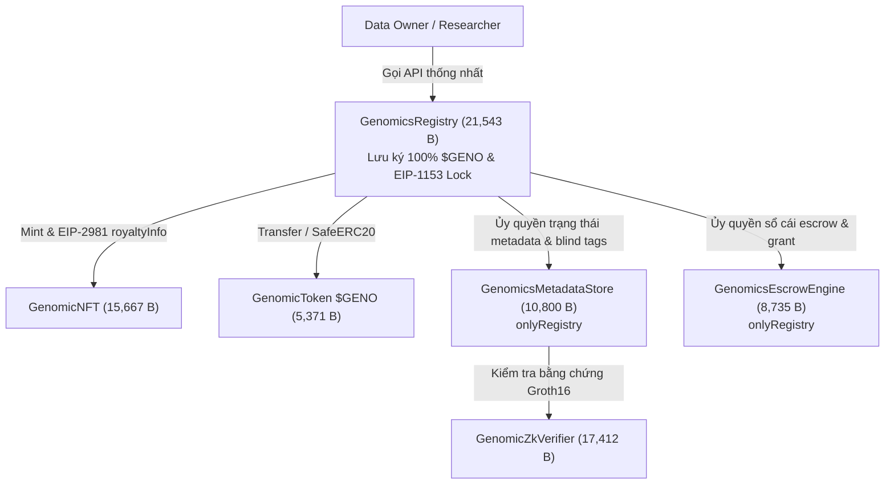
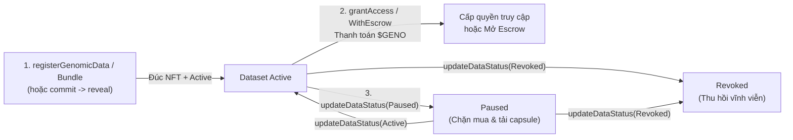
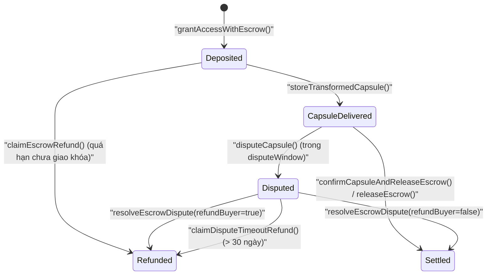
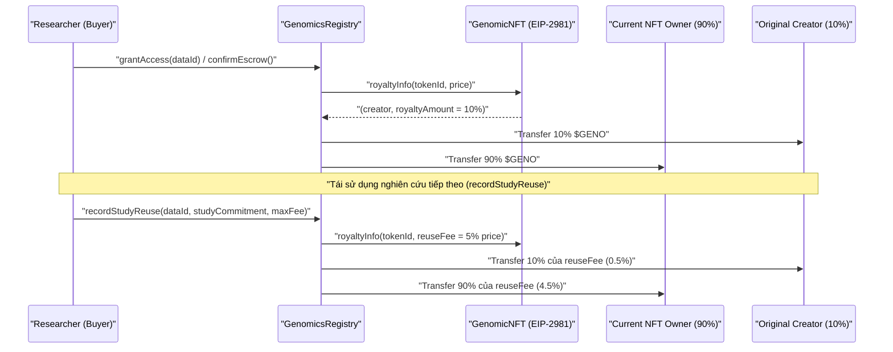
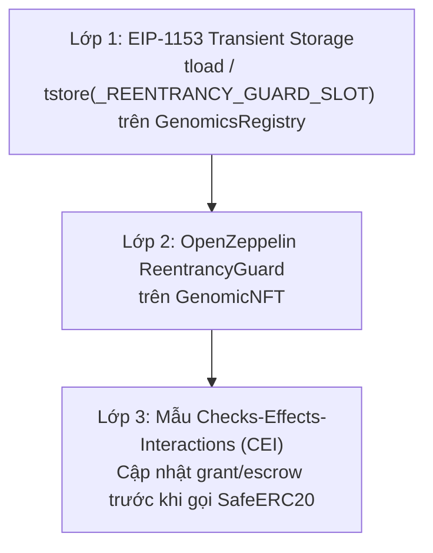

# Báo Cáo Đối Chiếu Đề Bài & Kiểm Định Smart Contracts (Bài Tập 06)

> **Phạm vi:** Phần 1 — Smart Contracts, Tokenomics & Deploy (`contracts/GenomicsRegistry.sol`, `contracts/GenomicToken.sol`, `contracts/GenomicNFT.sol`, các mô-đun `contracts/registry/`, và `scripts/deploy/`)  
> **Chuẩn biên dịch:** `solc 0.8.24`, `evmVersion: "cancun"`, `viaIR: true`, `optimizer.runs: 200`  
> **Liên kết audit toàn repo:** Xem thêm [FULL_REPO_SECURITY_AND_LOGIC_AUDIT.md](../FULL_REPO_SECURITY_AND_LOGIC_AUDIT.md)

---

## 1. Bảng Đối Chiếu 1-1 Yêu Cầu Đề Bài (Tiêu Chí 1 & Tiêu Chí 4)

### 1.1. Tiêu chí 1: Xây dựng & Triển khai Hợp đồng thông minh

| Yêu cầu đề bài | Hiện thực trong mã nguồn | Vị trí chính xác | Kiểm thử xác nhận |
| :--- | :--- | :--- | :--- |
| **`registerGenomicData()`** — Đăng ký hash dữ liệu DNA kèm đặc điểm kiểu hình (CID Metadata JSON) | Đăng ký `rawDataHash`, 3 CID IPFS (`rawCid`, `summaryCid`, `metadataCid`), giá `$GENO`, thời hạn, royalty EIP-2981 và đúc `GenomicNFT`; biến thể `registerGenomicDataBundle()` neo đủ 3 hash + blind tags; biến thể Commit-Reveal chống front-running. | [GenomicsRegistry.sol](../../contracts/GenomicsRegistry.sol#L474-L508) | [RubricAndSecurityAudit.test.js](../../test/RubricAndSecurityAudit.test.js) (Nhóm 1) |
| **`grantAccess()`** — Cấp quyền truy cập cho ví nhà nghiên cứu sau khi thanh toán | Thu đủ `$GENO`, ghi nhận giấy phép có thời hạn `accessDuration`, tách dòng tiền theo EIP-2981; có overload `grantAccess(dataId, maxPrice)` chống trượt giá MEV; biến thể `grantAccessWithEscrow()` giữ ký quỹ an toàn. | [GenomicsRegistry.sol](../../contracts/GenomicsRegistry.sol#L600-L659) | [RubricAndSecurityAudit.test.js](../../test/RubricAndSecurityAudit.test.js) (Nhóm 1, 3) |
| **`updateDataStatus()`** — Tạm dừng chia sẻ hoặc thu hồi quyền bất cứ lúc nào | Cho phép chủ sở hữu NFT chuyển `Active <-> Paused` và `Revoked` (thu hồi vĩnh viễn không thể khôi phục qua `ConsentPermanentlyRevoked`). | [GenomicsRegistry.sol](../../contracts/GenomicsRegistry.sol#L816-L822) | [RubricAndSecurityAudit.test.js](../../test/RubricAndSecurityAudit.test.js) (Nhóm 1) |
| **Ràng buộc 1 — Bảo mật quyền hạn** | Modifier `onlyMutableDataOwner(dataId)` kiểm tra trực tiếp `ERC721.ownerOf(tokenId)` hiện tại cho `updateDataPrice()`, `updateDataStatus()`, `grantDirectAccess()`. Người lạ hoặc chủ cũ sau chuyển nhượng bị chặn bằng `NotDataOwner()`. | [GenomicsRegistry.sol](../../contracts/GenomicsRegistry.sol#L816-L850) | [RubricAndSecurityAudit.test.js](../../test/RubricAndSecurityAudit.test.js) (Nhóm 2) |
| **Ràng buộc 2 — Kiểm tra tính hợp lệ thanh toán** | `_validatePurchase()` kiểm tra dữ liệu `Active`, chặn tự mua (`OwnerCannotBuyOwnData`), kiểm tra `maxPrice` (`PriceExceedsMax`), và `SafeERC20.safeTransferFrom` bắt buộc người mua đủ số dư & `approve` `$GENO`. | [GenomicsRegistry.sol](../../contracts/GenomicsRegistry.sol#L613-L622) | [RubricAndSecurityAudit.test.js](../../test/RubricAndSecurityAudit.test.js) (Nhóm 2) |

### 1.2. Tiêu chí 4: Tạo & Triển khai Token ERC-20 / NFT

| Yêu cầu đề bài | Hiện thực trong mã nguồn | Vị trí chính xác | Kiểm thử xác nhận |
| :--- | :--- | :--- | :--- |
| **ERC-20 (`GenomicToken` / `$GENO`)** | Token thanh toán chuẩn `ERC20` + `ERC20Burnable` + `Ownable2Step`, trần cung cứng `MAX_TOTAL_SUPPLY = 100,000,000 $GENO`, faucet có cooldown 1 giờ + khóa chống spam EIP-1153 + chế độ voucher ECDSA cho mạng công khai. | [GenomicToken.sol](../../contracts/GenomicToken.sol#L23-L249) | [RubricAndSecurityAudit.test.js](../../test/RubricAndSecurityAudit.test.js) (Nhóm 4) |
| **NFT (`GenomicNFT` / `GNFT`)** | Mỗi bộ dữ liệu tương ứng 1 NFT duy nhất (`ERC721URIStorage`), lưu trữ thông tin CID và `rawDataHash`, chỉ duy nhất `GenomicsRegistry` được đúc (`OnlyRegistry`), kiểm tra định dạng CID & JSON capsule. | [GenomicNFT.sol](../../contracts/GenomicNFT.sol#L165-L315) | [RubricAndSecurityAudit.test.js](../../test/RubricAndSecurityAudit.test.js) (Nhóm 4) |
| **Payment & EIP-2981 Royalty + Reuse 5%** | `_settleRoyaltyPayment()` tự động chia doanh thu theo `royaltyInfo(tokenId, amount)` (mặc định 90% chủ sở hữu NFT hiện tại / 10% tác giả gốc). Hàm `recordStudyReuse()` thu thêm phí tái sử dụng 5% (`REUSE_FEE_BPS = 500`) kèm chống trượt giá và chống ghi nhận trùng biên lai. | [GenomicsRegistry.sol](../../contracts/GenomicsRegistry.sol#L1303-L1363) | [RubricAndSecurityAudit.test.js](../../test/RubricAndSecurityAudit.test.js) (Nhóm 4) |

---

## 2. Kiến Trúc Phân Tách Mô-Đun (Tuân Thủ Trần 24 KB EIP-170)

Ethereum giới hạn kích thước runtime bytecode mỗi hợp đồng tối đa `24,576 bytes` (EIP-170). Để tích hợp đầy đủ Registry, Commit-Reveal, Escrow, Trọng tài tranh chấp, Blind Tags và ZK Bridge mà vẫn giữ ABI thống nhất cho Frontend, `GenomicsRegistry` được thiết kế theo mô hình **Facade + 2 Child Modules** với một bất biến quan trọng: **100% tiền ký quỹ `$GENO` chỉ lưu giữ tại `GenomicsRegistry`**.

- **`GenomicsMetadataStore` (10,800 B):** Lưu bản ghi metadata gọn, hash tài liệu (PDF + JSON), khóa công khai nhà nghiên cứu, blind tags và cam kết commit-reveal. Mọi hàm ghi đều gắn `onlyRegistry`.
- **`GenomicsEscrowEngine` (8,735 B):** Quản lý bảng ghi ký quỹ `EscrowDeposit`, thời hạn `accessGrants`, và kho chứa `buyerCapsules`. Hợp đồng này **không giữ bất kỳ đồng `$GENO` nào** — toàn bộ việc chuyển tiền nằm ở `GenomicsRegistry`.
- **Lợi ích:** Tổng headroom còn lại của `GenomicsRegistry` là **`3,033 bytes`** dưới ngưỡng EIP-170, đồng thời giảm thiểu diện tích tấn công tài chính về duy nhất một hợp đồng lưu ký.

---

## 3. Sơ Đồ Luồng Nghiệp Vụ & Bảo Mật

### 3.1. Luồng 3 Hàm Cốt Lõi & Commit-Reveal

### 3.2. Máy Trạng Thái Ký Quỹ Escrow & Trọng Tài Tranh Chấp

### 3.3. Luồng Thanh Toán `$GENO`, Bản Quyền EIP-2981 & Phí Tái Sử Dụng 5%

### 3.4. Cơ Chế Chống Reentrancy 3 Lớp

---

## 4. Tổng Hợp 7 Tình Huống Biên (Edge Cases) Đã Rà Soát

| # | Tình huống biên | Cơ chế xử lý trong hợp đồng | Tham chiếu kiểm chứng |
| :--- | :--- | :--- | :--- |
| **1** | Chuyển nhượng `GenomicNFT` khi hợp đồng ký quỹ (Escrow) đang mở | Escrow giải ngân cho `dep.seller` đã ghi nhận tại thời điểm ký quỹ, không trả cho người mua NFT sau này để tránh chiếm đoạt doanh thu giao dịch trước khi chuyển nhượng. | [EscrowGuarantee.test.js](../../test/adversarial/agent2/EscrowGuarantee.test.js#L110) (`A2-E03`) |
| **2** | Chuyển nhượng `GenomicNFT` làm lộ quyền worker ủy quyền cũ | Callback `resetAuthorizedWorkersForToken()` tự động tăng `workerEpoch`, vô hiệu hóa toàn bộ worker cũ với chi phí `O(1)`. | [GenomicNFT.sol](../../contracts/GenomicNFT.sol#L697-L699) |
| **3** | Phí tái sử dụng 5% (`recordStudyReuse`) với giá nhỏ hoặc bị front-run tăng giá | Ép tối thiểu `1 wei` để tránh làm tròn về `0`, kiểm tra `reuseFee <= maxFee` (`PriceExceedsMax`), và khóa `studyCommitments` chống ghi nhận trùng biên lai (`StudyReuseAlreadyRecorded`). | [GenomicsRegistry.sol](../../contracts/GenomicsRegistry.sol#L1317-L1332) |
| **4** | Faucet `$GENO` bị bot hoặc hợp đồng nhà máy gọi hàng loạt | Chặn địa chỉ có bytecode (`extcodesize == 0`), khóa EIP-1153 1 lần/tx, cooldown 1 giờ 2 chiều (`msg.sender` và `to`), giới hạn theo giờ (`50,000 $GENO`) và cho phép bật chế độ ECDSA voucher (`claimFaucetWithVoucher`). | [GenomicToken.sol](../../contracts/GenomicToken.sol#L163-L249) |
| **5** | Chủ dữ liệu đặt `royaltyBps` quá cao để chiếm toàn bộ thanh toán | `GenomicNFT` giới hạn cứng `MAX_ROYALTY_BPS = 5000` (50%), và `_settleRoyaltyPayment()` kẹp `royaltyAmount <= totalPrice` chống tràn trừ. | [GenomicsRegistry.sol](../../contracts/GenomicsRegistry.sol#L1353) |
| **6** | Trọng tài bỏ quên vụ tranh chấp Escrow (hoặc khóa quyền quản trị) | Sau `DISPUTE_ARBITRATION_TIMEOUT = 30 days` kể từ lúc ký quỹ/tranh chấp, người mua được tự động rút lại `100% $GENO` qua `claimDisputeTimeoutRefund()`. | [GenomicsRegistry.sol](../../contracts/GenomicsRegistry.sol#L754-L758) |
| **7** | Dữ liệu đang `Paused` hoặc bị `Revoked` vĩnh viễn | Mọi đường mua mới, giao khóa, đọc khóa, chỉnh giá đều bị chặn đối xứng (`DataNotActive`); `Revoked` khóa cứng chuyển trạng thái ngược lại qua `ConsentPermanentlyRevoked()`. | [RubricAndSecurityAudit.test.js](../../test/RubricAndSecurityAudit.test.js) (Nhóm 1) |

---

## 5. Kết Quả Kiểm Định Thực Tế Trên Workspace

Tất cả công cụ dưới đây được chạy trực tiếp trên mã nguồn hiện tại sau khi hoàn tất Commit 1–4:

| Công cụ / Bộ kiểm thử | Lệnh thực thi | Kết quả thực tế | Trạng thái |
| :--- | :--- | :--- | :---: |
| **Solhint Linter** | `npm run lint:sol` (`--max-warnings 0`) | `0` errors, `0` warnings trên toàn bộ `contracts/**/*.sol` | **PASS** |
| **EIP-170 & EIP-3860 Size** | `python scripts/audit/check_eip170.py` | 7/7 hợp đồng đạt chuẩn (`GenomicsRegistry`: `21,543 / 24,576 B`, dư `3,033 B`) | **PASS** |
| **Slither Static Analysis** | `python scripts/audit/parse_slither.py docs/reports/slither_latest.json` | `0` High, `0` Medium trong toàn bộ `contracts/` sản xuất | **PASS** |
| **Post-Deploy Verification** | `npx hardhat run scripts/deploy/verify_deployment.js --network localhost` | Kiểm tra node local (`chainId=31337`): `failures=0, warnings=0` | **PASS** |
| **Rubric & Security Audit Tests** | `npx hardhat test test/RubricAndSecurityAudit.test.js` | `13 passing` (bao phủ trọn Nhóm 1–5) | **PASS** |
| **Full Hardhat Test Suite** | `npm test` | **`514 passing`** (`501` test gốc + `13` test đối chiếu đề bài) | **PASS** |
