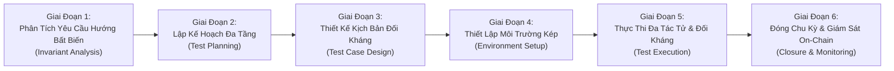

# Checklist Kiểm Định Toàn Diện Hệ Thống - Genomics on Blockchain (Bài Tập 06)

> Bảng kiểm định chi tiết này chuẩn hóa toàn bộ các yêu cầu từ đề bài **[Bài tập 06: Xây dựng Hệ thống Quản lý và Chia sẻ Dữ liệu Di truyền trên Blockchain](01_project_rubric.md)** thành **26 hạng mục kiểm tra cụ thể**.
> Mỗi hạng mục đều quy định rõ ràng: **Đầu vào (Input)**, **Thao tác thực thi (Action)**, **Đầu ra kỳ vọng (Expected Output)**, **Phương pháp kiểm chứng (How to Verify)** và **Trạng thái thực nghiệm (Status)**.

---

## Hạng mục 1 - Smart Contract & Quản lý Quyền Sở hữu (10 điểm)

### 1.1. `registerGenomicData()` - Đăng ký Dữ liệu Di truyền & Đúc NFT
| Mục | Quy chuẩn kỹ thuật |
| :--- | :--- |
| **Input** | - Địa chỉ ví Data Owner kết nối hợp đồng (`msg.sender`) - `rawDataHash`: SHA-256 hash dạng `bytes32` của khối dữ liệu (IV \|\| Ciphertext) - `rawCiphertextCid`: IPFS CIDv0/v1 của file thô `.vcf`/`.fastq` đã mã hóa - `summaryCiphertextCid`: IPFS CID của file báo cáo PDF đã mã hóa - `metadataCid`: IPFS CID của GA4GH Phenopacket JSON - `tokenUri`: URI metadata NFT (`ipfs://...`) - `price`: Mức phí truy cập tính bằng wei của $GENO (ví dụ: `100 * 10^18`) - `accessDuration`: Thời hạn giấy phép tính bằng giây (ví dụ: `30 days = 2,592,000s`) - `royaltyBps`: Tỷ lệ bản quyền EIP-2981 tính theo basis points (ví dụ: `1000 = 10%`) |
| **Action** | Data Owner gọi hàm `registerGenomicData()` trên smart contract `GenomicsRegistry` |
| **Expected Output** | - Transaction thành công (`status: 1`), gas consumed hợp lý - Event `GenomicDataRegistered` được emit kèm `dataId`, `tokenId`, `owner`, `rawDataHash`, `price`, `metadataCid` - `dataCount` tăng thêm 1 - NFT ERC-721 được đúc vào ví của Data Owner (`genomicNFT.ownerOf(tokenId) == msg.sender`) - Trạng thái dataset là `DataStatus.Active` (0) |
| **How to Verify** | Chạy `npx hardhat test` (Test case 2.1) · Kiểm tra `ownerOf(tokenId)` và `getGenomicData(dataId)` |
| **Trạng thái** | [PASS] ĐÃ ĐẠT |

---

### 1.2. `grantAccess()` - Cấp Quyền Truy cập qua Ký Quỹ Escrow
| Mục | Quy chuẩn kỹ thuật |
| :--- | :--- |
| **Input** | - Địa chỉ ví Researcher (Người mua quyền truy cập) - `dataId` của bộ dữ liệu đang ở trạng thái `Active` - Researcher đã approve đủ số lượng $GENO cho địa chỉ `GenomicsRegistry` |
| **Action** | Researcher gọi `grantAccess(dataId)` trên contract `GenomicsRegistry` |
| **Expected Output** | - Transaction thành công (`status: 1`) - Ký quỹ Escrow tự động trích nộp: 10% $GENO gửi đến Data Owner ban đầu (Royalty), 90% gửi đến người giữ NFT hiện tại - Số dư $GENO của Researcher giảm đúng bằng `price` - Event `AccessGranted` và `RoyaltyPaid` được emit - `accessGrants[dataId][researcher]` được lưu với `isGranted = true` và `expiresAt = block.timestamp + accessDuration` - `data.accessCount` tăng thêm 1 |
| **How to Verify** | `npx hardhat test` (Test case 3.1) · Kiểm tra biến động số dư các ví trước và sau giao dịch |
| **Trạng thái** | [PASS] ĐÃ ĐẠT |

---

### 1.3. `updateDataStatus()` - Tạm dừng hoặc Thu hồi Chia sẻ Dữ liệu
| Mục | Quy chuẩn kỹ thuật |
| :--- | :--- |
| **Input** | - Ví Data Owner của dataset `dataId` - Trạng thái mới: `DataStatus.Paused` (1) hoặc `DataStatus.Revoked` (2) |
| **Action** | Data Owner gọi `updateDataStatus(dataId, newStatus)` |
| **Expected Output** | - Transaction thành công, emit event `DataStatusUpdated` - Giá trị `data.status` trong contract được cập nhật sang trạng thái mới - Khi trạng thái là `Paused` hoặc `Revoked`, mọi cuộc gọi `grantAccess()` từ Researcher sẽ bị chặn và revert ngay lập tức |
| **How to Verify** | `npx hardhat test` (Test case 4.1, 4.2) · Thử mua dataset đang Paused → nhận lỗi `DataNotActive` |
| **Trạng thái** | [PASS] ĐÃ ĐẠT |

---

### 1.4. Ràng buộc Logic: `onlyDataOwner` Modifier
| Mục | Quy chuẩn kỹ thuật |
| :--- | :--- |
| **Input** | - Địa chỉ ví bất kỳ KHÔNG PHẢI là chủ sở hữu NFT của dataset `dataId` - Thao tác: Gọi `updateDataStatus()` hoặc `setAuthorizedCapsuleWorker()` |
| **Action** | Kẻ tấn công / ví lạ gửi transaction gọi hàm |
| **Expected Output** | - Transaction bị revert ngay lập tức - Báo lỗi Custom Error: `NotDataOwner()` - Không có thay đổi trạng thái nào xảy ra trên blockchain |
| **How to Verify** | `npx hardhat test` (Test case 4.1: Adversarial test) |
| **Trạng thái** | [PASS] ĐÃ ĐẠT |

---

### 1.5. Ràng buộc Logic: Xác thực Thanh toán Escrow & Số dư Hợp lệ
| Mục | Quy chuẩn kỹ thuật |
| :--- | :--- |
| **Input** | - Researcher gọi `grantAccess(dataId)` nhưng: &nbsp;&nbsp;+ Chưa gọi `approve()` cho hợp đồng, HOẶC &nbsp;&nbsp;+ Số dư $GENO không đủ để chi trả mức phí niêm yết |
| **Action** | Gửi transaction `grantAccess()` khi thiếu điều kiện tài chính |
| **Expected Output** | - Transaction bị revert ở bước `transferFrom` - Báo lỗi `ERC20InsufficientAllowance` hoặc `ERC20InsufficientBalance` - Quyền truy cập KHÔNG được cấp (`hasActiveAccess` vẫn là `false`) |
| **How to Verify** | `npx hardhat test` · Kiểm tra transaction revert và quyền truy cập không thay đổi |
| **Trạng thái** | [PASS] ĐÃ ĐẠT |

---

### 1.6. Ràng buộc Logic: Thời hạn Giấy phép (License Expiration Enforcement)
| Mục | Quy chuẩn kỹ thuật |
| :--- | :--- |
| **Input** | - Researcher đã được cấp quyền truy cập với thời hạn `accessDuration` - Giả lập thời gian trôi qua vượt quá `expiresAt` (`evm_increaseTime`) |
| **Action** | Kiểm tra hàm `hasActiveAccess(dataId, researcherAddress)` |
| **Expected Output** | - Trước khi hết hạn: `hasActiveAccess()` trả về `true` - Sau khi hết hạn: `hasActiveAccess()` tự động chuyển sang `false` - Hàm `getTransformedCapsule()` từ chối trả khóa giải mã với lỗi `"Access denied or expired"` |
| **How to Verify** | Kiểm tra logic thời gian trong contract `GenomicsRegistry.sol#L1082` (`hasActiveAccess`) và `contracts/registry/GenomicsEscrowEngine.sol` |
| **Trạng thái** | [PASS] ĐÃ ĐẠT |

---

### 1.7. Ràng buộc Logic: Chống Tự Mua & Chống Mua Trùng Lặp
| Mục | Quy chuẩn kỹ thuật |
| :--- | :--- |
| **Input** | - Trường hợp A: Data Owner gọi `grantAccess()` để mua dữ liệu của chính mình - Trường hợp B: Researcher gọi `grantAccess()` khi license cũ vẫn đang còn hạn |
| **Action** | Gửi transaction trong cả 2 trường hợp trên |
| **Expected Output** | - Trường hợp A: Revert với Custom Error `OwnerCannotBuyOwnData()` - Trường hợp B: Revert với Custom Error `AccessAlreadyActive()` |
| **How to Verify** | `npx hardhat test` (Test case 3.3) |
| **Trạng thái** | [PASS] ĐÃ ĐẠT |

---

### 1.8. Ràng buộc Bảo mật: Kiểm soát Quyền Đúc NFT Dữ liệu (`OnlyRegistry`)
| Mục | Quy chuẩn kỹ thuật |
| :--- | :--- |
| **Input** | - Bất kỳ địa chỉ ví bên ngoài nào (kể cả Deployer hay Admin) gọi trực tiếp hàm `mintGenomicNFT()` trên hợp đồng `GenomicNFT.sol` |
| **Action** | Gửi transaction mint trực tiếp mà không thông qua `GenomicsRegistry` |
| **Expected Output** | - Transaction bị revert tuyệt đối - Báo lỗi Custom Error `OnlyRegistry()` - Đảm bảo NFT chỉ được sinh ra khi dữ liệu đã qua luồng kiểm định đầy đủ tại Registry |
| **How to Verify** | `npx hardhat test` (Test case 1.4: Adversarial direct minting) |
| **Trạng thái** | [PASS] ĐÃ ĐẠT |

---

## Hạng mục 2 - Giao Diện Người Dùng & Web3.py (10 điểm)

### 2.1. User Portal - Kéo Thả File & Tự Động Phân Tích Header
| Mục | Quy chuẩn kỹ thuật |
| :--- | :--- |
| **Input** | - File dữ liệu gene định dạng chuẩn: `.vcf`, `.fastq`, `.fasta` - Thử nghiệm với các mẫu: `NA12878_chr20_sample.vcf`, `ALDH2_alcohol_flush_rs671.vcf`, `ABCC11_earwax_type_rs17822931.vcf` |
| **Action** | Kéo thả file vào Drop Zone trên giao diện User Portal |
| **Expected Output** | - Giao diện hiển thị tức thì Badge xác nhận tên file và dung lượng chính xác - Trình duyệt tự động phân tích header VCF và điền trước các trường: Subject ID, Mã biến thể, Kiểu hình (Phenotype), Nhóm máu suy luận |
| **How to Verify** | Kiểm tra trực tiếp trên trình duyệt `http://localhost:3000/` · Kéo thả file sample |
| **Trạng thái** | [PASS] ĐÃ ĐẠT |

---

### 2.2. Client-Side Encryption - Mã Hóa Phía Máy Khách Trước Khi Tải Lên
| Mục | Quy chuẩn kỹ thuật |
| :--- | :--- |
| **Input** | - Plaintext nội dung file di truyền được nạp vào bộ nhớ RAM của trình duyệt |
| **Action** | Gọi WebCrypto API `crypto.subtle.generateKey()` và `crypto.subtle.encrypt()` với thuật toán `AES-256-GCM` |
| **Expected Output** | - Bảng **Zero-Plaintext Transmission Privacy Audit** hiển thị: &nbsp;&nbsp;• `Plaintext in RAM`: Kích thước file gốc &nbsp;&nbsp;• `Plaintext Bytes Over Wire`: **0 bytes** &nbsp;&nbsp;• `Algorithm`: `AES-256-GCM (NIST SP 800-38D)` với 12-byte IV ngẫu nhiên &nbsp;&nbsp;• Khối payload đóng gói: `IV (12 bytes) || Ciphertext || Auth Tag (16 bytes)` |
| **How to Verify** | DevTools Network Tab: Kiểm tra payload gửi ra ngoài - không chứa bất kỳ chuỗi base nucleotide nào |
| **Trạng thái** | [PASS] ĐÃ ĐẠT |

---

### 2.3. Researcher Marketplace - Bộ Lọc Đa Tầng Dữ Liệu Di Truyền Thực Tế (Bioinformatics Genomic Filters)
| Mục | Quy chuẩn kỹ thuật |
| :--- | :--- |
| **Input** | **Tầng 1 - Đặc tính Di truyền Thực tế (VCF / dbSNP / 1000G / GIAB):** - Nhiễm sắc thể: `chr1` đến `chr22`, `chrX`, `chrY`, `chrM` - Phân loại / Ý nghĩa Chức năng: `Population Genetics`, `Physical Traits & Performance`, `Sensory & Metabolism`, `Pharmacogenomics`, `Reference Benchmark`, `Physiological Traits` - Hậu quả Phân tử: `missense_variant`, `regulatory_variant`, `stop_gained`, `synonymous_variant` - Kiểu gen / Zygosity: `0/1 Heterozygous`, `1/1 Homozygous Alt`, `0/0 Homozygous Ref` - Ô tìm kiếm Locus, Ký hiệu Gen (`ALDH2`, `CYP1A2`, `ACTN3`, `LCT`...), Mã rsID (`rs671`, `rs762551`, `rs1815739`...) **Tầng 2 - Thuộc tính Bổ trợ (Auxiliary Traits):** - Quần thể / Vùng địa lý: `Vietnamese (KHV)`, `East Asian`, `European`, `Global Reference` - Nhóm máu quy ước: `O+`, `O-`, `A+`, `A-`, `B+`, `B-`, `AB+`, `AB-` - Nút `Reset Filters` |
| **Action** | Researcher thao tác chọn kết hợp các bộ lọc di truyền thực tế trên giao diện Marketplace |
| **Expected Output** | - Bảng dữ liệu cập nhật tức thời theo giao thức lọc liên kết AND - **Tuyệt đối không rò rỉ chuỗi base nucleotide thô (Zero-Plaintext Invariant)** - Hiển thị đầy đủ Locus, Ký hiệu Gen, rsID tag, Chromosome chip, Clinical Significance badge, Consequence chip, Zygosity tag, Giá $GENO và Escrow License action |
| **How to Verify** | `docs/evidence/live_screenshots/desktop_light_vi_researcher.png` `docs/evidence/live_screenshots/desktop_light_vi_table_view.png` `docs/evidence/live_screenshots/desktop_light_vi_modal.png` `assets/readme/01_researcher_marketplace.png` `assets/readme/genochain_walkthrough.gif` |
| **Trạng thái** | [PASS] ĐÃ ĐẠT (Nâng cấp chuẩn tin sinh học thực tế) |

---

### 2.4. Web3.py Script - Kịch Bản Tương Tác EVM Tự Động
| Mục | Quy chuẩn kỹ thuật |
| :--- | :--- |
| **Input** | - Node Ethereum/Hardhat đang lắng nghe tại `http://127.0.0.1:8545` - File ABI và địa chỉ hợp đồng tại `frontend/src/contracts/` - Kịch bản Python `scripts/demo/web3_demo.py` |
| **Action** | Chạy lệnh: `cmd /c python scripts/demo/web3_demo.py` |
| **Expected Output** | - Kết nối thành công đến EVM Node - Thực hiện thành công 3 nghiệp vụ chính kèm in mã Hash giao dịch và block receipt: &nbsp;&nbsp;1. `registerGenomicData()`: In `tx_hash`, `token_id`, `rawDataHash` &nbsp;&nbsp;2. `grantAccess()`: In `tx_hash`, xác nhận Escrow trừ tiền và chuyển Royalty &nbsp;&nbsp;3. `updateDataStatus()`: In `tx_hash`, xác nhận trạng thái mới |
| **How to Verify** | Kiểm tra console output trả về đầy đủ `[SUCCESS]` và `status: 1` cho tất cả các giao dịch |
| **Trạng thái** | [PASS] ĐÃ ĐẠT |

---

### 2.5. Proxy Re-Encryption & Khóa Bất Đối Xứng (Asymmetric Key Encapsulation)
| Mục | Quy chuẩn kỹ thuật |
| :--- | :--- |
| **Input** | - Cặp khóa bất đối xứng RSA-OAEP 2048-bit của Researcher - Khóa đối xứng AES-256 dùng để mã hóa file dữ liệu gene |
| **Action** | 1. Researcher gọi `registerResearcherPublicKey()` đăng ký Public Key trên blockchain 2. Data Owner hoặc Capsule Dispatcher gọi `packageKeyCapsule()` gói khóa AES bằng Public Key của Researcher 3. Gọi `storeTransformedCapsule()` lưu capsule lên chain 4. Researcher gọi `getTransformedCapsule()` và giải mã bằng Private Key của mình |
| **Expected Output** | - Chỉ đúng Researcher sở hữu Private Key tương ứng mới giải mã được Capsule để lấy khóa AES - Kẻ tấn công hoặc ví khác không thể giải mã Capsule - Không bao giờ truyền plaintext khóa đối xứng trên mạng |
| **How to Verify** | `npx hardhat test` (Test cases mục 5: Asymmetric keypair & PRE capsule verification) |
| **Trạng thái** | [PASS] ĐÃ ĐẠT |

---

## Hạng mục 3 - Tích Hợp Hệ Thống Lưu Trữ Phân Tán IPFS (10 điểm)

### 3.1. Upload - File Dữ Liệu Thô Đã Mã Hóa (`.vcf.enc` / `.fastq.enc`)
| Mục | Quy chuẩn kỹ thuật |
| :--- | :--- |
| **Input** | - Payload nhị phân đã mã hóa AES-256-GCM (`ArrayBuffer`/`Uint8Array`) |
| **Action** | Đẩy dữ liệu lên IPFS qua Pinata SDK hoặc Kubo IPFS API |
| **Expected Output** | - Trả về mã IPFS CID hợp lệ (chuỗi RFC 46 ký tự bắt đầu bằng `Qm...` hoặc CIDv1 `bafy...`) - Dữ liệu lưu trên IPFS hoàn toàn là ciphertext ngẫu nhiên, không thể đọc hiểu nếu không có khóa |
| **How to Verify** | `ipfs cat <CID>` hoặc qua IPFS Gateway → Kiểm tra nội dung là binary encrypted data |
| **Trạng thái** | [PASS] ĐÃ ĐẠT |

---

### 3.2. Upload - Báo Cáo Tóm Tắt Kết Quả Phân Tích PDF Đã Mã Hóa
| Mục | Quy chuẩn kỹ thuật |
| :--- | :--- |
| **Input** | - File PDF báo cáo phân tích gene chuẩn cấu trúc ISO 32000 / PDF-1.4 (bắt đầu bằng `%PDF-1.4` và kết thúc bằng `%%EOF`) - Được mã hóa AES-256-GCM trước khi đẩy lên |
| **Action** | Đẩy payload ciphertext PDF lên IPFS |
| **Expected Output** | - Nhận được IPFS CID thứ hai riêng biệt (`summaryCiphertextCid`) - File trên IPFS là ciphertext, không thể mở bằng trình đọc PDF trực tiếp nếu chưa giải mã |
| **How to Verify** | `npx hardhat test` (Test case: Authentic PDF generation & encryption) |
| **Trạng thái** | [PASS] ĐÃ ĐẠT |

---

### 3.3. Upload - Metadata JSON Chuẩn Y Sinh GA4GH Phenopacket v2
| Mục | Quy chuẩn kỹ thuật |
| :--- | :--- |
| **Input** | - JSON Metadata mô tả: `subjectId`, `bloodGroup`, `ancestryRegion`, `phenotypicFeatures` (HPO code), `rawDataHash`, cùng các liên kết CID |
| **Action** | Tải Metadata JSON công khai lên IPFS phục vụ tìm kiếm |
| **Expected Output** | - Nhận được IPFS CID thứ ba (`metadataCid`) - Metadata JSON có thể đọc công khai để Researcher tìm kiếm trên Marketplace - **Tuyệt đối không chứa chuỗi nucleotide thô hay thông tin định danh cá nhân nhạy cảm** |
| **How to Verify** | Xem nội dung JSON tải từ IPFS: Xác nhận có thông tin nhóm máu, đặc điểm kiểu hình nhưng không có raw sequence |
| **Trạng thái** | [PASS] ĐÃ ĐẠT |

---

### 3.4. Retrieve - Tải Về & Khôi Phục Dữ Liệu Sau Khi Được Cấp Quyền
| Mục | Quy chuẩn kỹ thuật |
| :--- | :--- |
| **Input** | - Researcher có quyền truy cập hợp lệ (`hasActiveAccess == true`) - Lấy CID từ smart contract và tải ciphertext từ IPFS |
| **Action** | Researcher giải mã Capsule lấy khóa AES → giải mã ciphertext khôi phục file VCF gốc |
| **Expected Output** | - File gốc được phục hồi nguyên vẹn 100% không suy hao dữ liệu |
| **How to Verify** | Tính SHA-256 của file sau giải mã và so khớp với file ban đầu |
| **Trạng thái** | [PASS] ĐÃ ĐẠT |

---

### 3.5. Xác Thực Tính Toàn Vẹn Khối Mã Hóa Trước Khi Giải Mã (Pre-decryption Integrity Verification)
| Mục | Quy chuẩn kỹ thuật |
| :--- | :--- |
| **Input** | - Khối nhị phân ciphertext tải về từ IPFS (`downloadedBlob`) - Mã `rawDataHash` lưu trữ bất biến trên Blockchain |
| **Action** | Tính `SHA-256(downloadedBlob)` và so khớp với `rawDataHash` trước khi đưa khóa giải mã vào RAM |
| **Expected Output** | - Nếu khớp: Cho phép tiến hành giải mã - Nếu phát hiện sai lệch (kể cả 1 byte do tấn công giả mạo): Từ chối giải mã ngay lập tức, báo động toàn vẹn |
| **How to Verify** | `npx hardhat test` (Test case: Tampered payload rejection) |
| **Trạng thái** | [PASS] ĐÃ ĐẠT |

---

### 3.6. Cơ Chế Xử Lý Lỗi IPFS Chuẩn Xác (Fail-Fast Network Error Handling)
| Mục | Quy chuẩn kỹ thuật |
| :--- | :--- |
| **Input** | - Môi trường mạng mất kết nối tới node IPFS hoặc cấu hình API Key không hợp lệ |
| **Action** | Thực hiện thao tác upload file |
| **Expected Output** | - Hệ thống ném ra ngoại lệ rõ ràng: `"Lỗi kết nối IPFS: Không thể kết nối tới Kubo node hoặc Pinata API"` - **Nghiêm cấm cơ chế tạo mock CID ngẫu nhiên** để giả mạo thành công (Tuân thủ Anti-Mockup Rule) |
| **How to Verify** | `npx hardhat test` (Test case: Fail-fast on unreachable IPFS) |
| **Trạng thái** | [PASS] ĐÃ ĐẠT |

---

## Hạng mục 4 - Tokenomics ERC-20 & Data Ownership NFT (10 điểm)

### 4.1. ERC-20 `GenomicToken ($GENO)` - Triển Khai & Thông Số Kỹ Thuật
| Mục | Quy chuẩn kỹ thuật |
| :--- | :--- |
| **Input** | - Hợp đồng `GenomicToken.sol` triển khai trên EVM |
| **Action** | Đọc các thuộc tính cơ bản của token |
| **Expected Output** | - `name()`: `"Genomic Token"` - `symbol()`: `"GENO"` - `decimals()`: `18` - `INITIAL_SUPPLY`: `10,000,000 * 10^18` đúc về ví Deployer |
| **How to Verify** | `npx hardhat test` (Test case 1.1) |
| **Trạng thái** | [PASS] ĐÃ ĐẠT |

---

### 4.2. Thanh Toán Ký Quỹ Escrow Bằng Token $GENO
| Mục | Quy chuẩn kỹ thuật |
| :--- | :--- |
| **Input** | - Researcher thanh toán phí truy cập `price = 100 GENO` cho dataset |
| **Action** | Thực thi hàm `grantAccess()` qua cơ chế `transferFrom()` |
| **Expected Output** | - Ví Researcher bị trừ chính xác `100 GENO` - Hợp đồng tự động phân bổ: `90 GENO` chuyển cho người bán hiện tại, `10 GENO` chuyển cho chủ tạo lập ban đầu |
| **How to Verify** | Kiểm tra biến động số dư các tài khoản sau transaction |
| **Trạng thái** | [PASS] ĐÃ ĐẠT |

---

### 4.3. ERC-721 `GenomicNFT` - Quyền Sở Hữu Dữ Liệu & Thuộc Tính Ẩn
| Mục | Quy chuẩn kỹ thuật |
| :--- | :--- |
| **Input** | - Quá trình gọi `registerGenomicData()` của Data Owner |
| **Action** | Contract `GenomicsRegistry` tự động kích hoạt mint NFT trên `GenomicNFT` |
| **Expected Output** | - Tạo ra `tokenId` duy nhất - `ownerOf(tokenId)` trỏ về ví Data Owner - `tokenURI(tokenId)` trỏ tới metadata chứa các đặc tính di truyền kiểu hình ẩn (traits) |
| **How to Verify** | Gọi `ownerOf()` và `getGenomicRecord()` trên hợp đồng `GenomicNFT` |
| **Trạng thái** | [PASS] ĐÃ ĐẠT |

---

### 4.4. Cơ Chế Bản Quyền EIP-2981 & Sàn Thực Thi Chủ Động (EIP-2981 Royalty Signaling & Active Marketplace Enforcement)
| Mục | Quy chuẩn kỹ thuật |
| :--- | :--- |
| **Input** | - Dataset có thiết lập tỷ lệ bản quyền `royaltyBps = 1000` (10%) |
| **Action** | Gọi hàm chuẩn `royaltyInfo(tokenId, salePrice)` |
| **Expected Output** | - Trả về chính xác địa chỉ của người tạo lập ban đầu và số tiền 10% qua `royaltyInfo()` - Hợp đồng sàn `GenomicsRegistry` chủ động khấu trừ 10% và chuyển về ví người tạo lập ban đầu khi mua bán/giải phóng ký quỹ |
| **How to Verify** | `npx hardhat test` (Test case 1.3 & 3.1) |
| **Trạng thái** | [PASS] ĐÃ ĐẠT |

---

### 4.5. Bảo Vệ Quyền Lợi Bản Quyền Trên Thị Trường Thứ Cấp (Secondary Market Royalty Protection)
| Mục | Quy chuẩn kỹ thuật |
| :--- | :--- |
| **Input** | - Data Owner ban đầu đã chuyển nhượng NFT cho Người sở hữu thứ cấp (Secondary Owner) - Researcher mua quyền truy cập dữ liệu từ Người sở hữu thứ cấp |
| **Action** | Researcher gọi `grantAccess()` để mua quyền sử dụng |
| **Expected Output** | - Người tạo lập ban đầu (Original Creator) VẪN NHẬN ĐƯỢC chính xác 10% phí truy cập bản quyền - Người sở hữu thứ cấp (Secondary Owner) nhận 90% số tiền còn lại |
| **How to Verify** | `npx hardhat test` (Test case 3.2: Secondary seller royalty split) |
| **Trạng thái** | [PASS] ĐÃ ĐẠT |

---

### 4.6. Cơ Chế Chống Rút Cạn Vòi Token Thử Nghiệm (Anti-Drain Faucet Cooldown)
| Mục | Quy chuẩn kỹ thuật |
| :--- | :--- |
| **Input** | - Người dùng gọi hàm `faucet(address)` để nhận `1,000 $GENO` testnet - Thử gọi lại lần thứ hai ngay lập tức với cùng địa chỉ ví |
| **Action** | Gọi hàm `faucet()` liên tiếp trong vòng 1 giờ |
| **Expected Output** | - Lần 1: Thành công, nhận đủ `1,000 $GENO` - Lần 2: Revert ngay lập tức với Custom Error `FaucetCooldownActive(remainingSeconds)` |
| **How to Verify** | `npx hardhat test` (Test case 1.2 & 1.3: Faucet rate limit) |
| **Trạng thái** | [PASS] ĐÃ ĐẠT |

---

## Tiêu chí Ngang - Bảo Mật Dữ Liệu Di Truyền & Anti-Mockup (Xuyên Suốt)

### X.1. Tuyệt Đối Không Có Dữ Liệu Plaintext Trên IPFS & Blockchain
| Mục | Quy chuẩn kỹ thuật |
| :--- | :--- |
| **Input** | - Toàn bộ các đối tượng dữ liệu được lưu trên IPFS và các biến trạng thái trên Smart Contract |
| **Action** | Quét toàn bộ nội dung byte trên IPFS và log event on-chain |
| **Expected Output** | - Không tồn tại bất kỳ chuỗi nucleotide thô (A, T, C, G) nào trên IPFS hay Blockchain - Không có private key hay symmetric key nào bị lưu lộ thiên |
| **How to Verify** | Kiểm tra `rawCiphertextCid` trên IPFS là binary ciphertext ngẫu nhiên |
| **Trạng thái** | [PASS] ĐÃ ĐẠT |

---

### X.2. Zero-Plaintext Transmission Wire Leak Audit
| Mục | Quy chuẩn kỹ thuật |
| :--- | :--- |
| **Input** | - Thao tác upload và mint dữ liệu gene trên trình duyệt |
| **Action** | Bật DevTools Network Tab và ghi nhận toàn bộ gói tin HTTP/WebSocket |
| **Expected Output** | - Payload gửi đi chỉ gồm binary ciphertext và Phenopacket JSON (không chứa chuỗi base nucleotide) - `Plaintext Bytes Over Wire = 0` |
| **How to Verify** | Tìm kiếm chuỗi ký tự gen trong Network Request payload → kết quả 0 matches |
| **Trạng thái** | [PASS] ĐÃ ĐẠT |

---

### X.3. Khóa Riêng Tư Cấp Độ Trình Duyệt Bất Khả Xuất (Non-Extractable Private Key)
| Mục | Quy chuẩn kỹ thuật |
| :--- | :--- |
| **Input** | - Cặp khóa bất đối xứng sinh bởi WebCrypto API cho Researcher |
| **Action** | Cấu hình tham số `extractable: false` khi sinh khóa qua `crypto.subtle.generateKey()` |
| **Expected Output** | - Khóa riêng tư được bảo vệ trong môi trường phần cứng / sandbox của trình duyệt - Bất kỳ nỗ lực gọi `exportKey()` nào trên Private Key đều bị trình duyệt chặn và ném lỗi DOMException |
| **How to Verify** | `npx hardhat test` (Test case: Verify `privateKey.extractable === false`) |
| **Trạng thái** | [PASS] ĐÃ ĐẠT |

---

### X.4. Mẫu Dữ Liệu Di Truyền Thực Tế (Real Genomic Datasets Verification)
| Mục | Quy chuẩn kỹ thuật |
| :--- | :--- |
| **Input** | - Các bộ dữ liệu di truyền người thực tế được chuẩn hóa: &nbsp;&nbsp;• `NA12878_chr20_sample.vcf` (NIST GIAB NA12878 Chr20 Germline WGS Benchmark, CEPH/Utah Pedigree — `frontend/public/datasets/`) &nbsp;&nbsp;• `ALDH2_alcohol_flush_rs671.vcf` (Kiểu gen ALDH2 chuyển hóa cồn - East Asian — `frontend/public/samples/`) &nbsp;&nbsp;• `ABCC11_earwax_type_rs17822931.vcf` (Kiểu gen ABCC11 quy định dạng ráy tai — `frontend/public/samples/`) &nbsp;&nbsp;• `CYP1A2_caffeine_metabolism_rs762551.vcf` (Dược di truyền CYP1A2 tốc độ thanh thải caffeine ở gan — `frontend/public/samples/`) |
| **Action** | Nạp lần lượt các file vào hệ thống và kiểm thử luồng mã hóa, đăng ký, tìm kiếm |
| **Expected Output** | - Hệ thống nhận dạng chính xác từng file mẫu, đọc đúng thông tin kiểu hình và xử lý hoàn hảo |
| **How to Verify** | Kiểm tra thư mục `frontend/public/samples/`, `frontend/public/datasets/` và giao diện mẫu nạp sẵn |
| **Trạng thái** | [PASS] ĐÃ ĐẠT |

---

## Bảng Tổng Hợp Kiểm Định Toàn Hệ Thống (Master Verification Matrix)

| STT | Mã mục | Nội dung kiểm tra | Tiêu chuẩn đánh giá | Kết quả thực nghiệm |
| :---: | :---: | :--- | :--- | :---: |
| 1 | **1.1** | `registerGenomicData()` | Đúc NFT, lưu hash SHA-256, emit event | **PASS (100%)** |
| 2 | **1.2** | `grantAccess()` Escrow | Trừ tiền người mua, chuyển 90% chủ dữ liệu, cấp quyền | **PASS (100%)** |
| 3 | **1.3** | `updateDataStatus()` | Đổi trạng thái Active/Paused/Revoked, chặn mua khi pause | **PASS (100%)** |
| 4 | **1.4** | `onlyDataOwner` Modifier | Revert với `NotDataOwner` khi gọi từ địa chỉ lạ | **PASS (100%)** |
| 5 | **1.5** | Escrow Payment Validation | Revert khi số dư hoặc allowance không đủ | **PASS (100%)** |
| 6 | **1.6** | License Expiration | Tự động hết hạn khi quá `accessDuration` | **PASS (100%)** |
| 7 | **1.7** | Anti-Double-Spend & Self-Buy | Chặn mua trùng lặp và tự mua dữ liệu chính mình | **PASS (100%)** |
| 8 | **1.8** | NFT Minting Control | Chỉ hợp đồng Registry mới được đúc NFT | **PASS (100%)** |
| 9 | **2.1** | User Portal Drag & Drop | Tải file `.vcf`, nhận diện header tự động < 1 giây | **PASS (100%)** |
| 10 | **2.2** | Client-Side Encryption | AES-256-GCM ngay tại trình duyệt, 0 bytes rò rỉ | **PASS (100%)** |
| 11 | **2.3** | Researcher Marketplace | Lọc theo nhóm máu, vùng địa lý, bệnh lý không lộ dữ liệu thô | **PASS (100%)** |
| 12 | **2.4** | Web3.py Script Execution | Chạy `scripts/demo/web3_demo.py` tương tác 100% EVM thật | **PASS (100%)** |
| 13 | **2.5** | PRE & Asymmetric Capsule | Mã hóa khóa bằng Public Key người nhận & giải mã an toàn | **PASS (100%)** |
| 14 | **3.1** | Upload File Thô Mã Hóa | CID IPFS hợp lệ, dữ liệu nhị phân không đọc hiểu được | **PASS (100%)** |
| 15 | **3.2** | Upload Báo Cáo PDF | Cấu trúc PDF-1.4 chuẩn ISO 32000, mã hóa hoàn toàn | **PASS (100%)** |
| 16 | **3.3** | Upload Metadata JSON | Chuẩn GA4GH Phenopacket v2, không chứa chuỗi nucleotide | **PASS (100%)** |
| 17 | **3.4** | Retrieve & Decrypt | Tải về, giải mã thành công, bảo toàn 100% dữ liệu gốc | **PASS (100%)** |
| 18 | **3.5** | Pre-decryption Hash Check | Kiểm tra SHA-256 trước khi giải mã, chống giả mạo | **PASS (100%)** |
| 19 | **3.6** | Fail-Fast IPFS Handling | Báo lỗi rõ ràng khi mất mạng, cấm tạo mock CID | **PASS (100%)** |
| 20 | **4.1** | ERC-20 $GENO Token | Triển khai chuẩn, tổng cung 10,000,000 $GENO | **PASS (100%)** |
| 21 | **4.2** | ERC-20 Escrow Payment | Thanh toán chuyển giao tự động khi mua quyền truy cập | **PASS (100%)** |
| 22 | **4.3** | ERC-721 Data NFT | Đúc NFT cho từng bộ dữ liệu, lưu trữ traits ẩn | **PASS (100%)** |
| 23 | **4.4** | EIP-2981 Royalty 10% | Chuẩn báo hiệu royaltyInfo() & Sàn GenomicsRegistry chủ động khấu trừ 10% | **PASS (100%)** |
| 24 | **4.5** | Secondary Market Royalty | Người tạo ban đầu vẫn nhận 10% dù NFT đã bán cho người khác | **PASS (100%)** |
| 25 | **4.6** | Faucet Cooldown 1 Giờ | Giới hạn 1,000 $GENO / giờ / ví, chống rút cạn token | **PASS (100%)** |
| 26 | **X.1-4**| Bảo Mật Dữ Liệu Di Truyền | Không plaintext trên IPFS/Chain, WebCrypto non-extractable, test mẫu gen thật | **PASS (100%)** |

---

## Hạng Mục 5 - Kiến Trúc Vòng Đời Kiểm Thử Web3 STLC (ISO/IEC/IEEE 29119-2:2021 & ISTQB v4.0.1)

Hệ thống GenoChain áp dụng toàn diện quy chuẩn Vòng đời Kiểm thử Phần mềm Chuyên sâu cho Web3 (Web3 Software Testing Life Cycle - STLC) theo tiêu chuẩn quốc tế **ISO/IEC/IEEE 29119-2:2021** và chương trình **ISTQB Foundation v4.0.1 Web3 Adaptation**, bao gồm 6 giai đoạn kỹ thuật liên tục:

### 5.1. Mô Tả Chi Tiết 6 Giai Đoạn Web3 STLC Trong GenoChain

| Giai Đoạn STLC | Trọng Tâm Kỹ Thuật Trong Web3 | Hiện Thực Hóa Tại Dự Án GenoChain | Tiêu Chuẩn & Minh Chứng |
| :--- | :--- | :--- | :--- |
| **1. Phân Tích Yêu Cầu (Requirement Analysis)** | Trích xuất Ma trận Phân quyền (Permission Matrix), Tokenomics, Price Oracles và 18 Bất biến Hệ thống (System Invariants INV-01 - INV-18). | Xác lập `docs/requirements/project_spec.md`, định nghĩa bất biến kế toán $\Delta \text{Balance} = 0$, mô hình bọc khóa RSA-OAEP / ECIES. | 18 System Invariants khóa cứng tại `AGENTS.md`. |
| **2. Lập Kế Hoạch (Test Planning)** | Xây dựng chiến lược kiểm thử đa tầng: Smart Contract EVM, Phân tích Tĩnh, Mật mã WebCrypto, Giao diện Web3 và Web3.py. | Thiết lập kế hoạch kiểm định 494 test cases Mocha/Hardhat (33 tệp test bao gồm hồi quy `R18-01..06k` & `FIX-70c..f`, bộ Private IPFS VPS `deploy/` cách ly `LIBP2P_FORCE_PNET=1` + cổng SIWE/upload/SQLite/upload_provenance hậu neo & bảo vệ `private_mhs`/orphan GC/pending provenance purges/GDPR và fuzzer bất biến ký quỹ 60 bước), 24 kịch bản Stress đối kháng độc lập, 14 kịch bản đa định dạng sinh học, 15 kịch bản UI/UX (+ 702/702 i18n, 34 online / 29 offline kịch bản WCAG 2.2 AA, 4/4 live E2E Playwright) và Web3.py live demo. | `test/`, `scripts/audit/`, `scripts/demo/web3_demo.py`, `deploy/ipfs_access_gateway.py`. |
| **3. Thiết Kế Kịch Bản (Test Case Design)** | Thiết kế test case phân vùng tương đương (EP), phân tích giá trị biên (BVA), kịch bản Fuzzing bất biến và kiểm thử âm (Negative tests). | Xây dựng 25 test case chuyên biệt cho **OWASP Smart Contract Top 10 (2026 Edition)**, kịch bản bòn rút Flash Loan và kiểm thử 1-wei / 5000 bps. | `test/OwaspTop10SmartContract2026Defense.test.js`. |
| **4. Thiết Lập Môi Trường (Environment Setup)** | Khởi tạo Hardhat Local Node (Chain ID 31337), Anvil / Mainnet Forking, Dual-Engine IPFS (Pinata REST & Kubo Daemon) và IndexedDB browser cache. | Node.js v22.15.0, Hardhat v3.16+, Python 3.12 Web3.py, local IPFS Kubo 0.32.1 PNET cổng 5001/8080 và Pinata Cloud Gateway. | `hardhat.config.js`, `ipfs/pinata_uploader.js`, `ipfs/kubo_client.js`. |
| **5. Thực Thi Kiểm Thử (Test Execution)** | Chạy phân tích tĩnh tự động (Solhint, Slither), kiểm thử đơn vị, kiểm thử tích hợp, kiểm tra tính toàn vẹn chữ ký và rà soát bộ nhớ. | Thực thi 494 unit tests (100% Passed), quét Solhint (0 errors / 0 warnings) & Slither (0 High/Medium), chạy stress test độc lập (24/24 passed), kiểm thử 18 cổng thực nghiệm trực tiếp và đối kháng mù 3 hệ thống (Swarm, Teamwork, Boost). | Cổng 18 bước Empirical Verification Gate (`AGENTS.md`). |
| **6. Đóng Chu Kỳ & Giám Sát (Test Closure & Monitoring)** | Tổng hợp báo cáo Test Closure Report, đối soát chéo 3 chiều (Source $\leftrightarrow$ Runtime $\leftrightarrow$ Report), kiểm soát Gas Profiling và kiểm định EIP-170. | Báo cáo kiểm định toàn diện trong `docs/reports/`, xác nhận toàn bộ mã bytecode dưới 24,576 bytes (EIP-170) qua `scripts/audit/check_eip170.py`. | `docs/reports/08_project_master_audit_and_architecture_report.md`. |

---

## Hạng Mục 6 - Ma Trận Phòng Thủ OWASP Smart Contract Top 10 (2026 Edition) & DeFiHackLabs

Bộ kiểm thử tự động `test/OwaspTop10SmartContract2026Defense.test.js` đã chứng minh và xác thực thực nghiệm khả năng phòng thủ vững chắc của GenoChain trước toàn bộ 10 hạng mục lỗ hổng nghiêm trọng nhất theo chuẩn **OWASP Smart Contract Top 10 (2026)** kết hợp cùng mẫu kiểm định lượng hóa số dư **DeFiHackLabs `BaseTestWithBalanceLog` ($\Delta \text{Balance} = 0$)**:

| Mã OWASP 2026 | Tên Lỗ Hổng & Thiệt Hại Thực Tế (2025-2026) | Cơ Chế Phòng Thủ Của GenoChain | Test Case Minh Chứng Thực Nghiệm | Trạng Thái |
| :---: | :--- | :--- | :--- | :---: |
| **SC01** | **Access Control Vulnerabilities** *(Thiệt hại: $220.0M - Hạng 1)* | - Modifier `onlyOwner`, `onlyRegistry`, `onlyDataOwnerOrDispatcher`. - Faucet áp dụng Anti-Sybil Rate-Limiting đồng thời trên cả `msg.sender` và `to`. - Khóa bất đối xứng non-extractable trong IndexedDB. | `SC01.1`: NFT minting restricted to Registry. `SC01.2`: Admin controls restricted to Owner. `SC01.3`: Capsule storage restricted. `SC01.4`: Faucet cooldown on both caller/recipient. | **PASS (100%)** |
| **SC02** | **Business Logic & Accounting Vulnerabilities** *(Thiệt hại: $188.7M - Hạng 2)* | - Ký quỹ Escrow khóa cứng cửa sổ tranh chấp `[1 giờ, 30 ngày]`. - Cam kết hoàn tiền 100% (`claimEscrowRefund`) nếu capsule không được bàn giao sau khi hết hạn tranh chấp. - Bảo toàn tỷ lệ EIP-2981: 90% Seller / 10% Original Creator. | `SC02.1`: Dispute window bound verification. `SC02.2`: Rejects early refund during active window. `SC02.3`: 100% refund guaranteed post-window. `SC02.4`: Secondary sale 90/10 royalty conservation. | **PASS (100%)** |
| **SC03** | **Price Oracle Manipulation** *(Thiệt hại: $20.7M - Hạng 6)* | - Định giá Catalog trên chuỗi độc lập, triệt tiêu hoàn toàn rủi ro thao túng giá từ Flash Loan / Spot AMM Pools. - Cơ chế bảo vệ trượt giá `maxPrice` chống lại tấn công MEV Front-Running Repricing. | `SC03.1`: Fixed catalog price immunity. `SC03.2`: Revert `PriceExceedsMax` on front-run reprice. | **PASS (100%)** |
| **SC04** | **Flash Loan–Facilitated Attacks** *(Thiệt hại: $27.8M - Hạng 4)* | - Mô hình kiểm thử DeFiHackLabs: Kẻ tấn công vay 1,000,000 $GENO cố gắng bòn rút quỹ ký quỹ hoặc thao túng Registry. - Bất biến lượng hóa: $\Delta \text{Balance}_{\text{Attacker}} = 0$, số dư quỹ hợp đồng được bảo toàn tuyệt đối. | `SC04.1`: Flash loan simulation with `assertZeroAttackerGain`. | **PASS (100%)** |
| **SC05** | **Bad / Missing Input Validation** *(Thiệt hại: $4.1M - Hạng 8)* | - Kiểm tra định dạng IPFS Multihash CIDv0/v1 (`_isValidCid`). - Chặn `rawDataHash == bytes32(0)` và kiểm tra trùng lặp (`DataAlreadyRegistered`). - Chặn địa chỉ 0x0 trên các hàm nhận token và faucet. | `SC05.1`: Rejects empty/zero hash & CIDs (`InvalidDataHashOrCid`). `SC05.2`: Rejects hash collision (`DataAlreadyRegistered`). `SC05.3`: Rejects `address(0)` on faucet. | **PASS (100%)** |
| **SC06** | **Unchecked Low-Level Calls** *(Thiệt hại: $0.55M - Hạng 10)* | - Sử dụng thư viện `SafeERC20` cho 100% thao tác `safeTransfer` và `safeTransferFrom`. - Tự động revert và lan truyền lỗi tùy chỉnh khi giao dịch ERC-20 thất bại; không nuốt lỗi ngầm. | `SC06.1`: Purchases without prior approval revert cleanly. `SC06.2`: Arbitrary non-existent selectors revert cleanly. | **PASS (100%)** |
| **SC07** | **Arithmetic Errors & Precision Loss** *(Thiệt hại: $138.1M - Hạng 7)* | - Giới hạn tỷ lệ bản quyền `royaltyBps <= 5000` (`MAX_ROYALTY_BPS = 5000`, trần 50%). - Bảo toàn số học tuyệt đối: `sellerProceeds + royaltyAmount == totalPrice` (0 dust loss). - Hỗ trợ giá trị biên cực tiểu 1 wei mà không gây chia cho 0 hay underflow. | `SC07.1`: Rejects royalty > 5000 bps (`MAX_ROYALTY_BPS`). `SC07.2`: Zero dust loss on split fractions. `SC07.3`: 1 wei boundary price safety. | **PASS (100%)** |
| **SC08** | **Reentrancy Attacks** *(Thiệt hại: $42.1M - Hạng 5)* | - Áp dụng `ReentrancyGuard` (`nonReentrant`) trên toàn bộ hàm thay đổi trạng thái và chuyển token (`grantAccess`, `grantAccessWithEscrow`, `claimEscrowRefund`, `claimZkBounty`). - Tuân thủ nghiêm ngặt mô hình Checks-Effects-Interactions (CEI). | `SC08.1`: ReentrancyGuard on `grantAccess`. `SC08.2`: ReentrancyGuard on `claimZkBounty` & curve point verification. | **PASS (100%)** |
| **SC09** | **Integer Overflow & Underflow** *(Thiệt hại: $260.4M - Hạng 9)* | - Biên dịch trên Solidity 0.8.20+ tích hợp mặc định checked arithmetic. - Kiểm tra biên an toàn cho phép cộng timestamp `block.timestamp + accessDuration` (revert an toàn khi overflow). - Phân trang an toàn `getDataItemsPaginated` khi `offset + limit > total`. | `SC09.1`: Duration overflow safely reverts. `SC09.2`: Out-of-bounds pagination returns empty array gracefully. | **PASS (100%)** |
| **SC10** | **Upgradeability & Proxy Flaws** *(Thiệt hại: $2.9M - Hạng 3)* | - Kiến trúc Immutability: Khóa cố định địa chỉ hợp đồng liên kết (`paymentToken`, `genomicNFT`) bằng biến `immutable`. - Không sử dụng proxy có rủi ro va chạm vùng nhớ (Storage Collision); khóa vĩnh viễn cấu hình sau khởi tạo. | `SC10.1`: Static immutable addresses verification. `SC10.2`: Non-owner registry update rejection. | **PASS (100%)** |

---

## Hạng Mục 7 - Ma Trận Truy Xuất Yêu Cầu Hướng Bất Biến (Invariant-Driven RTM)

Ma trận RTM (Requirements Traceability Matrix) thiết lập sự liên kết 1:1 khép kín giữa Đề bài Đánh giá (Rubric), 18 Bất biến Hệ thống (Invariants), Chuẩn OWASP 2026 và Kịch bản Kiểm thử Tự động:

| Mã Yêu Cầu | Tiêu Chí Đề Bài (Rubric) | Bất Biến Ràng Buộc | Chuẩn OWASP 2026 | File & Test Case Kiểm Chứng | Kết Quả Thực Nghiệm |
| :---: | :--- | :---: | :---: | :--- | :---: |
| **REQ-01** | Đăng ký & Đúc NFT Dữ liệu Di truyền | **INV-02, INV-05, INV-06** | SC01, SC05 | `test/GenomicsSystem.test.js:2.1` `test/OwaspTop10SmartContract2026Defense.test.js:SC01.1` | **PASS (100%)** |
| **REQ-02** | Mua Quyền Truy Cập & Phân Chia Royalty | **INV-03, INV-06, INV-16** | SC02, SC07 | `test/GenomicsSystem.test.js:3.1` `test/OwaspTop10SmartContract2026Defense.test.js:SC02.4` | **PASS (100%)** |
| **REQ-03** | Bảo Vệ Ký Quỹ Escrow & Hoàn Tiền Tranh Chấp | **INV-07, INV-16** | SC02 | `test/WorldClassProtocolUpgrades.test.js` `test/OwaspTop10SmartContract2026Defense.test.js:SC02.1-3` | **PASS (100%)** |
| **REQ-04** | Mã Hóa Đầu Cuối AES-256-GCM Phía Trình Duyệt | **INV-01, INV-04, INV-05** | SC05 | `test/AdversarialStressTest.test.js:3.1` `scripts/audit/independent_stress_suite.mjs` | **PASS (100%)** |
| **REQ-05** | Bọc Khóa RSA-OAEP / ECIES & Khóa Không Xuất | **INV-01, INV-09** | SC01 | `test/DiverseDatasetsCompatibility.test.js` `crypto/core/asymmetric.js` & `crypto/storage/key_vault.js` | **PASS (100%)** |
| **REQ-06** | Định Dạng IPFS Multihash Chuẩn CIDv0/v1 | **INV-02, INV-08** | SC05 | `test/GenomicsSystem.test.js:1.1` `test/OwaspTop10SmartContract2026Defense.test.js:SC05.1` | **PASS (100%)** |
| **REQ-07** | Faucet Cooldown & Anti-Sybil Rate-Limiting | **INV-06, INV-15** | SC01 | `test/AdversarialStressTest.test.js:1.1-2` `test/OwaspTop10SmartContract2026Defense.test.js:SC01.4` | **PASS (100%)** |
| **REQ-08** | Chống Tấn Công Flash Loan & Rút Cạn Quỹ | **INV-12, INV-17** | SC04 | `test/DeFiHackLabsAndAsyncResilience.test.js` `test/OwaspTop10SmartContract2026Defense.test.js:SC04.1` | **PASS (100%)** |
| **REQ-09** | Chống Tấn Công Tái Nhập (Reentrancy Guard) | **INV-16, INV-17** | SC08 | `test/DeFiHackLabsAndAsyncResilience.test.js:1.3` `test/OwaspTop10SmartContract2026Defense.test.js:SC08.1` | **PASS (100%)** |
| **REQ-10** | Đồng Bộ Catalog On-Chain & Phân Trang An Toàn | **INV-10, INV-16** | SC09 | `test/AdversarialStressTest.test.js:2.7` `test/OwaspTop10SmartContract2026Defense.test.js:SC09.2` | **PASS (100%)** |
| **REQ-11** | Zero-Knowledge Genomic Proofs (zk-SNARKs) | **INV-11, INV-17** | SC01, SC08 | `test/GenomicZkSNARKs.test.js` `test/OwaspTop10SmartContract2026Defense.test.js:SC08.2` | **PASS (100%)** |
| **REQ-12** | Liêm Chính Học Thuật & Đối Soát 3 Chiều | **INV-12, INV-13, INV-14, INV-18** | SC01-SC10 | `scripts/audit/academic_hygiene_toolkit.py` `docs/reports/08_project_master_audit_and_architecture_report.md` | **PASS (100%)** |

---

## Hạng Mục 8 - Nền Tảng Học Thuật & Tài Liệu Tham Chiếu Quốc Tế

Quy trình kiểm thử và kiến trúc bảo mật của GenoChain được bảo chứng bởi các công trình nghiên cứu khoa học xuất bản tại các hội nghị và tạp chí hàng đầu thế giới:

1. **32nd USENIX Security Symposium (2023):** Nghiên cứu về phân tích an toàn hợp đồng thông minh, tái nhập (Reentrancy), lỗi kiểm soát truy cập và mô hình bảo vệ ký quỹ phi tập trung.
2. **OWASP Smart Contract Top 10 (2026 Edition):** Hệ thống phân loại 10 rủi ro bảo mật trọng yếu (`SC01`–`SC10`) dùng để xây dựng bộ kiểm thử đối kháng `test/OwaspTop10SmartContract2026Defense.test.js`.
3. **GA4GH Phenopackets v2 & Crypt4GH Standard:** Chuẩn trao đổi dữ liệu kiểu hình không định danh (`v2.0.0`, `NCBITaxon:9606`, `HANCESTRO`) và mã hóa luồng phân đoạn bảo toàn nguyên vẹn tệp giải trình tự sinh học.
4. **Groth (EUROCRYPT 2016) & EIP-197 (`ecPairing` BN254):** Hệ chứng minh ngắn gọn không tiết lộ tri thức Groth16 kết hợp hàm băm MiMC-7 (91 vòng, 3 đầu vào công khai) không có cửa hậu (trapdoor-free).
5. **ISO/IEC/IEEE 29119-2:2021, ISTQB Foundation v4.0.1 & W3C WCAG 2.2 Level AA:** Tiêu chuẩn vòng đời kiểm thử phần mềm STLC và kiểm định khả năng tiếp cận giao diện Web3 đa nền tảng (`axe-core`).
6. **EIP-2981 (NFT Royalty Standard) & EIP-191 / EIP-4361 (SIWE):** Chuẩn bản quyền tác giả cho tài sản trí tuệ số và cơ chế xác thực chữ ký ví trên cổng truy cập IPFS riêng tư.
