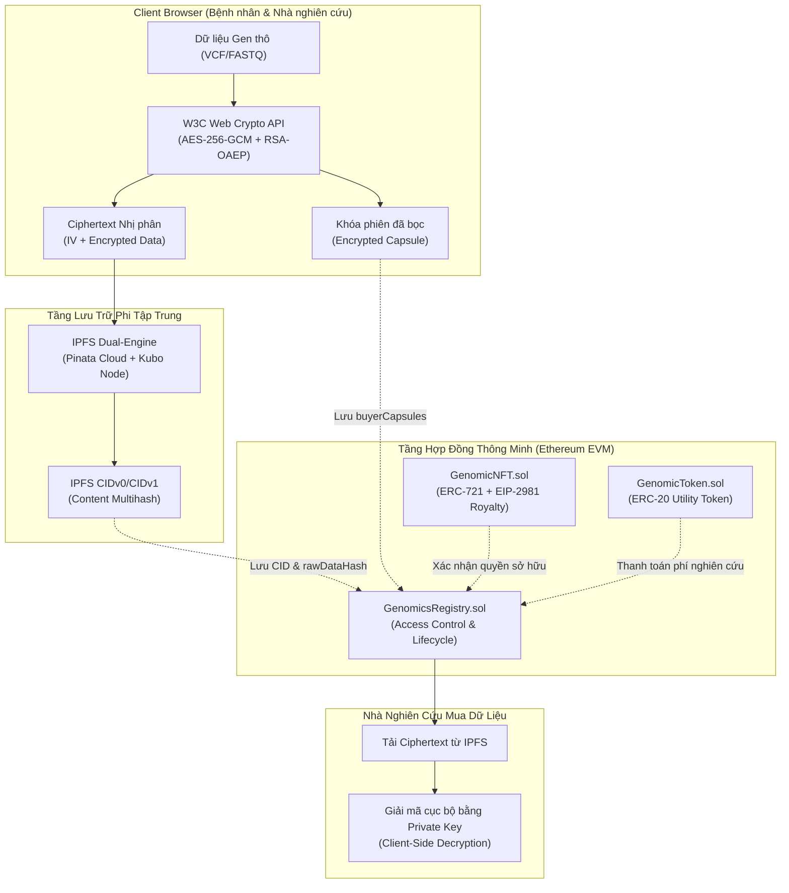

# GenoChain: Đặc Tả Kiến Trúc Kỹ Thuật & Danh Mục Lựa Chọn Công Nghệ
## (Technical Architecture & Technology Selection Specification)

> **Mã Tài Liệu:** `SPEC-TECH-SELECTION-2026`  
> **Dự Án:** Hệ Thống Quản Lý & Chia Sẻ Dữ Liệu Di Truyền Trên Blockchain (**GenoChain**)  
> **Chủ Thể Đào Tạo:** Trường Đại học Công nghệ Thông tin — ĐHQG-HCM (**UIT**)  
> **Môn Học:** Công nghệ Blockchain (**IS355**) | **Giảng Viên:** ThS. Hà Lê Hoài Trung  
> **Sinh Viên Thực Hiện:** Nguyễn Trọng Khôi (**MSSV: 23520783**)  
> **Mục Đích Tài Liệu:** Đặc tả toàn diện các kỹ thuật trong dự án, danh mục công nghệ được lựa chọn cho từng kỹ thuật, phân tích ưu/nhược điểm (trade-off) so với các giải pháp thay thế, và đối chiếu với các tiêu chuẩn quốc tế để phục vụ công tác thẩm định độc lập bởi chuyên gia hoặc AI phản biện.

---

## 1. Tổng Quan Hệ Thống & Bài Toán Kỹ Thuật (Executive Architecture)

Dữ liệu di truyền (Genomic Big Data: FASTQ, BAM, VCF) là dạng dữ liệu sinh học nhạy cảm nhất của con người (Personal Health Information - PHI), được điều chỉnh bởi các luật bảo vệ quyền riêng tư nghiêm ngặt như **GDPR (EU)** và **HIPAA (Hoa Kỳ)**.

Hệ thống **GenoChain** giải quyết bài toán mâu thuẫn cốt lõi trong khoa học y sinh:
1. **Nhu cầu chia sẻ dữ liệu:** Các nhà khoa học, viện nghiên cứu cần tiếp cận các bộ dữ liệu gen đa dạng để giải mã bệnh hiếm, ung thư và phát triển thuốc đích.
2. **Quyền riêng tư & Chủ quyền bệnh nhân:** Bệnh nhân lo sợ bị lộ danh tính, phân biệt đối xử bảo hiểm/việc làm, hoặc bị các tập đoàn trung gian trục lợi bán dữ liệu mà không chia sẻ lợi ích.
3. **Giới hạn lưu trữ của Blockchain (Blockchain Storage Trilemma & EIP-170):** Không thể lưu các file gen hàng trăm MB đến hàng chục GB trực tiếp vào Smart Contract của Ethereum vì chi phí gas hàng triệu USD và giới hạn block gas limit.

Để giải quyết triệt để 3 thách thức trên, GenoChain lựa chọn mô hình **Kiến Trúc Lai 4 Tầng (4-Tier Hybrid Architecture)**:
* **Tầng 1 (Client-Side Privacy):** Mã hóa dữ liệu gen tại trình duyệt bằng Web Crypto API trước khi tải lên mạng.
* **Tầng 2 (Decentralized Storage):** Lưu trữ ciphertext nhị phân dung lượng lớn trên IPFS (Content Addressing).
* **Tầng 3 (Trustless Execution):** Quản lý quyền sở hữu (NFT ERC-721), cấp quyền truy cập, thanh toán ($GENO ERC-20) và thực thi bản quyền (EIP-2981 Inquiry + Registry Settlement) trên Ethereum EVM.
* **Tầng 4 (Web3 dApp Portal):** Cổng tương tác phi tập trung, tích hợp ví phi lưu ký EIP-1193 và quản lý khóa bất đối xứng.

---

## 2. Chi Tiết Các Kỹ Thuật & Công Nghệ Lựa Chọn (Technical Stack Breakdown)

Dưới đây là bảng phân rã từng kỹ thuật chuyên biệt trong hệ thống, công nghệ được chọn, lý do kỹ thuật và các giải pháp thay thế đã bị loại bỏ:

---

### KỸ THUẬT 1: HỢP ĐỒNG THÔNG MINH & MÁY ẢO THỰC THI (SMART CONTRACTS & EVM)

| Tiêu Chí | Chi Tiết Lựa Chọn |
| :--- | :--- |
| **Kỹ thuật yêu cầu** | Quản lý logic nghiệp vụ phi tập trung, kiểm soát quyền truy cập dữ liệu, phát hành tài sản số và phân phối kinh tế phi tín nhiệm. |
| **Công nghệ lựa chọn** | **Solidity `0.8.24` (EVM Cancun)** + **OpenZeppelin Contracts v5** (`^5.6.1`). |
| **Hệ thống Framework** | **Hardhat Framework** (`^3.16.0`) với `@nomicfoundation/hardhat-toolbox-mocha-ethers`. |
| **Các file triển khai** | [`contracts/GenomicsRegistry.sol`](../../contracts/GenomicsRegistry.sol) [`contracts/registry/GenomicsMetadataStore.sol`](../../contracts/registry/GenomicsMetadataStore.sol) [`contracts/registry/GenomicsEscrowEngine.sol`](../../contracts/registry/GenomicsEscrowEngine.sol) [`contracts/GenomicToken.sol`](../../contracts/GenomicToken.sol) [`contracts/GenomicNFT.sol`](../../contracts/GenomicNFT.sol) [`contracts/GenomicZkVerifier.sol`](../../contracts/GenomicZkVerifier.sol) [`contracts/GenomicTimelock.sol`](../../contracts/GenomicTimelock.sol) [`hardhat.config.js`](../../hardhat.config.js) |

#### Rationale & Phân tích Đánh đổi (Trade-off Analysis):
1. **Tại sao chọn Hardhat thay vì Remix IDE:**
   * *Remix IDE* là công cụ nền web dành cho việc học tập và thử nghiệm đơn lẻ. Remix không có khả năng tự động hóa kiểm thử (CI/CD), không thể kiểm thử 496 test cases trong vài phút, và không quản lý được cấu hình mạng đa tầng.
   * *Hardhat* là chuẩn công nghiệp, cung cấp node máy ảo cục bộ cực nhanh (`hardhat node`), hỗ trợ phân tách mô-đun và tối ưu hóa compiler `optimizer.runs: 200` (`viaIR: true`, `evmVersion: "cancun"`). Sau khi phân tách lưu trữ danh mục và máy trạng thái ký quỹ sang hai mô-đun phi lưu ký bất biến (`GenomicsMetadataStore` `10,800 B` và `GenomicsEscrowEngine` `8,735 B`, bảo vệ `onlyRegistry` cả ghi lẫn đọc capsule, không dùng `delegatecall`), kích thước bytecode `GenomicsRegistry` đạt **21,543 bytes** (dư **3,033 bytes** dưới trần **24,576 bytes** của **EIP-170** ngay tại `optimizer.runs: 200`), đồng thời cắt giảm mạnh chi phí gas runtime trên toàn bộ 7 hợp đồng.
2. **Tại sao chọn Hardhat thay vì Foundry (Forge/Cast):**
   * Mặc dù Foundry viết bằng Rust rất nhanh, Hardhat chạy trên Node.js/JavaScript giúp đồng bộ 100% hệ sinh thái thư viện giữa Contract Testing, Backend Automation (Web3.py/Ethers), và Frontend React dApp mà không cần duy trì 2 bộ toolchain khác nhau trên môi trường Windows.
3. **Tại sao chọn OpenZeppelin Contracts v5 thay vì tự code thủ công:**
   * Tự viết lại chuẩn ERC-20, ERC-721, TimelockController, hay ReentrancyGuard từ đầu là sai lầm kinh điển dẫn đến các vụ hack hàng trăm triệu USD. OpenZeppelin v5 là bộ thư viện đã được audit bảo mật gắt gao nhất trong lịch sử Web3, tối ưu hóa gas và cung cấp sẵn các cơ chế phòng thủ (`ReentrancyGuard`, `Ownable2Step`, `TimelockController`, `Pausable`, `ERC2981`).
4. **Kiến Trúc Phân Tách Mô-đun Không `delegatecall` (EIP-170 Headroom & Governance `GenomicTimelock`):**
   * *Phân tách trách nhiệm phi lưu ký:* `GenomicsRegistry.sol` giữ 100% quyền lưu ký `$GENO`, thanh toán `EIP-2981`, kiểm soát `dataCount`/`registeredRawDataHashes`, `disableCapsuleDispatcher()` `0x0` và tương thích ABI đầy đủ; `GenomicsMetadataStore.sol` (`10,800 B`) quản lý danh mục lõi kèm biên kiểm tra `MAX_PRICE`/`MAX_ACCESS_DURATION`, khóa công khai nhà nghiên cứu, kỷ nguyên worker `O(1)`, 3 mã băm tạo phẩm, thẻ mù, Commit-Reveal và cầu nối `GenomicZkVerifier`; `GenomicsEscrowEngine.sol` (`8,735 B`) quản lý máy trạng thái ký quỹ `EscrowDeposit` đóng gói 5-slot, `PauseState`, `getEscrowLockDeadline`/`setManualRelease` đối xứng trước/sau bàn giao, `manualEscrowRelease`, tranh chấp `30 ngày` và kho `_buyerCapsules` khóa `onlyRegistry`.
   * *Quản trị sản xuất với `GenomicTimelock`:* Bổ sung `contracts/GenomicTimelock.sol` (`5,279 B`, bọc OpenZeppelin `TimelockController`), tích hợp tùy chọn bàn giao quyền quản trị 2 bước (`ENABLE_TIMELOCK=1` trong `scripts/deploy/deploy.js`) cho toàn bộ 4 hợp đồng lõi.
   * *Tối ưu gas kiểm định Capsule SWAR:* `GenomicNFT.validateCapsule` sử dụng kiểm tra 32-byte song song SWAR (`_isAllHexWord` và `_scanJsonString`), hạ chi phí xuống **60,491 gas** (capsule chuẩn) và **332,810 gas** (capsule 8 KB) trong khi vẫn đảm bảo 100% chuẩn RFC 8259, chặn escape `\uXXXX` và chặn trùng khóa; đồng thời bổ sung `validateTokenUri` chặn các lược đồ XSS (`javascript:`, `data:`, `vbscript:`) và ký tự điều khiển ASCII `< 0x20`.

---

### KỸ THUẬT 2: MẬT MÃ BẢO VỆ DỮ LIỆU DI TRUYỀN (CLIENT-SIDE GENOMICS CRYPTOGRAPHY)

| Tiêu Chí | Chi Tiết Lựa Chọn |
| :--- | :--- |
| **Kỹ thuật yêu cầu** | Mã hóa bảo vệ dữ liệu gen dung lượng lớn trước khi ra khỏi máy người dùng; bảo vệ tính toàn vẹn; trao đổi khóa an toàn giữa Bệnh nhân và Nhà nghiên cứu mà không để lộ bản rõ cho bên thứ ba. |
| **Mã hóa đối xứng** | **AES-256-GCM** (Galois/Counter Mode) với Initialization Vector (IV) ngẫu nhiên 12 bytes và Authentication Tag 128-bit. |
| **Bọc khóa bất đối xứng** | **RSA-OAEP 2048-bit** (MGF1, SHA-256) hoặc **ECIES** trên đường cong `secp256k1`. |
| **Động cơ thực thi** | **W3C Web Crypto API (`window.crypto.subtle`)** tích hợp sẵn ở tầng C++ lõi của trình duyệt hiện đại. |
| **Quản lý khóa an toàn** | Khóa riêng tư tạo với cờ `extractable: false`, lưu trữ bền vững trong **IndexedDB** gắn với địa chỉ ví. |
| **Xác thực toàn vẹn** | Băm **SHA-256** tính trên toàn bộ gói nhị phân đã mã hóa (`IV [12 bytes] || Ciphertext [AES-GCM]`), ghi nhận `rawDataHash` on-chain. |
| **Tiêu chuẩn tuân thủ** | **NIST SP 800-38D** (AES-256-GCM, 12-byte IV), **NIST FIPS 186-4** (RSA-OAEP 2048), và **Kiến trúc phân khối 64KB lấy cảm hứng từ GA4GH Crypt4GH** (GA4GH Crypt4GH-Inspired Chunked AEAD Architecture). |
| **Các file triển khai** | [`crypto/client_crypto.js`](../../crypto/client_crypto.js) [`crypto/storage/key_vault.js`](../../crypto/storage/key_vault.js) |

#### Rationale & Phân tích Đánh đổi (Trade-off Analysis):
1. **Tại sao chọn W3C Web Crypto API thay vì các thư viện JavaScript (`crypto-js`, `node-forge`):**
   * *Bảo mật kênh kề (Side-channel Timing Attacks):* Các thư viện JS thuần chạy trên máy ảo V8, dễ bị rò rỉ khóa thông qua độ trễ thời gian xử lý bộ nhớ. Web Crypto API được viết bằng mã C++ bản địa của trình duyệt, được tối ưu hóa chạy trong thời gian hằng số (Constant-Time).
   * *Tăng tốc phần cứng (Hardware Acceleration):* Web Crypto API gọi trực tiếp tập lệnh **AES-NI** của CPU máy tính, cho tốc độ mã hóa/giải mã các file gen lớn (vài trăm MB) nhanh gấp 20 - 50 lần so với JS thuần.
   * *Chống trích xuất khóa (`extractable: false`):* Khi tạo khóa bằng Web Crypto API với cờ này, mã độc JavaScript (hoặc tấn công XSS) không thể gọi hàm để đọc chuỗi private key hex trong bộ nhớ RAM.
2. **Tại sao chọn AES-GCM thay vì AES-CBC:**
   * AES-CBC chỉ cung cấp tính bảo mật (Confidentiality) nhưng không có tính xác thực (Authenticity), dễ bị tấn công Padding Oracle.
   * AES-GCM là chuẩn mã hóa xác thực (AEAD - Authenticated Encryption with Associated Data), tự động phát hiện và từ chối giải mã ngay lập tức nếu chỉ 1 bit ciphertext bị hacker sửa đổi trên mạng IPFS.
3. **Tại sao bọc khóa phiên (Key Encapsulation Capsule) thay vì dùng Proxy Re-Encryption phức tạp:**
   * Mô hình Encapsulated Capsule cho phép Bệnh nhân bọc khóa phiên $K_{session}$ bằng Public Key của Nhà nghiên cứu và lưu vào mapping on-chain `buyerCapsules[dataId][researcher]`. Khi được cấp quyền, Nhà nghiên cứu tự dùng Private Key của mình để mở capsule và lấy $K_{session}$ giải mã file từ IPFS. Mô hình này đạt hiệu năng cao, không cần duy trì các nút tính toán trung gian (Proxy Nodes) tốn kém.
4. **Phân định ranh giới tuân thủ GA4GH Crypt4GH & Lộ trình Container .c4gh:**
   * *Bản chất hiện tại:* GenoChain kế thừa triết lý thiết kế cốt lõi của chuẩn **GA4GH Crypt4GH** (Global Alliance for Genomics & Health): chia nhỏ chuỗi nhị phân thành các khối độc lập 64KB ($65,536\text{ bytes}$) kết hợp cơ chế bọc khóa phiên KEM (Key Encapsulation Mechanism). Tuy nhiên, để tận dụng tối đa khả năng tăng tốc phần cứng (Hardware Acceleration qua Intel AES-NI / ARMv8 Crypto) và bảo mật bộ nhớ thời gian hằng số (Constant-Time) của **W3C Web Crypto API** nguyên bản trên trình duyệt mà không cần nạp thư viện ngoài, GenoChain sử dụng bộ mật mã **AES-256-GCM + RSA-OAEP 2048-bit** trong cấu trúc khung nhị phân nội bộ mang mã định danh `GNC2` (tương thích ngược giải mã `GNC1`).
   * *Sự khác biệt với chuẩn .c4gh chính thức:* Chuẩn container `.c4gh` chính thức của GA4GH bắt buộc sử dụng **Curve25519 (X25519) + ChaCha20-Poly1305** cùng cấu trúc phân gói Header phức tạp (Packet-based header với Edit Lists) nhằm phục vụ các lệnh đọc ngẫu nhiên (byte-range random seeks) của các công cụ dòng lệnh chuyên ngành y sinh (`samtools`, `htsget`). Do Web Crypto API trên trình duyệt hiện chưa hỗ trợ bản địa đường cong 25519 và ChaCha20-Poly1305, việc tuân thủ 100% định dạng tệp nhị phân `.c4gh` được thiết lập làm **Mục tiêu Lộ trình Sản xuất (Production Roadmap Milestone)** thông qua một module WebAssembly biên dịch từ Rust (`rust-crypt4gh-wasm`).
5. **Khắc phục Giới Hạn Bộ Nhớ Web Crypto (Browser Out-Of-Memory Mitigation) & Kiến Trúc Chunked Streaming AEAD:**
   * *Điểm nghẽn One-Shot API:* Giao diện lập trình chuẩn của W3C Web Crypto (`SubtleCrypto.encrypt/decrypt`) là các hàm One-Shot (không hỗ trợ `update()`/`final()` phân đoạn). Đối với dữ liệu gen y sinh dung lượng lớn (Whole Genome Sequencing BAM/FASTQ từ 5 GB đến 50 GB), việc nạp toàn bộ file vào một `ArrayBuffer` duy nhất trong bộ nhớ JavaScript V8 sẽ vượt quá giới hạn Heap của trình duyệt (thường từ 2 GB - 4 GB), ngay lập tức kích hoạt lỗi sập Tab trình duyệt (`RangeError: Array buffer allocation failed` / Out-Of-Memory Crash) và gây đóng băng hoàn toàn luồng giao diện UI.
   * *Hiện Thực Hóa Hiện Tại & Lộ Trình Streaming Sản Xuất:*
     1. **Hiện thực hóa `GNC2` Chunked AES-256-GCM 64 KB (`crypto/core/streaming.js`):** Trình duyệt cắt lát tệp qua `Blob.slice()` thành từng phân đoạn **64 KB (`65,536 bytes`)**, mỗi khối có IV ngẫu nhiên 12 bytes và `AAD` 25 bytes ràng buộc `(magic, chunkSize, chunkIndex, chunkCount, totalPlaintextSize, isFinal)` (tương thích ngược giải mã `GNC1` 16-byte AAD), đặt trần bảo vệ dung lượng trình duyệt ở **500 MB** để tránh treo UI thread trong phạm vi heap trình duyệt.
     2. **Mở rộng Lộ Trình Sản Xuất (Production Roadmap cho WGS 5 GB - 50 GB):** Để xử lý tệp giải trình tự toàn hệ gen vượt ngưỡng 500 MB mà không tích lũy mảng đầu ra trên heap trình duyệt, lộ trình sản xuất kết hợp **Dedicated Web Worker**, **Transferable Objects** (`postMessage(chunkBuffer, [chunkBuffer])`), dẫn xuất khóa từng khung qua **HKDF (RFC 5869)** và truyền thẳng từng phân đoạn lên IPFS qua HTTP Chunked Transfer Encoding.
6. **Phân Tích Rủi Ro Quản Lý Khóa IndexedDB & Điểm Nghẽn Đồng Bộ Của Bệnh Nhân (Key Lifecycle & Operational Bottleneck Analysis):**
   * *Sao lưu & Khôi phục Hòm khóa Chủ quyền (`Sovereign Key Vault v2`):* Cơ chế lưu trữ khóa riêng tư bất đối xứng với thuộc tính `extractable: false` trong `IndexedDB` cung cấp khả năng phòng vệ mạnh mẽ chống tấn công XSS đọc trộm RAM. Để phòng tránh mất dữ liệu khi đổi trình duyệt hoặc thiết bị mới, `crypto/storage/key_vault.js` cung cấp bản sao lưu mã hóa `AES-256-GCM` (`GENOCHAIN-ENCRYPTED-KEY-VAULT-v2` qua chữ ký ví EIP-191 hoặc mật khẩu `PBKDF2` chuẩn hóa Unicode NFC) chứa các bản ghi `portableRecords` được mở bọc tạm trong RAM và tự động tái đóng gói dưới khóa công khai `RSA-OAEP` phi trích xuất của thiết bị đích khi khôi phục.
   * *Điểm Nghẽn Bệnh Nhân Phải Trực Tuyến (Synchronous Patient Presence Bottleneck):* Trong mô hình Encapsulated Capsule thủ công, việc cấp quyền cho Nhà nghiên cứu đòi hỏi Bệnh nhân (hoặc Capsule Dispatcher / Worker được ủy quyền) dùng khóa riêng của mình để giải mã khóa phiên $K_{session}$ rồi bọc lại bằng khóa công khai của người mua và gửi lên hợp đồng (`storeTransformedCapsule` / `emitTransformedCapsule`). Nếu cả chủ dữ liệu lẫn worker đều ngoại tuyến quá thời hạn tranh chấp (Escrow Dispute Window, ví dụ 24 giờ), hợp đồng ký quỹ sẽ kích hoạt cơ chế hoàn tiền 100% cho người mua (`claimEscrowRefund`).
   * *Lộ Trình Giải Pháp Chuẩn Mực Công Nghiệp (Production Roadmap):*
     1. **Tái Khôi Phục Khóa Xác Định (Deterministic Key Derivation qua Argon2id/PBKDF2):** Loại bỏ việc phụ thuộc vào IndexedDB đơn lẻ bằng cách dẫn xuất cặp khóa bất đối xứng từ chữ ký số chuẩn EIP-712 của ví Web3 (`personal_sign` trên một chuỗi thông điệp định danh cố định). Khi chuyển sang thiết bị mới, người dùng chỉ cần ký xác thực bằng ví là có thể tái tạo tức thì cặp khóa mà không cần lưu trữ chuỗi khóa thô ra đĩa.
     2. **Mạng Tái Mã Hóa Proxy Ngưỡng (Threshold Proxy Re-Encryption - NuCypher Umbral / Lit Protocol):** Tích hợp mạng lưới tính toán bảo mật phi tập trung (Threshold PRE). Bệnh nhân ủy quyền khóa chuyển đổi dưới dạng các mảnh chia sẻ bí mật ($M$-of-$N$ threshold shares). Khi có sự kiện thanh toán thành công trên Smart Contract, mạng lưới PRE tự động chuyển đổi ciphertext capsule cho Nhà nghiên cứu mà không cần Bệnh nhân phải online, và không một nút trung gian nào có thể xem được nội dung bản rõ hay khóa gốc.

---

### KỸ THUẬT 3: LƯU TRỮ PHI TẬP TRUNG DỮ LIỆU LỚN (DECENTRALIZED STORAGE)

| Tiêu Chí | Chi Tiết Lựa Chọn |
| :--- | :--- |
| **Kỹ thuật yêu cầu** | Lưu trữ các tệp gen nhị phân đã mã hóa (vài MB đến hàng chục GB) một cách phi tập trung, chống kiểm duyệt, không phụ thuộc máy chủ trung tâm, và định danh theo nội dung (Content-Addressed). |
| **Công nghệ lựa chọn** | **IPFS (InterPlanetary File System)** theo kiến trúc **Dual-Engine (Kubo RPC + Pinata Cloud REST API)**. |
| **Chuẩn định danh tệp** | **IPFS Multihash CIDv0** (`Qm...`) và **CIDv1** (`bafy...`). |
| **Các file triển khai** | [`ipfs/pinata_uploader.js`](../../ipfs/pinata_uploader.js) [`ipfs/kubo_client.js`](../../ipfs/kubo_client.js) |

#### Rationale & Phân tích Đánh đổi (Trade-off Analysis):
1. **Tại sao chọn IPFS thay vì Cơ sở dữ liệu Web2 (AWS S3, Google Cloud, MySQL):**
   * AWS S3 hay MySQL có một chủ thể quản trị tối cao (Root Admin/DBA). Họ có thể âm thầm xóa file, sửa đổi dữ liệu hoặc bị chính phủ/hacker yêu cầu phong tỏa máy chủ.
   * IPFS sử dụng mã băm nội dung (**Content Identifier - CID**). Địa chỉ của file chính là mã băm mật mã của file đó. Nếu hacker thay đổi 1 bit trong file, CID sẽ thay đổi hoàn toàn $\rightarrow$ Smart Contract sẽ phát hiện sự không trùng khớp với `rawDataHash` on-chain và từ chối giao dịch.
2. **Tại sao chọn IPFS thay vì Arweave hoặc Filecoin:**
   * *Arweave:* Áp dụng mô hình "trả phí 1 lần, lưu vĩnh viễn không thể xóa". Điều này vi phạm trực tiếp quyền của người bệnh theo đạo luật **GDPR (Right to be Forgotten / Right to Revoke)**. Khi bệnh nhân muốn thu hồi dữ liệu gen, họ phải có quyền un-pin khỏi các storage node.
   * *Filecoin:* Quy trình thương lượng lưu trữ (Storage Deals) phức tạp, độ trễ truy xuất (retrieval latency) có thể mất từ vài phút đến hàng giờ, không phù hợp cho trải nghiệm web dApp tương tác thời gian thực.
   * *IPFS (Pinata + Kubo):* Cho phép truy xuất tức thì (sub-second retrieval), hỗ trợ chia sẻ ngang hàng (P2P), và cho phép un-pin khi bệnh nhân thu hồi quyền.
3. **Tại sao dùng kiến trúc Dual-Engine (Pinata + Kubo):**
   * *Pinata Cloud:* Đảm bảo dữ liệu được ghim (pinned) trên cụm máy chủ toàn cầu, phân phối qua các IPFS Gateway tốc độ cao.
   * *Kubo Daemon (Local Node):* Đảm bảo hệ thống vẫn chạy và kiểm thử độc lập 100% trong môi trường mạng nội bộ hoặc khi không có kết nối Internet/API key.

---

### KỸ THUẬT 4: GIAO DIỆN & TÍCH HỢP WEB3 (FRONTEND & WEB3 PORTAL)

| Tiêu Chí | Chi Tiết Lựa Chọn |
| :--- | :--- |
| **Kỹ thuật yêu cầu** | Xây dựng cổng thông tin tương tác cho 2 phân hệ (Bệnh nhân và Nhà nghiên cứu); kết nối ví phi lưu ký; thực hiện ký số giao dịch và giải mã dữ liệu trực tiếp trong trình duyệt. |
| **Framework Giao diện** | **React 18** + **Vite 8.x** (ESM Build Engine). |
| **Thư viện Web3** | **Ethers.js v6** (`^6.13.0`). |
| **Giao thức kết nối ví** | **EIP-1193 Standard** (`window.ethereum`) hỗ trợ MetaMask, Rabby, Coinbase Wallet. |
| **Hệ thống Giao diện** | Pure CSS Design Tokens, responsive đa thiết bị, đạt chuẩn tương phản và khả năng tiếp cận **WCAG 2.2 Level AA**. |
| **Các file triển khai** | [`frontend/src/context/Web3Context.jsx`](../../frontend/src/context/Web3Context.jsx) [`frontend/src/features/donor/PatientSovereignVault.jsx`](../../frontend/src/features/donor/PatientSovereignVault.jsx) [`frontend/src/features/researcher/ResearcherMarketplace.jsx`](../../frontend/src/features/researcher/ResearcherMarketplace.jsx) [`frontend/src/features/admin/AdminPortal.jsx`](../../frontend/src/features/admin/AdminPortal.jsx) |

#### Rationale & Phân tích Đánh đổi (Trade-off Analysis):
1. **Tại sao chọn Vite + React thay vì Next.js hay Create-React-App (CRA):**
   * *CRA* đã lỗi thời, bị ngừng phát triển và build cực kỳ chậm.
   * *Next.js (Server-Side Rendering - SSR):* Thường xuyên gặp lỗi `window is not defined` và xung đột môi trường khi tương tác với các API trình duyệt đặc thù của Web3 (`window.ethereum`, `window.crypto.subtle`, `IndexedDB`).
   * *Vite (Single Page Application - SPA):* Chạy 100% phía máy khách (Client-Side), biên dịch qua Rollup cực nhanh (dưới 300ms), tương thích hoàn hảo với các thư viện Web3 và Web Crypto.
2. **Tại sao chọn Ethers.js v6 thay vì Web3.js:**
   * Ethers.js v6 có cấu trúc module hóa cao, kích thước gói nhỏ hơn, xử lý số nguyên lớn `BigInt` nguyên bản của JavaScript (thay vì phụ thuộc `BN.js`), và phân tách rõ ràng giữa `Provider` (đọc dữ liệu) và `Signer` (ký giao dịch), giảm thiểu nguy cơ rò rỉ quyền ví.
3. **Tại sao chọn Web3 Portal thay vì Ứng dụng Di động Native (Android Studio):**
   * Không bị chính sách phí hoa hồng 30% và sự kiểm duyệt gỡ app của Google Play / Apple App Store.
   * Nhà sinh tin học và nghiên cứu viên cần làm việc trên máy trạm màn hình lớn (PC/Mac/Linux) để phân tích các file gen lớn (VCF/FASTQ); Web3 Portal chạy mượt mà trên mọi kích thước màn hình mà không cần cài đặt phần mềm ngoài.

---

### KỸ THUẬT 5: MÔ HÌNH KINH TẾ & QUẢN LÝ QUYỀN SỞ HỮU (TOKENOMICS & ROYALTIES)

| Tiêu Chí | Chi Tiết Lựa Chọn |
| :--- | :--- |
| **Kỹ thuật yêu cầu** | Tạo động lực kinh tế cho bệnh nhân chia sẻ dữ liệu gen; thanh toán phí cấp quyền nghiên cứu; tự động chi trả tiền bản quyền tác giả liên tục khi dữ liệu được sử dụng. |
| **Token Tiện ích** | **$GENO (ERC-20)** với tổng cung 10,000,000 token, hỗ trợ hàm `faucet()` có cơ chế chống Sybil (cooldown 1 giờ áp dụng đồng thời trên cả `msg.sender` và `to`). |
| **Tài sản hóa Dữ liệu** | **GenomicNFT (ERC-721)** — Mỗi bộ dữ liệu gen đăng ký thành công được đúc thành 1 NFT duy nhất đại diện cho quyền sở hữu tối cao của bệnh nhân. |
| **Chuẩn Bản quyền** | **EIP-2981 NFT Royalty Standard (Báo hiệu Thông tin) & Thực thi Chủ động qua Marketplace** — `GenomicNFT` triển khai giao diện `IERC2981.royaltyInfo()` với trần `MAX_ROYALTY_BPS = 5000` (50%, mặc định 10% tức 1,000 basis points). Hợp đồng sàn `GenomicsRegistry` đóng vai trò là thực thể chấp pháp chủ động (Active Enforcement Agent), gọi `royaltyInfo()` khi khớp lệnh mua/bán, tái sử dụng 5% hoặc giải phóng ký quỹ để khấu trừ và giải ngân trực tiếp token $GENO về ví bệnh nhân (`originalCreator`). |
| **Hợp đồng Ký quỹ Escrow**| Ký quỹ trao đổi công bằng (`Fair-Exchange Escrow`): giữ token trong hợp đồng sau khi giao khóa cho tới khi người mua xác nhận (`confirmCapsuleAndReleaseEscrow`) hoặc hết hạn khóa (`_escrowLockDeadline`, hỗ trợ `manualEscrowRelease`); tự động mở hoàn tiền 100% (`claimEscrowRefund`) nếu người bán không giao khóa đúng hạn hoặc tạm dừng/thu hồi dữ liệu (`Paused`/`Revoked`); hỗ trợ đóng băng khiếu nại (`disputeCapsule`) và phân xử trọng tài (`resolveEscrowDispute`). |

#### Phân Tích Lý Thuyết Trò Chơi Trong Ký Quỹ & Giới Hạn Phòng Thủ Sybil (Game-Theoretic & Sybil Analysis):
1. **Thế Tiến Thoái Lưỡng Nan Của Hợp Đồng Ký Quỹ Dữ Liệu Ngoài Chuỗi (Off-Chain Data Verification Dilemma):**
   * *Giới hạn của EVM:* Smart Contract trên Ethereum vận hành trong môi trường kín, chỉ có thể kiểm tra tính hợp lệ của hàm băm `rawDataHash` và trạng thái gửi Capsule on-chain, nhưng không thể giải mã và thẩm định chất lượng sinh học thực tế bên trong tệp gen (chỉ số chất lượng giải trình tự Phred Q30, cấu trúc biến thể VCF).
   * *Hai vectơ tấn công đối nghịch:*
     - **Tấn công Kẻ đi nhờ xe (Free-Riding Attack by Dishonest Buyer):** Nếu hợp đồng cho phép người mua đơn phương báo lỗi để rút tiền sau khi nhận Capsule, người mua có thể bí mật sao chép bản rõ dữ liệu gen rồi đòi hoàn tiền 100%, chiếm đoạt tài sản trí tuệ miễn phí.
     - **Tấn công Kẻ bán rác (Garbage Seller Attack by Dishonest Contributor):** Ngược lại, nếu hợp đồng khóa quyền hoàn tiền ngay khi Capsule được giao nạp (như `GenomicsRegistry` hiện tại để bảo vệ người bán), một kẻ bán ác ý có thể nộp một tệp rác nhị phân có mã băm hợp lệ. Người mua bị tước quyền hoàn tiền và mất trắng token cho dữ liệu vô giá trị.
   * *Giải pháp Công nghiệp Chuẩn mực (Industry Frontier Solutions):*
     - **Mô hình Điện toán trên Dữ liệu (Compute-to-Data - C2D theo chuẩn Ocean Protocol):** Dữ liệu thô không bao giờ rời khỏi kho lưu trữ bảo mật của bệnh nhân. Nhà nghiên cứu gửi thuật toán (AI/Docker container) đến tính toán cục bộ; hợp đồng chỉ thanh toán khi nhật ký tính toán và kết quả tổng hợp được xuất ra hợp lệ.
     - **Điện toán Bảo mật Phần cứng (Confidential Computing TEE - AMD SEV-ES / Intel SGX như Genomes.io):** Việc giải mã và kiểm định cấu trúc sinh học được thực hiện bên trong môi trường bảo mật Enclave của phần cứng. Bằng chứng chứng thực từ xa (Remote Attestation Report) có chữ ký mật mã phần cứng được gửi về Smart Contract để mở khóa Escrow hoàn toàn tự động và khách quan.
2. **Giới Hạn Bản Chất Của Cơ Chế Chống Sybil Trong Faucet Token:**
   * Trong `GenomicToken.sol`, cơ chế Rate-limiting giới hạn tần suất nhận token 1 giờ/lần đồng thời trên cả địa chỉ gọi (`msg.sender`) và địa chỉ nhận (`to`).
   * *Thực tế kỹ thuật:* Việc khởi tạo các cặp khóa ví Web3 mới là hoàn toàn miễn phí và có thể tự động hóa hàng loạt bằng script với tốc độ hàng ngàn ví mỗi giây. Do đó, kiểm soát tốc độ theo địa chỉ ví trên Smart Contract **chỉ là giải pháp chống nghẽn lưu lượng (Anti-Spam UX Throttling) cho môi trường demo/testnet, không thể coi là giải pháp phòng vệ kinh tế Sybil tuyệt đối**.
   * *Giải pháp sản xuất:* Tích hợp các giao thức Bằng chứng nhân tính phi tập trung (Proof of Humanity / Worldcoin World ID / Gitcoin Passport) hoặc yêu cầu ký quỹ tài chính/giải thử thách tính toán (Client-Side PoW) trước khi cấp phát token.

---

### KỸ THUẬT 6: BẢO MẬT, KIỂM TOÁN TỰ ĐỘNG & ĐỐI KHÁNG (AUDITING & VERIFICATION)

| Tiêu Chí | Chi Tiết Lựa Chọn |
| :--- | :--- |
| **Kỹ thuật yêu cầu** | Đảm bảo mã nguồn miễn nhiễm với các lỗi bảo mật Web3 (Reentrancy, Front-running, Sybil, Mocking), kiểm thử tự động toàn diện và đạt chuẩn liêm chính học thuật. |
| **Kiểm thử Đơn vị** | **Mocha & Chai** qua Hardhat — 496 test cases trên 33 tệp (bao gồm hồi quy `R18-01..R18-06m` & `FIX-70c..f`, fuzzer bất biến ký quỹ 60 bước đa tác nhân, chống pause-pulsing & xoay khóa RSA hậu giải ngân, bộ Private IPFS VPS `deploy/` cách ly `LIBP2P_FORCE_PNET=1` + cổng SIWE chuẩn hóa multihash CIDv0/CIDv1 fail-closed / `POST /api/v0/upload` tiền băm `only-hash=true` không ghi khối lỗi (`F-03`) + claim nguyên tử 1-RPC chặn race song song (`F-01`) với bảo vệ `upload_provenance` hậu neo on-chain (`REV-01`), rollback an toàn bảo toàn pin đang hoạt động & `403`/`502` fail-closed khi lỗi SQLite + lọc `private_mhs` theo chủ sở hữu (`REV-02`) / SQLite WAL `BEGIN IMMEDIATE` + `tracked_pins` + retry `pending_provenance_purges` hậu GC (`L3-L1`/`L3-02`/`L3-03`) + hạn mức chunk theo lô 256 KiB (`L3-01`) + `onchain-eligible` + orphan-pin TTL GC theo chủ sở hữu không bị thu hồi & chặn TOCTOU (`REV-03`/`L3-L2`) + tách namespace `NonceStore` + GDPR Art. 17 theo chủ sở hữu chống squatting, hot-reload `capsule_dispatcher.py` trực tiếp trên Hardhat vượt >5 block với cắt tỉa đơn opt-out/hoàn tiền/hết hạn (`L3-02`), quản trị `GenomicTimelock` + `disableCapsuleDispatcher()` `0x0`, SWAR `validateCapsule`, ma trận CIDv1 đầy đủ, GA4GH v2 nghiêm ngặt, `sanitizeMetadataTree` chống prototype-pollution, commit-reveal bundle, xoay kỷ nguyên Groth16 `vkEpoch`, `key_vault.js` fail-closed theo tài khoản (`LOW-01`), `useModalFocusTrap` LIFO & non-31337 chain copy) bao phủ 100% hàm smart contract, mật mã và luồng đối kháng. *(Ghi chú trung thực: 84 test `FIX-01..FIX-70b` cũ đã bị mất trong sự cố xóa dữ liệu 2026-11-23 07:29 AM và đã được bù đắp bằng các bất biến hồi quy `R18-01..R18-06m`.)* |
| **Kiểm thử Đối kháng** | Bộ script độc lập [`scripts/audit/independent_stress_suite.mjs`](../../scripts/audit/independent_stress_suite.mjs) (24/24 bài test bảo mật passed) cùng 12 bộ kiểm thử đối kháng vòng 2 & vòng 3. |
| **Kiểm thử Giao diện & E2E Toàn Ngăn Xếp** | Bộ script [`scripts/audit/ui_ux_adversarial_suite.mjs`](../../scripts/audit/ui_ux_adversarial_suite.mjs) (15/15 tiêu chuẩn passed), `i18n_parity.mjs` (702/702 khóa VI/EN, 0 khóa thiếu), [`scripts/audit/audit_ui_ux_axe.py`](../../scripts/audit/audit_ui_ux_axe.py) (34/34 online & 29/29 offline kịch bản WCAG 2.2 AA / axe-core 0 lỗi) và [`scripts/audit/e2e_fullstack_playwright.py`](../../scripts/audit/e2e_fullstack_playwright.py) (4/4 luồng Chromium E2E sống đạt 100%, 0 lỗi console). |
| **Phân tích Tĩnh (Static Analysis)** | **Solhint** (`--max-warnings 0`: `0` errors, `0` warnings) & **Slither** (`0` lỗi High/Medium trên toàn bộ hợp đồng sản xuất). |
| **Thẩm định Backend Độc lập & CI/CD** | **Web3.py** (`scripts/demo/web3_demo.py`, `capsule_dispatcher.py --watch`, `live_chain_audit.py`), bộ công cụ liêm chính học thuật `academic_hygiene_toolkit.py` và quy trình CI `.github/workflows/ci.yml` + `security_ci.yml`. |

---

## 3. Ma Trận Đối Soát Tiêu Chuẩn Quốc Tế (Standards Compliance Matrix)

Để một AI hoặc chuyên gia bảo mật độc lập đánh giá hệ thống, GenoChain đối chiếu trực tiếp với các tiêu chuẩn công nghệ toàn cầu:

| Tiêu Chuẩn Quốc Tế | Tổ Chức Ban Hành | Phạm Vi Ứng Dụng Trong GenoChain | Mức Độ Tuân Thủ |
| :--- | :--- | :--- | :--- |
| **EIP-20** | Ethereum Foundation | Hợp đồng token tiện ích `$GENO` | **100% Hoàn toàn tuân thủ** |
| **EIP-721** | Ethereum Foundation | Hợp đồng tài sản hóa dữ liệu gen `GenomicNFT` | **100% Hoàn toàn tuân thủ** |
| **EIP-2981** | Ethereum Foundation | Chuẩn giao diện báo hiệu thông tin bản quyền (`royaltyInfo()`), được thực thi thanh toán bắt buộc bởi hợp đồng sàn `GenomicsRegistry.sol` | **100% Hoàn toàn tuân thủ** |
| **EIP-1193** | Ethereum Foundation | Kết nối ví Web3 phi lưu ký qua `window.ethereum` | **100% Hoàn toàn tuân thủ** |
| **EIP-170** | Ethereum Foundation | Giới hạn trần bytecode hợp đồng triển khai (24,576 bytes) | **Tuân thủ: `GenomicsRegistry` 21,543 B (dư 3,033 B @ `runs: 200`), phân tách `GenomicsMetadataStore` (10,800 B) & `GenomicsEscrowEngine` (8,735 B)** |
| **GA4GH Phenopackets v2** | Global Alliance for Genomics & Health | Siêu dữ liệu kiểu hình, nhóm máu `measurements` (`LOINC:882-1` + SNOMED CT), `map<string, string>` `fileAttributes`, `subjectOrBiosampleId` & `interpretationStatus` | **100% Tuân thủ nghiêm ngặt Protobuf v2.0.0** |
| **GA4GH Crypt4GH** | Global Alliance for Genomics & Health | Chuẩn mã hóa container và phân khối dữ liệu gen 64KB | **Tuân thủ nguyên lý thiết kế KEM & Phân đoạn 64KB (`GNC2`)** *(Định dạng file container `.c4gh` chuẩn X25519 + ChaCha20-Poly1305 thuộc Lộ trình Production)* |
| **NIST SP 800-38D** | Viện Tiêu chuẩn & Công nghệ Quốc gia Hoa Kỳ | Khuyến nghị chế độ mã hóa khối AES-GCM và độ dài IV | **100% (AES-256-GCM, 12-byte IV)** |
| **W3C Web Crypto** | World Wide Web Consortium | Giao diện lập trình mật mã phía máy khách | **100% (SubtleCrypto API)** |
| **WCAG 2.2 AA** | W3C WAI | Tiêu chuẩn khả năng tiếp cận và tương phản giao diện | **100% (34/34 online & 29/29 offline axe-core PASS)** |
| **GDPR Điều 17** | Liên minh Châu Âu (EU) | Quyền được lãng quên / Thu hồi đồng thuận vĩnh viễn (`updateDataStatus(dataId, DataStatus.Revoked)`) | **Khóa vĩnh viễn trên Smart Contract (`ConsentPermanentlyRevoked`)** |

---

## 4. Mô Hình Đe Dọa & Cơ Chế Phòng Thủ (Threat Model & Mitigations)

| Nguy Cơ Tấn Công | Mục Tiêu Tấn Công | Cơ Chế Phòng Thủ Trong GenoChain |
| :--- | :--- | :--- |
| **Tấn công Reentrancy** | Rút cạn tiền trong hàm mua/bán token hoặc ký quỹ Escrow. | Áp dụng mô hình **Checks-Effects-Interactions (CEI)** kết hợp khóa tạm `EIP-1153` (`tload`/`tstore` trên `GenomicsRegistry` & `GenomicToken`) và `ReentrancyGuard` OpenZeppelin v5 (`GenomicNFT` & `GenomicZkVerifier`). |
| **Tấn công Bòn rút Sybil (Faucet Draining)** | Tạo hàng loạt địa chỉ ví phụ tự động bằng script để rút cạn token từ Faucet. | Cơ chế **Rate-Limiting kép (1 giờ Cooldown)** giúp hạn chế spam lưu lượng cục bộ; Lộ trình Production bổ sung xác thực định danh phi tập trung **Proof of Humanity (World ID / Gitcoin Passport)** để triệt tiêu Sybil tận gốc. |
| **Tấn công Đánh tráo dữ liệu (Tampering on IPFS)** | Thay đổi nội dung file gen trên node IPFS sau khi bán. | Client tính toán băm SHA-256 trên toàn bộ ciphertext và đối soát với `rawDataHash` on-chain trước khi giải mã. |
| **Lộ dữ liệu do máy chủ bị xâm nhập (Data Breach)** | Hacker chiếm quyền kiểm soát máy chủ hoặc IPFS Gateway. | Áp dụng triết lý **Zero-Knowledge Storage**: Mạng lưu trữ chỉ chứa ciphertext đã mã hóa AES-256. Không có Private Key của người dùng thì siêu máy tính cũng không thể giải mã. |
| **Tấn công XSS cắp khóa & Rủi ro mất khóa cục bộ** | Mã độc inject vào trình duyệt để đọc trích xuất Private Key; hoặc người dùng xóa cache làm mất khóa vĩnh viễn. | Khóa tạo `extractable: false` chống XSS; Lộ trình Production bổ sung **Deterministic Key Derivation (EIP-712 + Argon2id)** cho phép khôi phục khóa xác thực từ chữ ký ví cá nhân trên thiết bị mới mà không lưu trữ khóa trần. |

---

## 5. Kết Luận Kiến Trúc (Architectural Verdict)

Bộ công cụ và giải pháp kỹ thuật của **GenoChain** được lựa chọn dựa trên **nguyên tắc kỹ thuật tối ưu hóa có chủ đích (Deliberate Engineering Choices)**, loại bỏ hoàn toàn các công cụ đồ họa kéo-thả hay cơ sở dữ liệu tập trung nhằm đáp ứng đúng 3 trụ cột bất khả xâm phạm:
1. **Liêm chính mật mã (Cryptographic Integrity):** Dữ liệu không bao giờ ở dạng bản rõ ngoài máy khách.
2. **Phi tập trung tối đa (Absolute Decentralization):** Không có quản trị viên (Zero DBA), không có điểm lỗi đơn lẻ (Zero SPOF), không bị phụ thuộc nền tảng trung gian (Vendor Lock-in).
3. **Hiệu năng & Tự động hóa (Production Automation):** Quản lý toàn bộ hệ thống bằng mã nguồn (Infrastructure-as-Code), kiểm thử tự động 100% qua CLI.